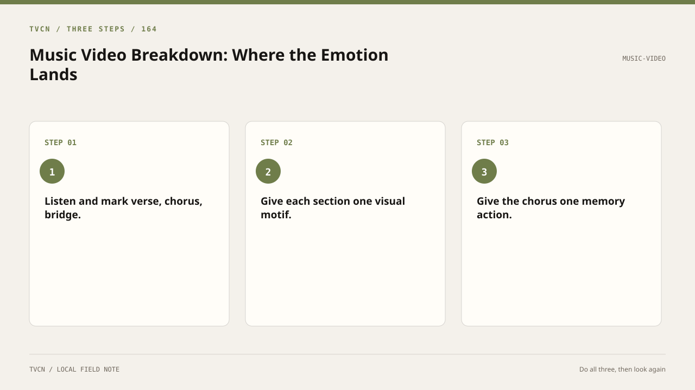

<!-- DIAGRAM_START -->
<h2>Diagram</h2>
<figure>
  
  <figcaption>The diagram is an entry point: watch the timecodes, then use the checks at the end.</figcaption>
</figure>
<!-- DIAGRAM_END -->
<h2>Fix Three Variables First</h2>
Fix three variables: three and a half minutes, music platform/Channels, and the goal is image escalating with the song. An MV is not a narrative short; mark song sections, motifs, then check whether the chorus escalates.
<blockquote>
<strong>Sample note:</strong> the timecodes below are a teaching sample for this format's usual length. They do not correspond to one specific film and are not frame-accurate analysis. Use the same positions on your own film; do not treat these beats as the only answer.
</blockquote><h2>Timecode Breakdown: 9 Beats</h2>
Watch in order; do not read commentary first. For each beat record four things: picture, sound, job, and steal or do-not-copy.
<ol class="timecode-list"><li><strong>0:00–0:10</strong> | Picture: intro gives one visual motif, no plot. Sound: song intro/ambience. Job: establish a rule. Steal: one repeatable action. Do not copy: a drone location intro.</li><li><strong>0:10–0:30</strong> | Picture: verse gives space and relationships; camera can slow. Sound: verse. Job: let viewers enter the world. Steal: one space plus one person. Do not copy: a new location per lyric.</li><li><strong>0:30–0:50</strong> | Picture: pre-chorus narrows: closer framing/smaller space. Sound: rhythm rises. Job: prepare escalation. Steal: narrow framing. Do not copy: strobe.</li><li><strong>0:50–1:25</strong> | Picture: first chorus escalation: same action bigger/faster/riskier. Sound: drums. Job: memory point. Steal: action escalation. Do not copy: effects only.</li><li><strong>1:25–1:50</strong> | Picture: verse two adds information: relationship change/new space. Sound: verse two. Job: avoid repetition. Steal: change one variable, not the theme. Do not copy: a whole new story.</li><li><strong>1:50–2:15</strong> | Picture: bridge holds one long take/still, letting viewers breathe. Sound: bridge. Job: contrast. Steal: one long take. Do not copy: keep accelerating.</li><li><strong>2:15–2:50</strong> | Picture: final chorus maxes out: all motifs, action at limit. Sound: final chorus. Job: peak. Steal: three motifs in one frame. Do not copy: pile every effect.</li><li><strong>2:50–3:20</strong> | Picture: outro returns to the first motif, changed. Sound: outro/ambience. Job: close. Steal: return to the motif. Do not copy: add a new location.</li><li><strong>3:20–3:30</strong> | Picture: hold on action/empty frame, no explanation. Sound: silence. Job: let the song end. Steal: stop on consequence. Do not copy: add plot captions.</li></ol><h2>Read the Structure</h2>
The spine is motif, space, narrowing, escalation, new information, breath, max escalation, return, hold. Images are not lyric illustrations; they need sections and a peak like the song.

Ask only three questions: what proof arrives in the first ten seconds; whether every ten to fifteen seconds adds information; whether the end lands one action, one change, or one question. If any is missing, a 3–4 min film falls apart.
<h2>Budget Order of Magnitude</h2>
Budget is a rough mainland-China production range, excluding media spend; it is an order of magnitude, not a quote. At the same length, a stage, cast, effects, or music rights can each double the cost.
<ul><li>Low: RMB 10,000–30,000, three to five people, one location, two or three looks, one day.</li><li>Mid: RMB 30,000–100,000, six to ten people, one or two locations, light/art, two days.</li><li>High: RMB 100,000–500,000+, director, camera, art, wardrobe, post, multiple locations, three to seven days.</li></ul><h2>Three Structures You Can Steal</h2>
Steal structure, not images. These three still work when you change the subject.
<ol><li>Mark chorus and turn before writing images.</li><li>Keep three motifs; change one variable per section.</li><li>Escalate the chorus through action, not strobe.</li></ol><h2>Three Reasons Not to Copy</h2>
Not “bad,” but built on different conditions; copying exposes your budget, platform, and audience.
<ol><li>Do not copy one location per lyric: the song does not have that many places, and viewers cannot remember them.</li><li>Do not copy a strobe-only chorus: without action escalation, it empties out.</li><li>Do not copy a plot that overwhelms the song: viewers came for the music.</li></ol><h2>Breakdown Exercises</h2>
Do them before shooting; do not just read. Do the three in order, and the third must become a fifteen-second file.
<ol><li>Watch muted; mark where motifs repeat.</li><li>Mark chorus/bridge against the song; does the image escalate with it?</li><li>Compress to sixty seconds: motif, first chorus, max escalation, return.</li></ol>
<h2>Check</h2><ul><li>A repeatable motif in the first ten seconds.</li><li>Verse gives space, not a new location per line.</li><li>Pre-chorus narrows framing/space.</li><li>First chorus escalates through action.</li><li>Bridge holds one long take/still.</li><li>Final chorus puts three motifs in one frame.</li><li>Outro returns to the first motif, changed.</li></ul>

<!-- SOURCES_START -->
## Experience note

Experience note: this page draws on 6 format breakdown and project review reviews under a 30-second to five-minute film for one platform; it discusses “Music Video Breakdown: Map Song Structure to Image”; no external laboratory test was run, and the conclusion may not transfer when conditions change.
<!-- SOURCES_END -->

