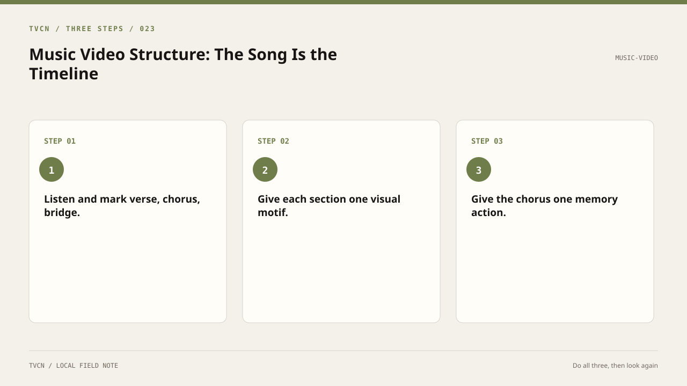

Music-video structure starts from lyrics and sections: verse establishes space, chorus gives a repeatable motif, bridge changes relationship or location. Each section carries one job; do not tell the story and show off in the same section.

<!-- DIAGRAM_START -->
<h2>Diagram</h2>
<figure>
  
  <figcaption>Watch “Mark verse, chorus, and bridge times.” and “Use long takes in the verse to establish”; judge whether the reason given in the first three seconds still holds at the end.</figcaption>
</figure>
<!-- DIAGRAM_END -->
<section><h2 id="section-1">Cut action to the beat, not cuts to the beat</h2>
Import the track, mark section boundaries, then place shots. Shot length comes from the action, not “cut every two seconds.”
<h2 id="section-2">Limits</h2>
The image should not explain the lyric. “Leaving” does not require a door; a ticket in a hand may be more specific.
</section><section><h2 id="section-3">On set</h2>
Mark verse, chorus, and bridge times. Use long takes in the verse to build space; in the chorus cut a remembered action every four beats.
</section><section><h2 id="section-4">Do this</h2>
An MV follows the song: verse gives space, chorus gives a memory hook, bridge turns.
<ol><li>Mark verse, chorus, and bridge times.</li><li>Use long takes in the verse to establish space.</li><li>Cut to a memory action every four beats in the chorus.</li></ol></section><section><h2 id="section-5">Avoid</h2>
Do not illustrate every lyric; that is a slideshow, not an MV.
</section><figure class="article-audio"><audio controls preload="none" src="../../../assets/audio/en/fmt-music-video.en.mp3"></audio><figcaption>20-second audio demo: one check point and the most common failure. Transcript and steps are in the article.</figcaption></figure><section><h2>Judge</h2>
This page passes on three observable checks, not slogans:
<ul><li><strong>1.</strong> Verse, chorus, and bridge times are marked on the timeline.</li><li><strong>2.</strong> Verse shots run longer and chorus cuts denser.</li><li><strong>3.</strong> The chorus has a repeatable memory action, not lyric subtitles.</li></ul></section><section><h2>Failures</h2>
Any one of these means stop and fix it before post:
<ul><li><strong>1.</strong> Check 1 is only staged (“Verse, chorus, and bridge times are marked on…”); another camera position or location exposes it.</li><li><strong>2.</strong> Check 2 is left to post or a verbal explanation (“Verse shots run longer and chorus cuts denser”); nothing on set can be rechecked.</li><li><strong>3.</strong> Do not illustrate every lyric; that is a slideshow, not an MV.</li></ul></section><section><h2>Extend</h2>
<strong>10-minute exercise:</strong> Break down one 30-second reference, mark the timecodes for “Mark verse, chorus, and bridge times.” and “Use long takes in the verse to establish”, then answer: if one disappeared, would the film still hold?
</section>
<h2>Check</h2><ul><li>Verse, chorus, and bridge times are marked on the timeline.</li><li>Verse shots run longer and chorus cuts denser.</li><li>The chorus has a repeatable memory action, not lyric subtitles.</li></ul>

<!-- DEEP_DIVE_START -->
## Deep dive

<strong>About 7 minutes.</strong> A music video is not pictures under a song. It is three visual motifs varying with the music.

### Listen to the structure first

Split the track into intro, verse, chorus, bridge, outro. Give each section one emotional job. The chorus is not “bigger noise”; it is the same motif raised one level.

Choose one memory point: an action, a color, a room. It should appear three times in the chorus, different each time. Without a memory point, expensive images still vanish.

### Three motifs

Character motif: one habitual action. Space motif: a room that transforms. Material motif: water, smoke, fabric. Let the three collide; that gives the song a visual structure.

Verse uses tight frames and slow motion; chorus uses wides and fast cuts; the bridge can go quiet with one motif. Do not fill every section with effects.

### Shoot and cut

Shoot performance first, inserts second. Lip-sync line by line, not the whole track at once. Inserts must stand alone: hand, shoe, door, lamp. Not just “pretty b-roll.”

Cut on the beat, but not every beat. Chorus can cut every two beats; verse can hold four. Do not illustrate every lyric; the viewer is here to hear the song, not read it.

### Five-minute drill: six shots for a thirty-second chorus

Pick a thirty-second chorus and shoot six shots: two character motifs, two space motifs, two material motifs. Each shot must stand without the lyric.

Cut on the beat and see which two shots can swap places. If they can swap, they are decoration, not structure. Cut one and add a shot that changes the emotion.

### When it is done

Play it muted, then with sound. If the image has one memorable action, and the chorus lifts that action when the music enters, the video is done. If muted it is only pretty b-roll, go back and build the motif.

### Ten music-video checks
<ul><li>Track split into clear sections</li><li>One emotional job per section</li><li>One memory point</li><li>Three visual motifs</li><li>Chorus lifts the same motif</li><li>Verse and chorus differ in scale</li><li>Bridge allowed to go quiet</li><li>Lip-sync line by line</li><li>Inserts stand alone</li><li>Lyrics not illustrated line by line</li></ul>
The memory point is not the most expensive shot; it is the action the viewer recalls when the chorus hits.

<!-- DEEP_DIVE_END -->

<!-- SOURCES_START -->
## References and further reading

- [S14] [YouTube Community Guidelines](https://support.google.com/youtube/answer/2801973) — Accessed 2026-11-26. Used to check the terminology and public context in the opening paragraph (“Follow the song: verses give space, chorus gives a memory im”) against Current platform rules on misleading content, dangerous acts, copyright and disclosure; not a substitute for an on-set test.
- [S15] [TikTok Community Guidelines](https://www.tiktok.com/community-guidelines/en/) — Accessed 2026-11-26. Used to check the terminology and public context in the opening paragraph (“Follow the song: verses give space, chorus gives a memory im”) against Short-video platform rules on content, AI-generated media and commercial disclosure; not a substitute for an on-set test.
- [S16] [BBC Editorial Guidelines](https://www.bbc.co.uk/editorialguidelines/) — Accessed 2026-11-26. Used to check the terminology and public context in the opening paragraph (“Follow the song: verses give space, chorus gives a memory im”) against Editorial standards on accuracy, fairness, privacy and secret recording; not a substitute for an on-set test.
- [S29] [YouTube Upload Specs](https://support.google.com/youtube/answer/1722171) — Accessed 2026-11-26. Used to check the terminology and public context in the opening paragraph (“Follow the song: verses give space, chorus gives a memory im”) against Recommended resolution, bitrate, frame rate and audio codec; not a substitute for an on-set test.
<!-- SOURCES_END -->

