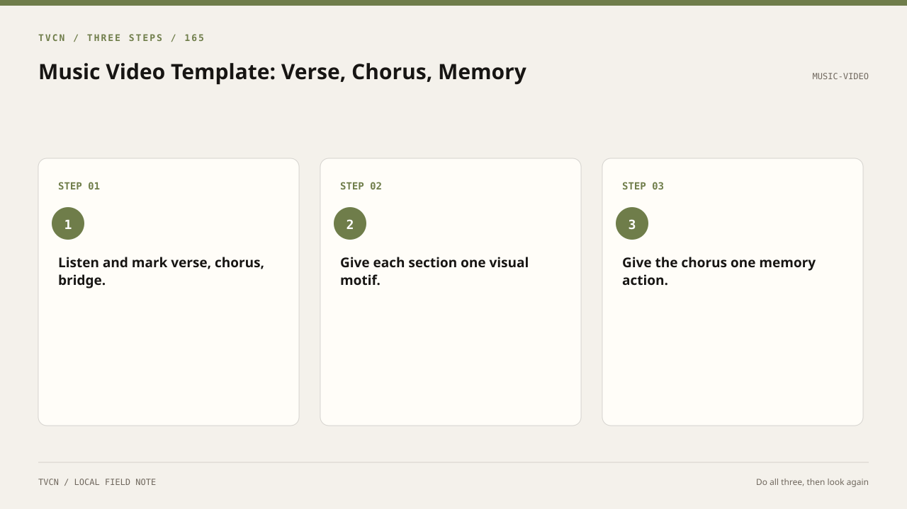

Verse, chorus, memory. The memory can be one action or one image.

<!-- DIAGRAM_START -->
<h2>Diagram</h2>
<figure>
  
  <figcaption>Do the three steps in order, then look again at the image or file.</figcaption>
</figure>
<!-- DIAGRAM_END -->
<h2>On set</h2>

Verse gives space, chorus gives a remembered action, bridge gives a turn. The action must repeat.

<h2>Do this</h2>

An MV template uses verse, chorus, memory point; the hook can be an action or an image.
<ol><li>Let the verse establish space and location.</li><li>Give the chorus one repeatable memory action.</li><li>Let the bridge turn by changing space or relationship.</li></ol>
<h2>Avoid</h2>

Do not make the bridge just a volume drop; without a visual turn, it is forgotten.

<h2>Check</h2>
<ul><li>The verse establishes where the person is.</li><li>The chorus hook appears at least twice and is memorable.</li><li>The bridge changes space or relationship, not just volume.</li></ul>
