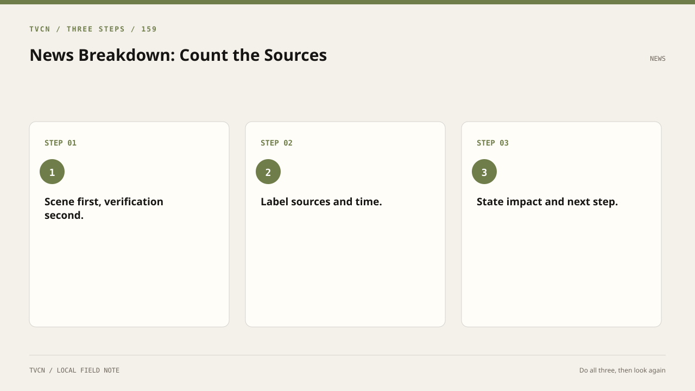

Count the sources: how many, who, and whether any are secondhand.

<!-- DIAGRAM_START -->
<h2>Diagram</h2>
<figure>
  
  <figcaption>Do the three steps in order, then look again at the image or file.</figcaption>
</figure>
<!-- DIAGRAM_END -->
<h2>On set</h2>

Count sources: how many on camera, how many captions, how many second-hand. Label reused footage.

<h2>Do this</h2>

A news breakdown counts sources: how many, who, and whether any are secondhand.
<ol><li>Count on-camera sources.</li><li>Count caption sources.</li><li>Count secondhand shots and check corner labels.</li></ol>
<h2>Avoid</h2>

Do not treat secondhand retelling as firsthand; mixed sources make the whole piece untrustworthy.

<h2>Check</h2>
<ul><li>On-camera, caption, and secondhand sources are counted separately.</li><li>Every key fact traces to a source.</li><li>All secondhand footage is labeled and not passed as firsthand.</li></ul>
