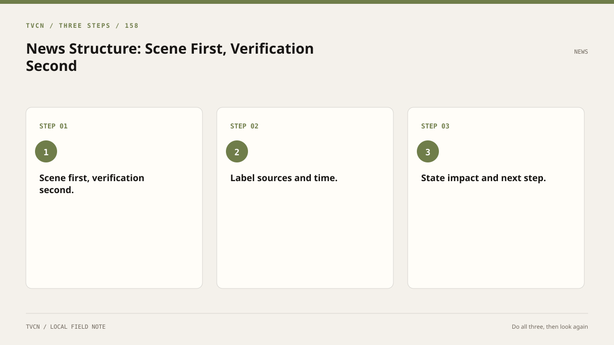

A news open shows what happened, then verification: who confirmed it, when, and what is still unknown. End with impact and next step. Keep only background needed to explain this event; do not start with a history lecture.

<!-- DIAGRAM_START -->
<h2>Diagram</h2>
<figure>
  
  <figcaption>Watch “0–5 seconds: the scene.” and “5–15 seconds: verification.”; judge whether the reason given in the first three seconds still holds at the end.</figcaption>
</figure>
<!-- DIAGRAM_END -->
<section><h2 id="section-1">Scene, verification, impact: one question per section</h2>
Each section answers one audience question. Separate “why it happened” from “what happens next” so the middle does not lose them.
<h2 id="section-2">Limits</h2>
Unverified information does not get a confident tone. Put “alleged” and “being verified” on screen or in the voice; do not edit uncertainty into certainty.
</section><section><h2 id="section-3">On set</h2>
Scene at 0 to 5, verification at 5 to 15, context and impact at 15 to 30. Label sources on screen.
</section><section><h2 id="section-4">Do this</h2>
News structure gives the scene first, verification second; background first loses the audience.
<ol><li>0–5 seconds: the scene.</li><li>5–15 seconds: verification.</li><li>15–30 seconds: context and impact with source captions.</li></ol></section><section><h2 id="section-5">Avoid</h2>
Do not pass secondhand footage off as scene; it destroys credibility.
</section><figure class="article-audio"><audio controls preload="none" src="../../../assets/audio/en/fmt-news.en.mp3"></audio><figcaption>20-second audio demo: one check point and the most common failure. Transcript and steps are in the article.</figcaption></figure><section><h2>Judge</h2>
This page passes on three observable checks, not slogans:
<ul><li><strong>1.</strong> The first five seconds are scene footage or sound, not an anchor talking.</li><li><strong>2.</strong> Verification names a source, time, and checkable record.</li><li><strong>3.</strong> Secondhand footage is corner-labeled so viewers can tell.</li></ul></section><section><h2>Failures</h2>
Any one of these means stop and fix it before post:
<ul><li><strong>1.</strong> Check 1 is only staged (“The first five seconds are scene footage or so…”); another camera position or location exposes it.</li><li><strong>2.</strong> Check 2 is left to post or a verbal explanation (“Verification names a source, time, and checkab…”); nothing on set can be rechecked.</li><li><strong>3.</strong> Do not pass secondhand footage off as scene; it destroys credibility.</li></ul></section><section><h2>Extend</h2>
<strong>10-minute exercise:</strong> Break down one 30-second reference, mark the timecodes for “0–5 seconds: the scene.” and “5–15 seconds: verification.”, then answer: if one disappeared, would the film still hold?
</section>
<h2>Check</h2><ul><li>The first five seconds are scene footage or sound, not an anchor talking.</li><li>Verification names a source, time, and checkable record.</li><li>Secondhand footage is corner-labeled so viewers can tell.</li></ul>

<!-- DEEP_DIVE_START -->
## Deep dive

<strong>About 6 minutes.</strong> News starts with verifiable facts, then context. The image does not get to decide the conclusion.

### Lead with the scene

Give time, place, people, and one verifiable detail in the first ten seconds: a seal, a water line, a timestamp, a street number. Do not open with a presenter reading a lead in front of the door.

First-hand material first: your own footage, original files, a complete timeline. Label second-hand images, keep the publish time of screenshots, and never pass old footage off as today.

### Sources

Use at least two independent sources. If a source is anonymous, say why and what they can verify. One person saying the same thing three times is not three sources.

Separate “who said it” from “what happened”: facts use images and documents, judgment uses interviews. Do not put a guess in the headline.

### Structure and correction

What happened, what proves it, who is where, what happens next. When those four are answered, stop. Do not use sentimental music to do the judging, and do not cut the answer that hurts your angle.

Leave a correction path before publishing: wrong word, wrong time, wrong name. Fix it and note the change at the end or in the description. Trust comes from being correctable, not from sounding certain.

### Five-minute drill: three lines of facts

Take one scene you shot and write three lines: what happened at what time, who was there, which object proves it. Each line must be checkable by another shot or document.

Then write one line: “what I still do not know.” Put it at the end or in the description. Do not turn the unknown into a declarative sentence; naming it is what makes the report trustworthy.

### When it is done

Pull out every factual claim and ask: which shot, document, or independent source verifies it? If every claim has an answer, the report is done. If one rests on “someone said,” downgrade it to a judgment; do not present it as fact.

### Ten news-field checks
<ul><li>Time, place, people within ten seconds</li><li>One verifiable detail</li><li>First-hand material first</li><li>Second-hand images labeled</li><li>Screenshots keep publish time</li><li>At least two independent sources</li><li>Anonymous source explained</li><li>Fact separated from judgment</li><li>No sentimental music judging</li><li>Correction path before publishing</li></ul>
News is not about who shoots harder; it is about who puts what they can verify first.

<!-- DEEP_DIVE_END -->

<!-- SOURCES_START -->
## References and further reading

- [S83] [AP: News Values and Principles](https://www.ap.org/about/news-values-and-principles/) — Accessed 2026-11-26. Used to check the terminology/method/rule in the “Scene, verification, impact: one question per section” section against AP news values, not platform growth rules; it does not verify numbers, model choices or on-set conclusions derived from this page, and is not a substitute for a test.
- [S16] [BBC: Editorial Guidelines](https://www.bbc.co.uk/editorialguidelines/) — Accessed 2026-11-26. Used to check the terminology/method/rule in the “Limits” section against BBC editorial guidelines, not platform growth rules; it does not verify numbers, model choices or on-set conclusions derived from this page, and is not a substitute for a test.
<!-- SOURCES_END -->

