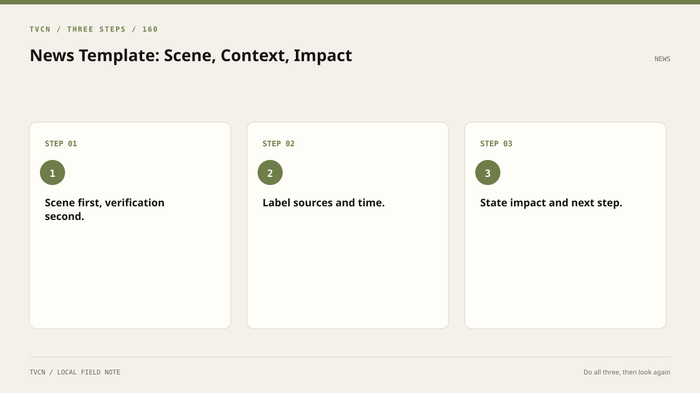

A news template runs scene, context, impact; every segment answers a viewer question.

<!-- DIAGRAM_START -->
<h2>Diagram</h2>
<figure>
  
  <figcaption>Watch “What happened on scene.” and “Why it happened.”; judge whether the reason given in the first three seconds still holds at the end.</figcaption>
</figure>
<!-- DIAGRAM_END -->
<section><h2 id="section-1">A usable 60-second segment table</h2>
<table class="template-table"><thead><tr><th>Segment</th><th>Time</th><th>Picture</th><th>Sound / pass line</th></tr></thead><tbody><tr><td>Scene</td><td>0–10s</td><td>What is happening now, or the latest scene footage</td><td>One “what happened” line; time and place clear</td></tr><tr><td>Verification</td><td>10–25s</td><td>Who confirmed, which document, which office</td><td>Source on screen; unknowns named as unknown</td></tr><tr><td>Context</td><td>25–40s</td><td>Only one or two images needed to explain this event</td><td>No history lecture; one cause line</td></tr><tr><td>Impact</td><td>40–55s</td><td>Who is affected and how</td><td>Separate what happened from what may happen</td></tr><tr><td>Next</td><td>55–60s</td><td>One actionable step or a clear uncertainty</td><td>Do not conclude for the audience</td></tr></tbody></table>
<h2 id="section-2">Fill three lines before rolling</h2><ul><li><strong>What happened:</strong> one fact without adjectives.</li><li><strong>Who confirmed:</strong> name, document and date; write “unverified” if missing.</li><li><strong>Next step:</strong> what can the viewer do, or what must they wait for?</li></ul></section><section><h2 id="section-3">On set</h2>
What happened, why, and what happens next. Each section answers one audience question.
</section><section><h2 id="section-4">Do this</h2><ol><li>What happened on scene.</li><li>Why it happened.</li><li>What happens next and what viewers can do.</li></ol></section><section><h2 id="section-5">Avoid</h2>
Do not turn context into a history lecture; viewers need why this happened now.
</section><section><h2>Judge</h2>
This page passes on three observable checks, not slogans:
<ul><li><strong>1.</strong> The three parts answer what happened, why, and what next.</li><li><strong>2.</strong> Context keeps only what directly explains the current event.</li><li><strong>3.</strong> The ending gives a concrete next step or names the uncertainty.</li></ul></section><section><h2>Failures</h2>
Any one of these means stop and fix it before post:
<ul><li><strong>1.</strong> Check 1 is only staged (“The three parts answer what happened, why, and…”); another camera position or location exposes it.</li><li><strong>2.</strong> Check 2 is left to post or a verbal explanation (“Context keeps only what directly explains the…”); nothing on set can be rechecked.</li><li><strong>3.</strong> Do not turn context into a history lecture; viewers need why this happened now.</li></ul></section><section><h2>Extend</h2>
<strong>10-minute exercise:</strong> Break down one 30-second reference, mark the timecodes for “What happened on scene.” and “Why it happened.”, then answer: if one disappeared, would the film still hold?
</section>
<h2>Check</h2><ul><li>The three parts answer what happened, why, and what next.</li><li>Context keeps only what directly explains the current event.</li><li>The ending gives a concrete next step or names the uncertainty.</li></ul>

<!-- SOURCES_START -->
## References and further reading

- [S83] [Associated Press: News Values and Principles](https://www.ap.org/about/news-values-and-principles/) — Accessed 2026-11-26. Used to check the terminology and public context in the opening paragraph (“Scene, context, impact; each section answers one viewer ques”) against Wire-service standards for accuracy, fairness and sourcing; not a substitute for an on-set test.
- [S16] [BBC Editorial Guidelines](https://www.bbc.co.uk/editorialguidelines/) — Accessed 2026-11-26. Used to check the terminology and public context in the opening paragraph (“Scene, context, impact; each section answers one viewer ques”) against Editorial standards on accuracy, fairness, privacy and secret recording; not a substitute for an on-set test.
<!-- SOURCES_END -->

