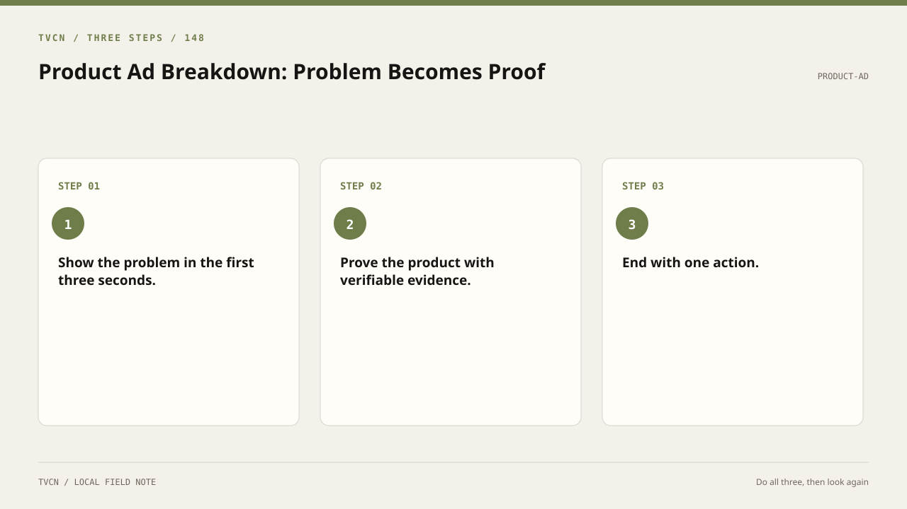

A product-ad breakdown watches a problem become proof: sting first, evidence second.

<!-- DIAGRAM_START -->
<h2>Diagram</h2>
<figure>
  
  <figcaption>Do the three steps in order, then look again at the image or file.</figcaption>
</figure>
<!-- DIAGRAM_END -->
<h2>On set</h2>

Check whether the problem appears in three seconds, whether seconds four to thirteen prove it, and whether the ending asks for one action.

<h2>Do this</h2>

A product-ad breakdown watches how a problem becomes a selling point: sting first, evidence second.
<ol><li>Check whether the first three seconds show the problem.</li><li>Check whether seconds four to thirteen offer verifiable evidence.</li><li>Check whether the ending gives one action.</li></ol>
<h2>Avoid</h2>

Do not read specifications like a manual; viewers want to see what it does.

<h2>Check</h2>
<ul><li>The first three seconds show a concrete problem, not a spinning product.</li><li>Mid-section evidence is visually verifiable, such as a before-and-after.</li><li>The ending asks for one action, not three at once.</li></ul>
