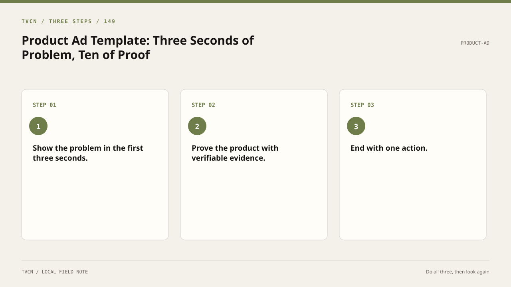

A product-ad template gives the problem in three seconds, proof in ten, and one action in the last five.

<!-- DIAGRAM_START -->
<h2>Diagram</h2>
<figure>
  
  <figcaption>Watch “0–3 seconds: the problem appears.” and “3–13 seconds: three pieces of evidence, each visible.”; judge whether the reason given in the first three seconds still holds at the end.</figcaption>
</figure>
<!-- DIAGRAM_END -->
<section><h2 id="section-1">A usable 18-second segment table</h2>
<table class="template-table"><thead><tr><th>Segment</th><th>Time</th><th>Picture</th><th>Sound / pass line</th></tr></thead><tbody><tr><td>Problem</td><td>0–3s</td><td>A real loss in use: spill, jam, wasted time</td><td>One concrete problem; no brand name</td></tr><tr><td>Proof 1</td><td>3–7s</td><td>Product enters, problem stops; hand close-up</td><td>Action sound; the use is visible</td></tr><tr><td>Proof 2</td><td>7–11s</td><td>Another condition proves it is not a fluke</td><td>One condition line; no exaggeration</td></tr><tr><td>Proof 3</td><td>11–13s</td><td>Measurable result: time, quantity, before/after</td><td>A number or comparison; no adjectives</td></tr><tr><td>Action</td><td>13–18s</td><td>Product returns to life, person leaves</td><td>One next step; no second slogan</td></tr></tbody></table>
<h2 id="section-2">Fill three lines before rolling</h2><ul><li><strong>Problem:</strong> who loses what, where? It must be visible.</li><li><strong>Three proofs:</strong> change one condition each; three identical proofs are one proof.</li><li><strong>Action:</strong> what should the viewer do? One thing only.</li></ul></section><section><h2 id="section-3">On set</h2>
Problem at 0 to 3, three proofs at 3 to 13, one action at 13 to 18. Make the proof visible.
</section><section><h2 id="section-4">Do this</h2><ol><li>0–3 seconds: the problem appears.</li><li>3–13 seconds: three pieces of evidence, each visible.</li><li>13–18 seconds: one action only.</li></ol></section><section><h2 id="section-5">Avoid</h2>
Do not cram five selling points into thirteen seconds; viewers remember none.
</section><section><h2>Judge</h2>
Three signals are observable on set:
<ul><li>the first three seconds give a believable reason</li><li>the middle adds information or resistance, not just mood</li><li>the ending shows a visible change instead of narrating it</li></ul></section><section><h2>Failures</h2>
These three moves erase the detail you just built:
<ul><li>the template is filled but the person and problem are not</li><li>no reason in the first three seconds, only title and music</li><li>no visible change at the end, only voice-over</li></ul></section><section><h2>Extend</h2>
<strong>10-minute exercise:</strong> Break down one 30-second reference, mark the timecodes for “0–3 seconds: the problem appears.” and “3–13 seconds: three pieces of evidence, each visible.”, then answer: if one disappeared, would the film still hold?
</section>
<h2>Check</h2><ul><li>The cut follows 0–3, 3–13, 13–18 timing.</li><li>All three evidence beats are visible without voiceover filling gaps.</li><li>The last five seconds carry one action and no second slogan.</li></ul>

> Intent split: this page covers the practical details of “Product Ad Template: Three Seconds of Problem, Ten of Proof”; start with <a href="https://formats.tvcn.org/article/music-video-template/">Music Video Template: Verse, Chorus, Memory</a> for the cluster-level judgement, then return here.

<!-- INTENT_SCOPE -->

<!-- SOURCES_START -->
## Experience note

Experience note: this page draws on 6 format breakdown and project review reviews under a 30-second to five-minute film for one platform; it discusses “Product Ad Template: Three Seconds of Problem, Ten of Proof”; no external laboratory test was run, and the conclusion may not transfer when conditions change.
<!-- SOURCES_END -->

