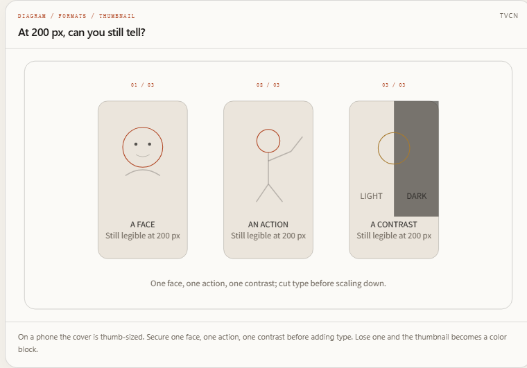

<!-- DIAGRAM_START -->
## Diagram

<figure>
  
  <figcaption>On a phone the cover is thumb-sized. Secure one face, one action, one contrast before adding type. Lose one and the thumbnail becomes a color block.</figcaption>
</figure>
<!-- DIAGRAM_END -->

## Make a black-and-white proof at thumb size

Turn the frame black and white, then shrink it to 200 pixels wide. If the subject disappears, reshoot or recrop. Color and type cannot rescue composition. Plenty of covers look fine at 1080 and turn into a color smudge in a phone list.

The black-and-white proof also forces you to see the face, the action, and the light instead of falling for a grade.

## One face, one action, one contrast

A face reads faster than a landscape. An action reads faster than a pose. A strong light-dark contrast reads faster than detail. With three or more people, the viewer does not know where to look. Keep one clear center and let everything else fall back.

If there is no face, show something happening: a hand entering frame, a door pushed open, an object falling. A still empty scene usually needs type to hold it up.

## Keep the words to three or five

Cover type is a road sign, not a title. “She left” does more than “a story about leaving.” Small type turns into a line at phone size, especially over a bright background.

Make three covers for the same film and test them in the feed. Do not ask a colleague which one looks better. Data is faster than taste, and more honest.

## Checks

- The subject still reads in a 200-pixel black-and-white proof.
- There is one clear center.
- Cover type is five words or fewer and stays legible on a phone.

<!-- DEEP_DIVE_START -->
## Deep dive

<strong>About 5 minutes.</strong> A thumbnail is not a shrunken poster. It is one image that has to be recognized in a phone list within two seconds.

### Recognize the person, then the event

At thumb size, first check whether there is a face or an action; if not, only text remains. A face should occupy at least a third of the frame, eyes to camera or to the key object.

The title should not repeat the image; the image gives emotion, the title gives information.

With two subjects, the audience looks for the face first. Blur or crop the secondary person so they do not steal focus.

### Contrast and breathing room

The thumbnail needs light-dark or warm-cool contrast, a clean background, and at least eight percent margin around the subject. Do not put type over the face or key action where the platform UI will cover it.

Check three crops: 16:9, 1:1, and 9:16. If the subject survives the crop, it is a thumbnail.

Two lines of type at most: the first line asks, the second delivers. Do not write a promise the film cannot keep.

### Test it, do not guess

Make three versions: face, action, object. Put them in a phone list and ask five people what they saw within two seconds. If they cannot say, redo it.

Do not use click-through as the only measure; the film must deliver what the cover promises. Disappointment makes the next cover fail.

Compare the three on a real phone, not on a 27-inch monitor pretending to be thumb size.

### Three-cover test

Make three covers for one film: face, action, object. Put them in a phone list and ask five people what they saw in two seconds; write down their first word.

If the first words disagree, the image has no claim. Remove decoration and keep one subject.

Export at the platform’s real size and do not judge on a desktop enlargement; thumb size is the test.

### Ten thumbnail checks
<ul><li>Readable at thumb size</li><li>A face or an action is visible</li><li>Face fills at least a third</li><li>Title does not repeat the image</li><li>Clean background</li><li>Eight percent margin around the subject</li><li>Two lines of type at most</li><li>Subject survives 16:9, 1:1, and 9:16</li><li>Test on a phone with five people</li><li>The film delivers the promise</li></ul>
The cover only makes people stop; the film makes them stay.

<!-- DEEP_DIVE_END -->
