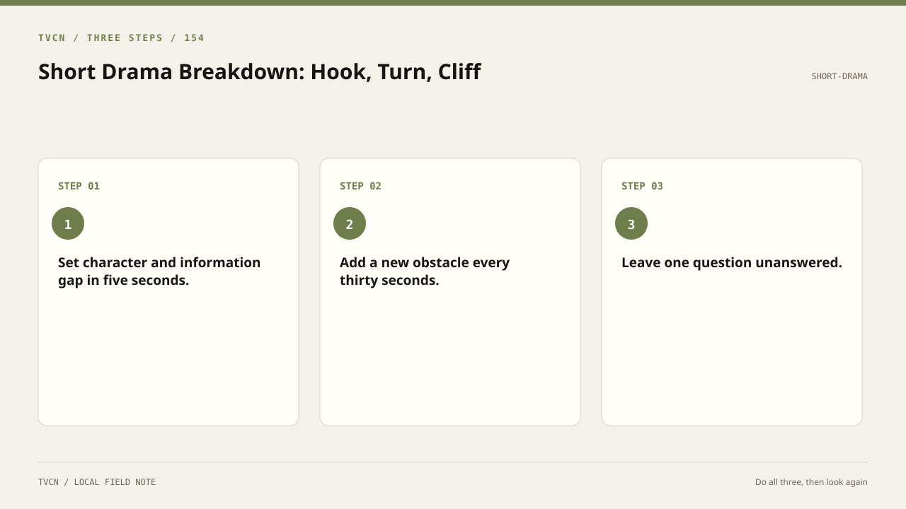

<!-- DIAGRAM_START -->
<h2>Diagram</h2>
<figure>
  
  <figcaption>The diagram is an entry point: watch the timecodes, then use the checks at the end.</figcaption>
</figure>
<!-- DIAGRAM_END -->
<h2>Fix Three Variables First</h2>
Fix three variables: thirty seconds, Douyin/Kuaishou, and the goal is believe A for twenty-five seconds, accept B in five. Short drama is not a slice of a longer show; find the false answer, then the clue.
<blockquote>
<strong>Sample note:</strong> the timecodes below are a teaching sample for this format's usual length. They do not correspond to one specific film and are not frame-accurate analysis. Use the same positions on your own film; do not treat these beats as the only answer.
</blockquote><h2>Timecode Breakdown: 8 Beats</h2>
Watch in order; do not read commentary first. For each beat record four things: picture, sound, job, and steal or do-not-copy.
<ol class="timecode-list"><li><strong>0:00–0:02</strong> | Picture: an odd image/action, no explanation. Sound: sync/one short line. Job: catch the eye. Steal: one odd action. Do not copy: a title caption explaining.</li><li><strong>0:02–0:05</strong> | Picture: one claim/goal that makes viewers think they understand. Sound: short line. Job: give the false answer. Steal: an everyday goal. Do not copy: reveal early.</li><li><strong>0:05–0:10</strong> | Picture: setup: who, where, what. Sound: ambience. Job: establish normal. Steal: three facts. Do not copy: explain backstory.</li><li><strong>0:10–0:16</strong> | Picture: escalation: the character approaches the goal the wrong way. Sound: pace rises. Job: invest the viewer. Steal: one wrong action. Do not copy: add a third character.</li><li><strong>0:16–0:21</strong> | Picture: false answer is “confirmed”: viewers believe A more. Sound: one confirmation. Job: nail the false answer. Steal: one visible proof. Do not copy: narration assures.</li><li><strong>0:21–0:25</strong> | Picture: real clue at the frame edge: shadow/hand/door/phone. Sound: one wrong sound. Job: plant the clue. Steal: clue appears twice. Do not copy: clue only in dialogue.</li><li><strong>0:25–0:28</strong> | Picture: turn: one action overturns A. Sound: silence/one hit. Job: make viewers recalculate. Steal: turn through action. Do not copy: explain in dialogue.</li><li><strong>0:28–0:30</strong> | Picture: reaction: one face/action closes. Sound: ambience. Job: land the turn. Steal: stop on reaction. Do not copy: add a recap voice-over.</li></ol><h2>Read the Structure</h2>
The spine is oddity, false answer, normal, escalation, confirmation, clue, turn, reaction. The first twenty-five seconds serve one false answer; the clue must appear twice in frame or the turn cheats.

Ask only three questions: what proof arrives in the first ten seconds; whether every ten to fifteen seconds adds information; whether the end lands one action, one change, or one question. If any is missing, a 30 sec film falls apart.
<h2>Budget Order of Magnitude</h2>
Budget is a rough mainland-China production range, excluding media spend; it is an order of magnitude, not a quote. At the same length, a stage, cast, effects, or music rights can each double the cost.
<ul><li>Low: RMB 5,000–20,000, three to five people, one or two sets, one day.</li><li>Mid: RMB 20,000–80,000, six to ten people, two or three sets, two days.</li><li>High: RMB 80,000–300,000+, director, camera, art, wardrobe, multiple sets, three to seven days.</li></ul><h2>Three Structures You Can Steal</h2>
Steal structure, not images. These three still work when you change the subject.
<ol><li>Odd action in the first two seconds, no explanation.</li><li>The first twenty-five seconds serve one false answer.</li><li>Clue appears twice in frame; the turn is not dialogue.</li></ol><h2>Three Reasons Not to Copy</h2>
Not “bad,” but built on different conditions; copying exposes your budget, platform, and audience.
<ol><li>Do not copy a slice of a longer show: thirty seconds cannot build a person; use action.</li><li>Do not copy a dialogue turn: if viewers did not see the clue, they feel cheated.</li><li>Do not copy a final voice-over: it turns the twist into a manual.</li></ol><h2>Breakdown Exercises</h2>
Do them before shooting; do not just read. Do the three in order, and the third must become a fifteen-second file.
<ol><li>Write a thirty-second turn: one false answer for twenty-five seconds.</li><li>Put the clue in frame twice, not in dialogue.</li><li>Watch muted; does the turn still read?</li></ol>
<h2>Check</h2><ul><li>An odd action in the first two seconds.</li><li>The first twenty-five seconds serve one false answer.</li><li>Setup uses three facts.</li><li>Escalation is one wrong action, not a new character.</li><li>Clue appears twice in frame.</li><li>Turn is action, not dialogue explanation.</li><li>End on reaction, no voice-over recap.</li></ul>

> Intent split: this page covers the practical details of “Short Drama Breakdown: One Turn in Thirty Seconds”; start with <a href="https://formats.tvcn.org/article/vertical-drama/">Vertical Drama: A Want in the First Three Seconds</a> for the cluster-level judgement, then return here.

<!-- INTENT_SCOPE -->

<!-- SOURCES_START -->
## Experience note

Experience note: this page draws on 5 format breakdown and project review reviews under a 30-second to five-minute film for one platform; it discusses “Short Drama Breakdown: One Turn in Thirty Seconds”; no external laboratory test was run, and the conclusion may not transfer when conditions change.
<!-- SOURCES_END -->

