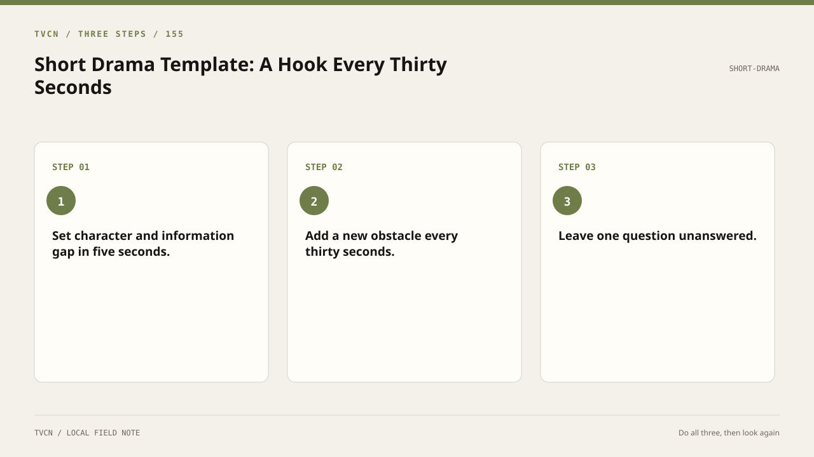

A hook every thirty seconds: new information, new obstacle, new cost.

<!-- DIAGRAM_START -->
<h2>Diagram</h2>
<figure>
  
  <figcaption>Do the three steps in order, then look again at the image or file.</figcaption>
</figure>
<!-- DIAGRAM_END -->
<h2>On set</h2>

Information gap at 0 to 5, new obstacle at 5 to 35, new cost at 35 to 60. End each beat with a question.

<h2>Do this</h2>

A short-drama template hooks every thirty seconds: new information, new obstacle, new cost.
<ol><li>0–5 seconds establish an information gap.</li><li>5–35 seconds add a new obstacle.</li><li>35–60 seconds add a new cost and end on a question.</li></ol>
<h2>Avoid</h2>

Do not rescue every segment with a new character; if the person does not change, the hook is fake.

<h2>Check</h2>
<ul><li>0–5, 5–35, and 35–60 each add new information or an obstacle.</li><li>The information gap is set in the first five seconds.</li><li>The final question is grounded in the previous minute.</li></ul>
