<!-- DIAGRAM_START -->
<h2>Diagram</h2>
<figure>
  
  <figcaption>Diagram: six beats in order; miss one and it becomes a pile of footage.</figcaption>
</figure>
<!-- DIAGRAM_END -->
<h2>First decision: when to use it</h2>
A sports film is not a slow-motion highlight. Set one physical goal—win, return, or accept failure—and let the body carry the story.

Use it when there is one clear subject, one action, and a visible change in the final film. Do not use it when there is only a slogan, no person, and no process to shoot; go back to the brief before rolling.
<h2>Six beats: one job per beat</h2>
Write the six beats as six sentences, each answering “what does the viewer know now.” Shoot in order, but cut out of order; do not add empty shots to fill the structure.
<ol><li>Before the start</li><li>First failure</li><li>Repeat training</li><li>Breaking point</li><li>Result</li><li>Aftermath</li></ol><h2>How to shoot it: six tasks</h2>
At least one primary shot per beat; do not shoot everything in one framing and rely on jump cuts. Shoot irreplaceable action first—hands, face, machine—then pickups.
<ul><li>Before: hands/shoes/breath close-up</li><li>Failure: same action, louder sound</li><li>Training: locked-off repetition</li><li>Breaking point: close-up + slower, no slow-mo abuse</li><li>Result: finish/scoreboard/body reaction</li><li>Aftermath: sit down/leave the track</li></ul><h2>Common failures: three ways it collapses</h2>
<strong>1. Logo/drone first</strong>: the viewer does not know whose story this is. Replace beat one with a problem or action. <strong>2. Narration in every beat</strong>: the images carry no information. Let one action speak. <strong>3. Unverifiable result</strong>: “more efficient” with no before/after or third party. Shoot something checkable.
<h2>Cost and check: can it be shot in a day</h2>
Typically one shoot day plus two to three post days: half a day for primary shots, half for pickups; cut structure first, then sound. Check only three things: six beats complete, one primary shot per beat, result checkable. Do not accept “it feels premium.”
<h2>Check</h2><ul><li>Each of six beats is one clear sentence.</li><li>Beat one is a problem/action, not a logo.</li><li>At least one primary shot per beat.</li><li>Result has before/after or third party.</li><li>At least one irreplaceable action captured.</li><li>Six beats survive the rough cut.</li></ul>

<!-- SOURCES_START -->
## References and further reading

- [S16] [BBC: Editorial Guidelines](https://www.bbc.co.uk/editorialguidelines/) — Accessed 2026-11-26. Used to check the terminology/method/rule in the “First decision: when to use it” section against BBC editorial guidelines, not platform growth rules; it does not verify numbers, model choices or on-set conclusions derived from this page, and is not a substitute for a test.
- [S14] [YouTube: Community Guidelines](https://support.google.com/youtube/answer/2801973) — Accessed 2026-11-26. Used to check the terminology/method/rule in the “Six beats: one job per beat” section against YouTube community rules, not creative standards; it does not verify numbers, model choices or on-set conclusions derived from this page, and is not a substitute for a test.
<!-- SOURCES_END -->

