<!-- DIAGRAM_START -->
<h2>Diagram</h2>
<figure>
  
  <figcaption>Diagram: six columns filled before rolling; a missing column makes the set guess.</figcaption>
</figure>
<!-- DIAGRAM_END -->
<h2>When to use this sheet</h2>
Fill it 24 hours before rolling and send one copy each to director, camera, sound, and producer. It does not replace the storyboard; it compresses it into “what must be shot today.” When the client changes scope, change the sheet before the budget.
<h2>The sheet: five columns plus a pass line</h2>
One beat per row. Picture is what the viewer sees, not “premium”; sound is what they hear; pass line is what must be captured to pass.

<table class="data-table"><thead><tr><th>Beat</th><th>Picture</th><th>Sound</th><th>Duration</th><th>Pass line</th></tr></thead><tbody><tr><td>Before</td><td>Hands/shoes/breath</td><td>Heartbeat/ambience</td><td>8–10 sec</td><td>No motivational text</td></tr><tr><td>Failure</td><td>One failed action</td><td>Friction/impact</td><td>15–20 sec</td><td>Failure can be retold</td></tr><tr><td>Training</td><td>Locked repeat</td><td>Steps/breath</td><td>20–25 sec</td><td>Repetition not chopped</td></tr><tr><td>Breaking point</td><td>Close-up pause</td><td>Ambience drops</td><td>15–20 sec</td><td>No slow-mo crutch</td></tr><tr><td>Result</td><td>Finish/timer</td><td>Crowd</td><td>15–20 sec</td><td>One number</td></tr><tr><td>Aftermath</td><td>Body relaxes</td><td>Breath</td><td>8–10 sec</td><td>No slogan</td></tr></tbody></table>
<h2>Filling example: hardest first</h2>
Fill the beats that need people, weather, or permits first; pickups last. Durations are ceilings, not targets. Stop when the pass line is met; do not repeat to fill time.
<h2>On set: how to run the sheet</h2>
Five minutes before rolling, read the sheet: which rows today, what pass line, who owns it. After each row, tick it and note the actual take. Photograph the sheet at wrap and archive it with the footage.
<h2>Check: a filled sheet is not a finished film</h2>
At wrap, check only: every pass line has footage, sound has an independent backup, the hardest beat has at least two takes. If one is missing, pick it up next day, not in post.
<h2>Check</h2><ul><li>One row per beat, no merging.</li><li>Picture is what is seen, not adjectives.</li><li>Sound is what is heard, including ambience.</li><li>Pass line is judgeable, not “feels right.”</li><li>Hardest beat shot first.</li><li>Sheet archived with footage at wrap.</li></ul>
<!-- SOURCES_START -->
<h2>Sources</h2>

Experience: TVCN field notes and project reviews; tested: the review setup and reproducible exercises noted on the page; references: public links below.

<ul><li>[S14] YouTube Community Guidelines</li><li>[S15] TikTok Community Guidelines</li><li>[S16] BBC Editorial Guidelines</li></ul>

<a href="../../SOURCES.md">Full links and notes in SOURCES.md</a>

<!-- SOURCES_END -->
