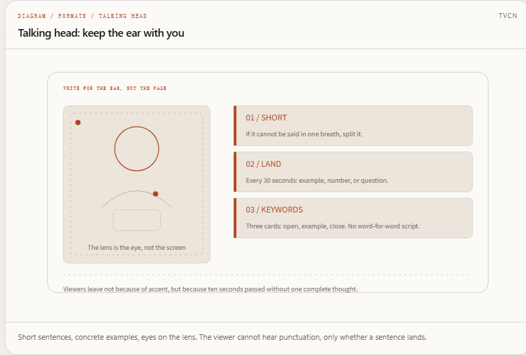

<!-- DIAGRAM_START -->
## Diagram

<figure>
  
  <figcaption>Short sentences, concrete examples, eyes on the lens. The viewer cannot hear punctuation, only whether a sentence lands.</figcaption>
</figure>
<!-- DIAGRAM_END -->

A talking-head piece is not an article read aloud. The viewer cannot see punctuation or paragraphs, only whether a sentence lands.

## Write sentences you can say

Cut “therefore,” “in conclusion,” and “it is worth noting.” They connect paragraphs on paper and tie the tongue on camera. One sentence does one job: give the point, give the example, make the turn. Finish one, then start the next.

Lead with the conclusion, not the background. The viewer is scrolling; if the first three seconds do not answer “what is this to me,” they are gone. The conclusion can be rough, but it must be clear: “The problem with talking heads is not your accent; it is your sentence length.”

Say “you,” not “the user.” “The user should note” belongs in a report. “You need to watch this” puts someone across the table. The distance closes in one word.

## Land something every thirty seconds

With no pictures to help, attention rides on information. Every twenty or thirty seconds, give something concrete: an example, a number, a question, a scene the viewer can see. Three abstract nouns in a row and the ear goes numb.

Keep examples small. Not “many people struggle when shooting,” but “you shoot in the living room, turn off the lamp, and your face goes black.” Small enough that the viewer sees themselves, and the line lands.

Turn early. Do not spend forty seconds setting up a “but.” Put the turn in the first ten seconds, then use the rest to explain why. The rhythm is not steady; it comes in blocks, and each block stops before the next.

## The body is also dialogue

Do not memorize a word-for-word script. Memorized eyes look up, the mouth outruns the brain, and it sounds like reading. Compress the script to three keyword cards: opening, example, close. The middle comes out the way you talk to a friend.

Look at the lens, not the screen. The lens is the person’s eye; the screen is your own face. Looking into the lens takes ten tries to feel natural. Looking at the screen makes the viewer think you are talking to someone else.

Keep your hands visible. Rest them on the table, at chest height, or at your sides; do not hide them under the desk. When you say “this big” or “this long,” your hands do the talking. If you flub a line, stop for one second and say it again. Do not fill with “um”; the filler cannot be cut.

## Checks

- Every sentence can be said in one breath, with no written connectives.
- Something concrete lands every thirty seconds.
- The cards hold keywords, not a script; the eyes stay on the lens.

<!-- DEEP_DIVE_START -->
## Deep dive

<strong>About 6 minutes.</strong> Talking head is not reading a script smoothly. It is giving the viewer something new every ten seconds.

### Write for the ear first

Write for the ear: clear subject, verb, object; one idea per sentence. Put numbers, examples, and action words first; adjectives and backstory later. The viewer needs something new every ten seconds, or the thumb moves.

Open with a judgment or a conflict in the first three seconds. No self-introduction, no “today I want to talk about.” Put the most counterintuitive line first, then support it with three reasons.

### Three shot types keep attention

The main shot is a half-body at eye level, with hands in frame. When you give a concrete example, cut to hands, product, screen, or the room. Use jump cuts to remove pauses, not every two seconds.

Change the information form every twenty to thirty seconds: talking head, insert, screen recording, empty frame. Cuts should follow the sentence, not decorate it. Keep subtitles to two lines; clarity beats bold keywords.

### Record one complete take, then add proof

Record one complete take first and make sure the logic holds. Then add examples, a counterexample, and a closing question. Do not polish wording before the structure exists, or you will never finish take one.

Before delivery, watch on a phone: is there a conclusion in three seconds, new information every ten, and a real question at the end? Put one short line on the cover, not three.

### Five-minute drill: one point only

Record sixty seconds on your phone with one judgment and three examples. No self-introduction, no backstory. Delete every “I think,” “actually,” and “you know,” then cut the first polite sentence.

Watch on a phone: conclusion in three seconds, new information every ten, a question at the end. If one is missing, record again. Do not fix it with subtitles.

### Ten talking-head checks
<ul><li>Judgment or conflict in three seconds</li><li>One idea per sentence</li><li>Something new every ten seconds</li><li>At least three concrete examples or numbers</li><li>Eye-level half-body as the main shot</li><li>Hands or product visible</li><li>Change form every twenty to thirty seconds</li><li>Jump cuts remove pauses only</li><li>Two subtitle lines max</li><li>A real question at the end</li></ul>
Talking head is not reading. It is cutting one argument into pieces the viewer can swallow.

<!-- DEEP_DIVE_END -->

<section><h2>Boundary</h2>
This page only covers “Talking Head: Write for the Ear”; it does not replace Talking Head Breakdown: Hold Attention for Sixty Seconds, Talking Head Template: One Claim, Three Proofs, One Action, Adjusting Actors: Give Verbs, Not Adjectives. When the problem belongs to one of those pages, use that page instead of adding more parameters here.
</section>
<!-- SOURCES_START -->
## References and further reading

- [S14] [YouTube: Community Guidelines](https://support.google.com/youtube/answer/2801973) — Accessed 2026-11-26. Used to check the terminology/method/rule in the “Write sentences you can say” section against YouTube community rules, not creative standards; it does not verify numbers, model choices or on-set conclusions derived from this page, and is not a substitute for a test.
- [S15] [TikTok: Community Guidelines](https://www.tiktok.com/community-guidelines/en/) — Accessed 2026-11-26. Used to check the terminology/method/rule in the “Land something every thirty seconds” section against TikTok community rules, not creative standards; it does not verify numbers, model choices or on-set conclusions derived from this page, and is not a substitute for a test.
- [S29] [YouTube: Upload Encoding Specs](https://support.google.com/youtube/answer/1722171) — Accessed 2026-11-26. Used to check the terminology/method/rule in the “The body is also dialogue” section against YouTube upload encoding recommendations, not creative standards; it does not verify numbers, model choices or on-set conclusions derived from this page, and is not a substitute for a test.
<!-- SOURCES_END -->

