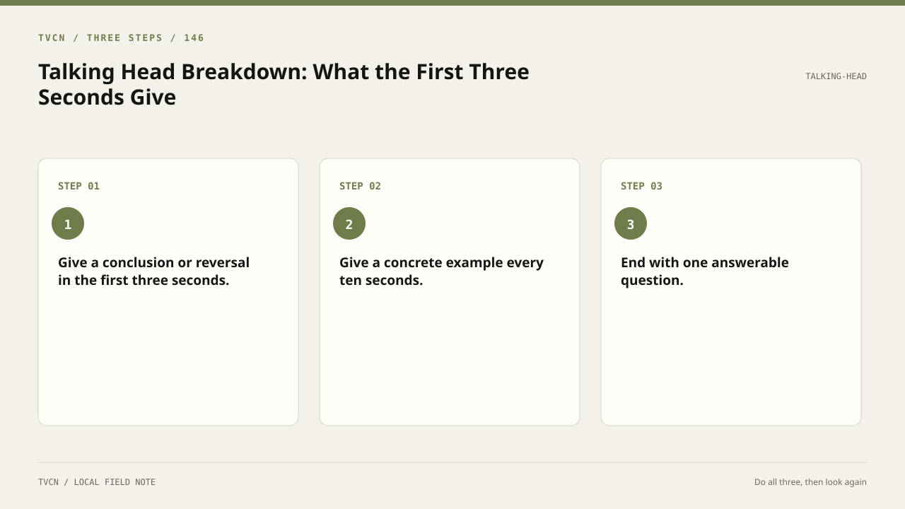

<!-- DIAGRAM_START -->
<h2>Diagram</h2>
<figure>
  
  <figcaption>The diagram is an entry point: watch the timecodes, then use the checks at the end.</figcaption>
</figure>
<!-- DIAGRAM_END -->
<h2>Fix Three Variables First</h2>
Fix three variables: sixty seconds, Douyin/Channels, and the goal is the viewer can repeat one conclusion. Talking head is not reading a script; check whether the first line is the claim, then whether every ten seconds adds information.
<blockquote>
<strong>Sample note:</strong> the timecodes below are a teaching sample for this format's usual length. They do not correspond to one specific film and are not frame-accurate analysis. Use the same positions on your own film; do not treat these beats as the only answer.
</blockquote><h2>Timecode Breakdown: 8 Beats</h2>
Watch in order; do not read commentary first. For each beat record four things: picture, sound, job, and steal or do-not-copy.
<ol class="timecode-list"><li><strong>0:00–0:03</strong> | Picture: the person is already speaking; first line is the claim. Sound: sync. Job: no chance to leave. Steal: claim first. Do not copy: thank followers.</li><li><strong>0:03–0:10</strong> | Picture: medium, frontal; hands in frame. Sound: one reason. Job: ground the claim. Steal: one counterintuitive reason. Do not copy: three claims in one line.</li><li><strong>0:10–0:18</strong> | Picture: example one: one person/action/result. Sound: sync. Job: make it concrete. Steal: one real example. Do not copy: three people.</li><li><strong>0:18–0:26</strong> | Picture: example two: new setting/person, same conclusion. Sound: one transition. Job: more than one proof. Steal: a second setting. Do not copy: repeat example one.</li><li><strong>0:26–0:34</strong> | Picture: counter: the common objection. Sound: say it aloud. Job: handle objection early. Steal: admit the counter has a point. Do not copy: a straw man.</li><li><strong>0:34–0:44</strong> | Picture: proof: data/demo/before-after. Sound: key number. Job: make the claim credible. Steal: one verifiable proof. Do not copy: three numbers.</li><li><strong>0:44–0:52</strong> | Picture: application: what viewers can do today. Sound: one step. Job: give a takeaway. Steal: one concrete action. Do not copy: a five-step list.</li><li><strong>0:52–1:00</strong> | Picture: return to the person, ask one concrete question. Sound: sync, hold two seconds. Job: direct comments. Steal: one answerable question. Do not copy: “comment below.”</li></ol><h2>Read the Structure</h2>
The spine is claim, reason, example one, example two, counter, proof, application, question. It is not “cover a topic”; it is “leave one usable conclusion.”

Ask only three questions: what proof arrives in the first ten seconds; whether every ten to fifteen seconds adds information; whether the end lands one action, one change, or one question. If any is missing, a 60 sec film falls apart.
<h2>Budget Order of Magnitude</h2>
Budget is a rough mainland-China production range, excluding media spend; it is an order of magnitude, not a quote. At the same length, a stage, cast, effects, or music rights can each double the cost.
<ul><li>Low: RMB 1,000–5,000, one person, one camera and one mic, natural light, half a day.</li><li>Mid: RMB 5,000–20,000, two to three people, two cameras/teleprompter/light, one day.</li><li>High: RMB 20,000–80,000+, director, camera, light, post, stage, one to two days.</li></ul><h2>Three Structures You Can Steal</h2>
Steal structure, not images. These three still work when you change the subject.
<ol><li>First line is the claim, no intro.</li><li>Every ten seconds adds information: reason/example/counter/proof.</li><li>End with a question answerable today.</li></ol><h2>Three Reasons Not to Copy</h2>
Not “bad,” but built on different conditions; copying exposes your budget, platform, and audience.
<ol><li>Do not copy rapid cutting: without new information, speed is empty.</li><li>Do not copy quote-speak: if every line is a quote, none is remembered.</li><li>Do not copy a thank-you open: the first three seconds are the only attention; do not waste them.</li></ol><h2>Breakdown Exercises</h2>
Do them before shooting; do not just read. Do the three in order, and the third must become a fifteen-second file.
<ol><li>Watch muted; can the first line be captioned as the claim?</li><li>Count new information every ten seconds; if none, rewrite.</li><li>Compress to fifteen seconds: claim, one example, one question.</li></ol>
<h2>Check</h2><ul><li>First line is the claim, not an intro.</li><li>A reason lands within ten seconds.</li><li>Two examples each have one person/action/result.</li><li>Counter is stated directly, not a straw man.</li><li>Proof is verifiable, not three numbers.</li><li>Application is one step.</li><li>Closing question is concrete and answerable today.</li></ul>

<!-- SOURCES_START -->
## Experience note

Experience note: this page draws on 7 format breakdown and project review reviews under a 30-second to five-minute film for one platform; it discusses “Talking Head Breakdown: Hold Attention for Sixty Seconds”; no external laboratory test was run, and the conclusion may not transfer when conditions change.
<!-- SOURCES_END -->

