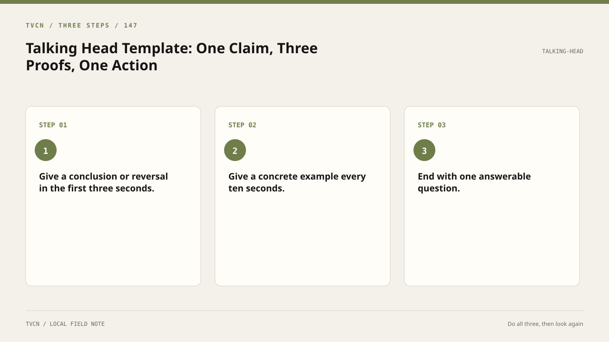

One claim, three proofs, one action; every proof must be visible on camera.

<!-- DIAGRAM_START -->
<h2>Diagram</h2>
<figure>
  
  <figcaption>Do the three steps in order, then look again at the image or file.</figcaption>
</figure>
<!-- DIAGRAM_END -->
<h2>On set</h2>

Write one claim, three shootable examples, and one closing action. Keep each example under ten seconds.

<h2>Do this</h2>

A talking-head template is one claim, three examples, one action; examples must be visible on camera.
<ol><li>Write one claim that fits in a sentence.</li><li>Add three shootable examples, each under ten seconds.</li><li>End with one action, such as open settings now.</li></ol>
<h2>Avoid</h2>

Do not use three adjectives as examples; if the camera cannot show it, viewers will not remember.

<h2>Check</h2>
<ul><li>The claim fits one sentence with no second center.</li><li>All three examples are filmable and each runs under ten seconds.</li><li>The ending gives one action so viewers know what to do next.</li></ul>
