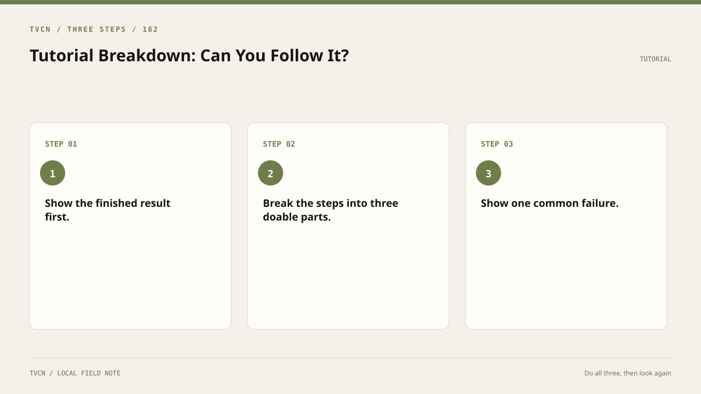

<!-- DIAGRAM_START -->
<h2>Diagram</h2>
<figure>
  
  <figcaption>The diagram is an entry point: watch the timecodes, then use the checks at the end.</figcaption>
</figure>
<!-- DIAGRAM_END -->
<h2>Fix Three Variables First</h2>
Fix three variables: five minutes, Bilibili/Channels, and the goal is the viewer can do it. A tutorial is not “watch me”; it is “you can.” Count steps and checks, not facts.
<blockquote>
<strong>Sample note:</strong> the timecodes below are a teaching sample for this format's usual length. They do not correspond to one specific film and are not frame-accurate analysis. Use the same positions on your own film; do not treat these beats as the only answer.
</blockquote><h2>Timecode Breakdown: 10 Beats</h2>
Watch in order; do not read commentary first. For each beat record four things: picture, sound, job, and steal or do-not-copy.
<ol class="timecode-list"><li><strong>0:00–0:10</strong> | Picture: show the finished result, no table of contents. Sound: result sound/one promise. Job: show what they can do after. Steal: result first. Do not copy: open with an outline.</li><li><strong>0:10–0:25</strong> | Picture: materials/tools, all in frame. Sound: count each. Job: show what to prepare. Steal: all materials in one frame. Do not copy: read ten items.</li><li><strong>0:25–0:55</strong> | Picture: step one, one take or minimal cuts. Sound: key action. Job: let viewers follow. Steal: one complete action. Do not copy: five angles.</li><li><strong>0:55–1:30</strong> | Picture: step two repeats the logic. Sound: one reminder. Job: build a method. Steal: same logic, new object. Do not copy: a new method.</li><li><strong>1:30–2:10</strong> | Picture: step three, the hardest. Sound: slow down, hold key frame two seconds. Job: make the hard part followable. Steal: pause plus close-up. Do not copy: speed through.</li><li><strong>2:10–2:50</strong> | Picture: check: how to know it is right. Sound: three criteria. Job: self-check. Steal: three visible standards. Do not copy: “close enough.”</li><li><strong>2:50–3:30</strong> | Picture: failure: the most common mistake. Sound: wrong sound plus fix. Job: help viewers avoid. Steal: one real failure. Do not copy: act an exaggerated error.</li><li><strong>3:30–4:10</strong> | Picture: recap: three steps on one card/list. Sound: one summary. Job: make the method memorable. Steal: a screenshot-able list. Do not copy: repeat the whole segment.</li><li><strong>4:10–4:40</strong> | Picture: next: variation/advanced use. Sound: one suggestion. Job: continue. Steal: one variation. Do not copy: three advanced paths.</li><li><strong>4:40–5:00</strong> | Picture: action: do one step now. Sound: one action. Job: from watching to doing. Steal: a one-minute action. Do not copy: “try it later.”</li></ol><h2>Read the Structure</h2>
The spine is result, materials, step one, step two, step three, check, failure, recap, next, action. Every step must be followable; if it cannot be followed, it is a showreel, not a tutorial.

Ask only three questions: what proof arrives in the first ten seconds; whether every ten to fifteen seconds adds information; whether the end lands one action, one change, or one question. If any is missing, a 5 min film falls apart.
<h2>Budget Order of Magnitude</h2>
Budget is a rough mainland-China production range, excluding media spend; it is an order of magnitude, not a quote. At the same length, a stage, cast, effects, or music rights can each double the cost.
<ul><li>Low: RMB 3,000–10,000, one to two people, one camera plus tabletop, one day.</li><li>Mid: RMB 10,000–40,000, three to five people, two cameras/overhead/light, two days.</li><li>High: RMB 40,000–150,000+, director, camera, art, motion, post, stage, three to seven days.</li></ul><h2>Three Structures You Can Steal</h2>
Steal structure, not images. These three still work when you change the subject.
<ol><li>Result first, no outline.</li><li>All materials in one frame.</li><li>Hold the hardest step two seconds plus a close-up.</li></ol><h2>Three Reasons Not to Copy</h2>
Not “bad,” but built on different conditions; copying exposes your budget, platform, and audience.
<ol><li>Do not copy fast-cut tutorials: if steps cannot be followed, viewers save and never do.</li><li>Do not copy an expert tone: without failure, viewers do not know where it breaks.</li><li>Do not copy a ten-step list: five minutes holds three steps; more means none.</li></ol><h2>Breakdown Exercises</h2>
Do them before shooting; do not just read. Do the three in order, and the third must become a fifteen-second file.
<ol><li>Watch muted; can you follow the steps?</li><li>Count checkpoints; fewer than three means no self-check.</li><li>Compress to sixty seconds: result, three steps, one check, action.</li></ol>
<h2>Check</h2><ul><li>Finished result in the first ten seconds.</li><li>Materials fit in one frame.</li><li>Three steps, each a complete action.</li><li>Hardest step has a pause/close-up.</li><li>Three visible checkpoints.</li><li>One real failure demo.</li><li>One one-minute action at the end.</li></ul>

<!-- SOURCES_START -->
## References and further reading

- [S29] [YouTube Upload Specs](https://support.google.com/youtube/answer/1722171) — Accessed 2026-11-26. Used to check the terminology and public context in the opening paragraph (“A ten-beat breakdown of a five-minute tutorial: result, mate”) against Recommended resolution, bitrate, frame rate and audio codec; not a substitute for an on-set test.
- [S42] [Pixar: Pixar in a Box](https://www.khanacademy.org/partner-content/pixar) — Accessed 2026-11-26. Used to check the terminology and public context in the opening paragraph (“A ten-beat breakdown of a five-minute tutorial: result, mate”) against Story structure, character and visual storytelling lessons; not a substitute for an on-set test.
<!-- SOURCES_END -->

