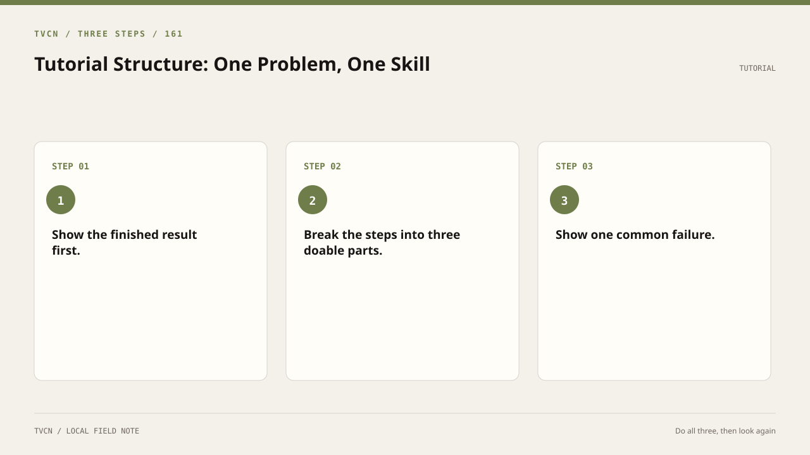

One problem, one skill. Three tricks in one tutorial means none is learned.

<!-- DIAGRAM_START -->
<h2>Diagram</h2>
<figure>
  
  <figcaption>Do the three steps in order, then look again at the image or file.</figcaption>
</figure>
<!-- DIAGRAM_END -->
<h2>On set</h2>

Teach one action: import media and set proxies. Do not also teach grading and subtitles.

<h2>Do this</h2>

A tutorial teaches one thing; three tips at once means the viewer learns none.
<ol><li>Teach one action: import footage and set proxies.</li><li>Show the finished result before breaking down steps.</li><li>Do not also cover grading and subtitles.</li></ol>
<h2>Avoid</h2>

Do not ramble while operating; viewers are following along.

<h2>Check</h2>
<ul><li>The whole piece teaches one action named in the title.</li><li>The finished result appears before steps.</li><li>No second topic such as grading or subtitles interrupts.</li></ul>

<!-- DEEP_DIVE_START -->
## Deep dive

<strong>About 6 minutes.</strong> A tutorial is not a display of skill. It is proof that the viewer can do it too.

### Show the result first

Show the finished result and the pass condition in the first ten seconds: what gets baked, exported, measured. Do not open with “hello, today I will share three tips.”

One problem, one lesson. Two goals in the title and the viewer no longer knows when they are done. State the final check up front and aim every step at it.

### Three steps, one failure

Each step gets one action, one setting, one failure point. Close-up on hands, screen capture for the interface, hold the key number for three seconds. Do not read ten settings in one breath.

Do it once complete, then break it down. The viewer needs the continuous process, not ten isolated tricks. You can speed up repetition, but never cut the cause and effect.

### Pass condition and template

End with a check the viewer can run: is the audio clipping, are subtitles over two lines, does the file open on the target machine? Add one common failure and its fix.

A downloadable checklist, settings sheet, or project file beats talk. If you cannot share a file, put the settings and order on screen so nobody has to pause and copy.

### Five-minute drill: teach one friend once

Pick a task that takes three minutes and teach it in three steps. Put the finished result and pass condition first. Ask a friend who has never done it to follow your steps without your help.

Note the three places they stop: which step is unclear, which setting they missed, which failure you did not warn about. Add those three places to the video; only then is the tutorial done.

### When it is done

Give someone who has not seen the video the footage and the materials, and say nothing. If they can produce the result and pass the check stated at the top, the tutorial is done. Where they get stuck, go back and add a close-up or a setting for that step.

### Ten tutorial checks
<ul><li>Finished result in ten seconds</li><li>One problem, one lesson</li><li>Pass condition stated up front</li><li>One action and one setting per step</li><li>Clear close-up or screen capture</li><li>Key number held for three seconds</li><li>Complete run before breakdown</li><li>Cause and effect never cut</li><li>Self-check at the end</li><li>Checklist or settings sheet provided</li></ul>
A tutorial succeeds when the viewer can produce a checkable result after the video ends.

<!-- DEEP_DIVE_END -->
