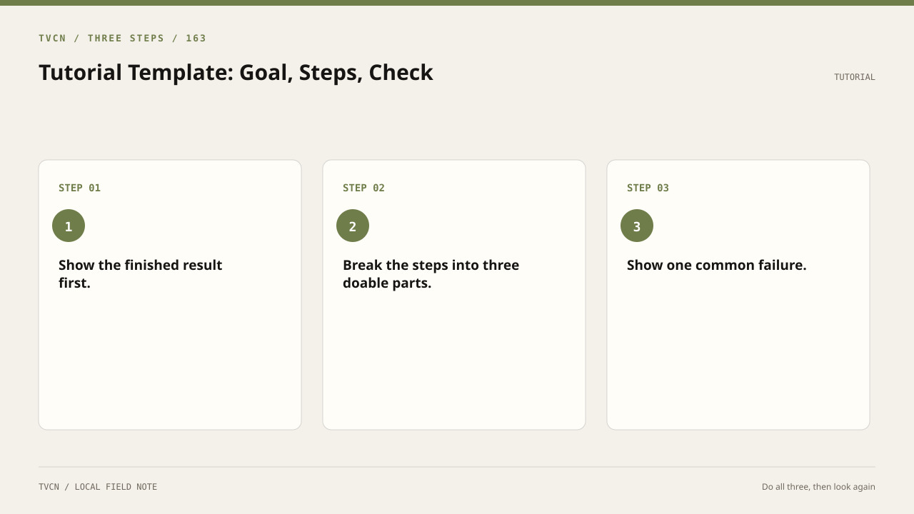

Goal, steps, check; every step needs an observable result.

<!-- DIAGRAM_START -->
<h2>Diagram</h2>
<figure>
  
  <figcaption>Do the three steps in order, then look again at the image or file.</figcaption>
</figure>
<!-- DIAGRAM_END -->
<h2>On set</h2>

Goal, three steps, check. Show the finished result before asking the viewer to follow.

<h2>Do this</h2>

A tutorial template uses goal, steps, acceptance; every step has an observable result.
<ol><li>State the goal: what the viewer will have at the end.</li><li>Split into three steps, each with an observable result.</li><li>Give acceptance: how viewers know they did it right.</li></ol>
<h2>Avoid</h2>

Do not use “when done” as acceptance; viewers do not know what done means.

<h2>Check</h2>
<ul><li>The opening states what the viewer will have.</li><li>Each of three steps has an observable result, such as an on-screen prompt.</li><li>Acceptance can be self-checked, not felt.</li></ul>
