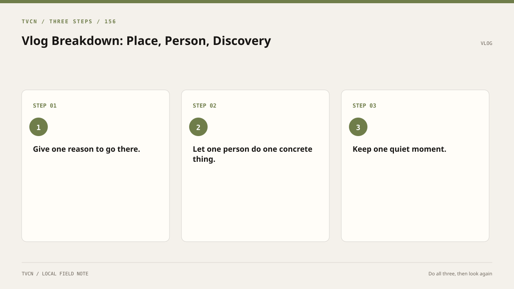

<!-- DIAGRAM_START -->
<h2>Diagram</h2>
<figure>
  
  <figcaption>The diagram is an entry point: watch the timecodes, then use the checks at the end.</figcaption>
</figure>
<!-- DIAGRAM_END -->
<h2>Fix Three Variables First</h2>
Fix three variables: ninety seconds, RED/Douyin, and the goal is one discovery. A vlog is not an itinerary; find the task, the failure, then the discovery.
<blockquote>
<strong>Sample note:</strong> the timecodes below are a teaching sample for this format's usual length. They do not correspond to one specific film and are not frame-accurate analysis. Use the same positions on your own film; do not treat these beats as the only answer.
</blockquote><h2>Timecode Breakdown: 8 Beats</h2>
Watch in order; do not read commentary first. For each beat record four things: picture, sound, job, and steal or do-not-copy.
<ol class="timecode-list"><li><strong>0:00–0:03</strong> | Picture: an action already happening: running, opening a door, boarding. Sound: ambience. Job: action first, no drone. Steal: action open. Do not copy: drone wide.</li><li><strong>0:03–0:10</strong> | Picture: place in three facts: where, with whom, what for. Sound: ambience plus one line. Job: set the task. Steal: three facts. Do not copy: voice-over history.</li><li><strong>0:10–0:25</strong> | Picture: first location does one thing: find, wait, ask, walk. Sound: ambience. Job: start the task. Steal: one complete action. Do not copy: three landmarks.</li><li><strong>0:25–0:45</strong> | Picture: obstacle: rain, closed door, wrong turn. Sound: room tightens. Job: make the task harder. Steal: real obstacle. Do not copy: manufacture drama.</li><li><strong>0:45–1:00</strong> | Picture: failure: wrong person/alley, keep eight seconds. Sound: dialogue/steps. Job: make discovery believable. Steal: one real failure. Do not copy: cut all failure.</li><li><strong>1:00–1:15</strong> | Picture: discovery: found/not found, one face/object. Sound: ambience plus one reaction. Job: give the film a landing. Steal: one concrete discovery. Do not copy: music faking emotion.</li><li><strong>1:15–1:25</strong> | Picture: quiet: one unguarded moment/empty frame. Sound: ambience. Job: let the pace land. Steal: one quiet shot. Do not copy: keep adding action.</li><li><strong>1:25–1:30</strong> | Picture: exit: person leaves/car goes/door closes. Sound: ambience out. Job: end. Steal: one exit action. Do not copy: add summary narration.</li></ol><h2>Read the Structure</h2>
The spine is action, place, task, obstacle, failure, discovery, quiet, exit. It is not “where I went,” but “what I looked for, what happened, what I found.”

Ask only three questions: what proof arrives in the first ten seconds; whether every ten to fifteen seconds adds information; whether the end lands one action, one change, or one question. If any is missing, a 90 sec film falls apart.
<h2>Budget Order of Magnitude</h2>
Budget is a rough mainland-China production range, excluding media spend; it is an order of magnitude, not a quote. At the same length, a stage, cast, effects, or music rights can each double the cost.
<ul><li>Low: RMB 1,000–3,000, one person, phone/one camera, one to two days.</li><li>Mid: RMB 3,000–10,000, one to two people, camera/stabilizer/mic, two to three days.</li><li>High: RMB 10,000–50,000+, three to five people, multi-camera/drone/post, three to seven days.</li></ul><h2>Three Structures You Can Steal</h2>
Steal structure, not images. These three still work when you change the subject.
<ol><li>Action in the first three seconds, no drone.</li><li>One thing per location.</li><li>Keep one failure so the discovery is believable.</li></ol><h2>Three Reasons Not to Copy</h2>
Not “bad,” but built on different conditions; copying exposes your budget, platform, and audience.
<ol><li>Do not copy itinerary editing: chronological order becomes a log.</li><li>Do not copy a drone at every location: it cuts the task.</li><li>Do not copy constant voice-over: it feels for the viewer.</li></ol><h2>Breakdown Exercises</h2>
Do them before shooting; do not just read. Do the three in order, and the third must become a fifteen-second file.
<ol><li>Write “what I looked for” and shoot only that.</li><li>Count locations; more than three, cut to two.</li><li>Watch muted; do task and failure still read?</li></ol>
<h2>Check</h2><ul><li>Action in the first three seconds, not a drone.</li><li>Within ten seconds: where, with whom, what for.</li><li>One thing per location.</li><li>One real obstacle.</li><li>One failure kept (at least five seconds).</li><li>One concrete discovery.</li><li>End on exit/quiet, not summary narration.</li></ul>
