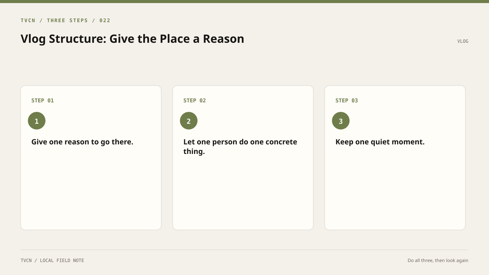

A vlog opens with “why I came here,” not an aerial landscape. State the reason in one line, then cut to the first action. Once the audience has a question, they tolerate the empty stretches of travel.

<!-- DIAGRAM_START -->
<h2>Diagram</h2>
<figure>
  
  <figcaption>Watch “Give a concrete reason in the first ten” and “Let one person do one specific thing instead”; judge whether the reason given in the first three seconds still holds at the end.</figcaption>
</figure>
<!-- DIAGRAM_END -->
<section><h2 id="section-1">Give the place a reason before the scenery</h2>
The middle needs at least one unplanned person or event; the end needs a visible small change, even deciding to stay for one meal. A change that only happens in narration is not believed.
<h2 id="section-2">Limits</h2>
A vlog is not a diary. Every section must answer “why shoot this now.” If it cannot, cut it.
</section><section><h2 id="section-3">On set</h2>
Give a concrete reason in the first ten seconds: a friend is waiting at this shop. Do not open with drone footage.
</section><section><h2 id="section-4">Do this</h2>
A travel vlog gives a reason for going before it looks pretty; without a reason, scenery is a screensaver.
<ol><li>Give a concrete reason in the first ten seconds, such as a friend waiting at this shop.</li><li>Let one person do one specific thing instead of only flying drone shots.</li><li>Keep one quiet moment and let ambient sound speak.</li></ol></section><section><h2 id="section-5">Avoid</h2>
Do not score the whole piece; ambient sound is the place.
</section><figure class="article-audio"><audio controls preload="none" src="../../../assets/audio/en/fmt-vlog.en.mp3"></audio><figcaption>20-second audio demo: one check point and the most common failure. Transcript and steps are in the article.</figcaption></figure><section><h2>Judge</h2>
Three signals are observable on set:
<ul><li>the first three seconds give a believable reason</li><li>the middle adds information or resistance, not just mood</li><li>the ending shows a visible change instead of narrating it</li></ul></section><section><h2>Failures</h2>
These three moves erase the detail you just built:
<ul><li>the template is filled but the person and problem are not</li><li>no reason in the first three seconds, only title and music</li><li>no visible change at the end, only voice-over</li></ul></section><section><h2>Extend</h2>
<strong>10-minute exercise:</strong> Break down one 30-second reference, mark the timecodes for “Give a concrete reason in the first ten” and “Let one person do one specific thing instead”, then answer: if one disappeared, would the film still hold?
</section>
<h2>Check</h2><ul><li>The first ten seconds name a concrete reason for visiting.</li><li>At least one person does a visible thing, not just scenery.</li><li>One stretch runs without score and lets location sound through.</li></ul>

<!-- DEEP_DIVE_START -->
## Deep dive

<strong>About 6 minutes.</strong> A travel vlog is not a landscape reel. It is one person doing one thing in one place, and something changing.

### Give the place a reason

Do not open with a drone panorama. Say why you came, what you are trying to do, and what might fail. The viewer follows a task; the landscape earns its place.

The place needs variables: weather, crowds, opening hours, stamina. A place without friction becomes a promo. Give today one small goal that must be completed.

### Five beats

Arrive, first action, turn, quiet moment, leave. No beat takes more than a quarter of the film. A turn is not an accident; it is how the person responds when the plan breaks.

The quiet moment lets the viewer breathe: sit down, look at the sea, wipe sweat, eat. No long narration. The exit answers the opening question: did it work, and what changed in the person?

### How to shoot it

Shoot the action first, then the empty frames. At each location get a main shot, a hand or foot detail, and one piece of ambient sound. Cut on the same action or sound; skip flashy transitions.

Handheld is fine if the walk is steady. Ask why the camera moves before it moves. Keep the cut between sixty and one hundred twenty seconds; subtitles carry key facts, and music never covers the room.

### Five-minute drill: three shots, one place

At one location, shoot three shots: what you see on arrival, one action you do, ten quiet seconds before leaving. One action each. No drone, no narration.

Cut them into thirty seconds and ask: does the viewer know why I came, what got done, where I go next? If not, add an opening or ending. Do not cover the gap with music.

### When it is done

After the cut, ask someone who was not there to repeat three things: what the day was for, which step failed, how it ended. If they can, the film is done. If not, add an action; do not explain it with narration.

### Ten travel-vlog checks
<ul><li>Why you came is clear up front</li><li>One concrete task for the day</li><li>The place has variables</li><li>All five beats are present</li><li>The turn is a human response</li><li>No long narration in the quiet beat</li><li>The exit answers the opening question</li><li>Main shot and detail at each location</li><li>Cut on action or sound</li><li>Music does not cover ambience</li></ul>
A travel vlog is not where you went; it is what got done while you were there.

<!-- DEEP_DIVE_END -->
<!-- SOURCES_START -->
