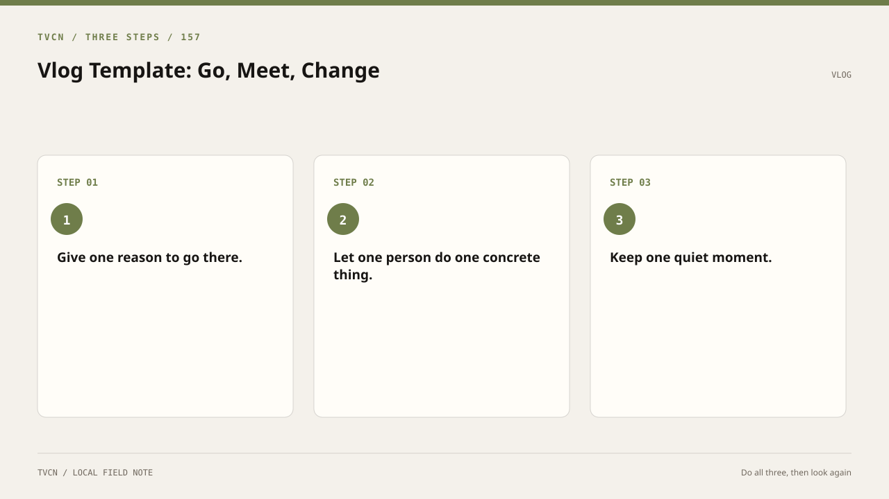

Go, meet, change. The change can be small, but it must happen.

<!-- DIAGRAM_START -->
<h2>Diagram</h2>
<figure>
  
  <figcaption>Do the three steps in order, then look again at the image or file.</figcaption>
</figure>
<!-- DIAGRAM_END -->
<h2>On set</h2>

Reason to go, someone or something met, one small change. The change can be deciding to stay for a meal.

<h2>Do this</h2>

A vlog template runs departure, encounter, change; the change can be small but must happen.
<ol><li>Open with the reason for departure.</li><li>Capture the person or event encountered, letting surprise in.</li><li>Land on a small change, such as deciding to stay for a meal.</li></ol>
<h2>Avoid</h2>

Do not put the change only in voiceover; if the picture does not change, viewers do not believe it.

<h2>Check</h2>
<ul><li>The opening states why the trip happens before scenery.</li><li>The middle includes an unplanned person or event.</li><li>The ending shows a visible small change without voiceover finishing it.</li></ul>
