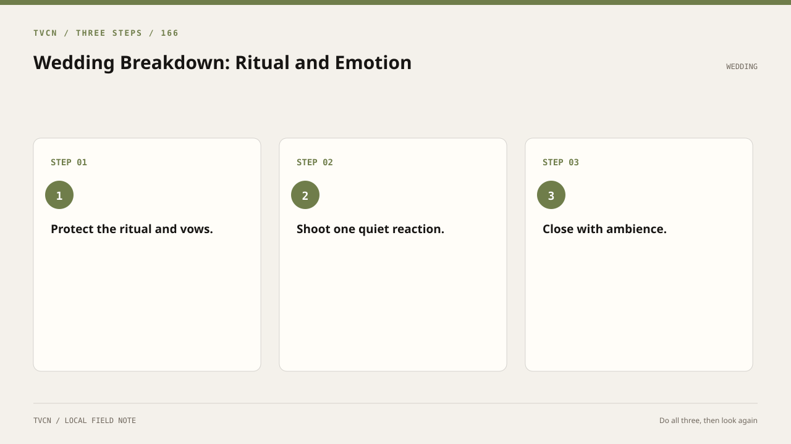

Watch ritual meet emotion: action then reaction, not a parade of smiles.

<!-- DIAGRAM_START -->
<h2>Diagram</h2>
<figure>
  
  <figcaption>Do the three steps in order, then look again at the image or file.</figcaption>
</figure>
<!-- DIAGRAM_END -->
<h2>On set</h2>

Find ceremony actions and reactions: hands with the ring, a parent's look. Do not only shoot smiles.

<h2>Do this</h2>

A wedding breakdown watches ritual action connect to reaction, not just smiles.
<ol><li>Find the ritual action: the ring hand, the exchange.</li><li>Find the reaction: a parent's eyes, a best man's pause.</li><li>Check whether action and reaction meet on the same cut.</li></ol>
<h2>Avoid</h2>

Do not shoot only smiles; smiles are results, action and reaction are process.

<h2>Check</h2>
<ul><li>A specific ritual action is nameable, such as the ring.</li><li>The action is followed by a reaction shot, not an immediate music cut.</li><li>Smile close-ups alone do not carry the emotion.</li></ul>
