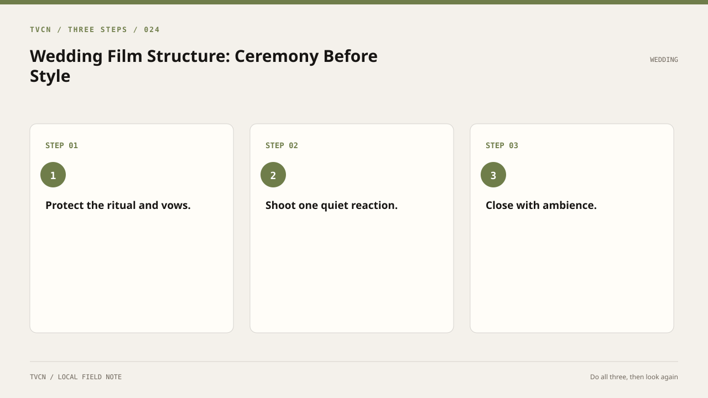

A wedding film starts from what happened today: one morning action, two separate preparations, the ceremony whole, the first embrace after. One action per section, not equal coverage of every ritual.

<!-- DIAGRAM_START -->
<h2>Diagram</h2>
<figure>
  
  <figcaption>Watch “Use two cameras: a wide master for the” and “Keep vows complete without slow motion.”; judge whether the reason given in the first three seconds still holds at the end.</figcaption>
</figure>
<!-- DIAGRAM_END -->
<section><h2 id="section-1">Use the actions of the day, not dress still lifes</h2>
Keep vows sync and pull the music back. The audience needs to hear what they said, not a song.
<h2 id="section-2">Limits</h2>
Do not write “happy forever” for them. A wedding film can be warm, but narration should not summarize their lives; leave one true line of their own.
</section><section><h2 id="section-3">On set</h2>
Cover the ceremony with two cameras: a wide for the flow, a close for hands and rings. Do not cut to slow motion during the vows.
</section><section><h2 id="section-4">Do this</h2>
A wedding film protects ceremony and vows before slow motion and grading; a missed ritual cannot be saved by style.
<ol><li>Use two cameras: a wide master for the flow, a close-up for hands and rings.</li><li>Keep vows complete without slow motion.</li><li>Then add one quiet reaction shot.</li></ol></section><section><h2 id="section-5">Avoid</h2>
Do not use slow motion instead of emotion; slow is not deep.
</section><figure class="article-audio"><audio controls preload="none" src="../../../assets/audio/en/fmt-wedding.en.mp3"></audio><figcaption>20-second audio demo: one check point and the most common failure. Transcript and steps are in the article.</figcaption></figure><section><h2>Judge</h2>
This page passes on three observable checks, not slogans:
<ul><li><strong>1.</strong> A wide master covers the ceremony without gaps.</li><li><strong>2.</strong> Vows run complete without slow motion or music cuts.</li><li><strong>3.</strong> At least one quiet reaction shot exists, not a posed smile.</li></ul></section><section><h2>Failures</h2>
Any one of these means stop and fix it before post:
<ul><li><strong>1.</strong> Check 1 is only staged (“A wide master covers the ceremony without gaps”); another camera position or location exposes it.</li><li><strong>2.</strong> Check 2 is left to post or a verbal explanation (“Vows run complete without slow motion or music…”); nothing on set can be rechecked.</li><li><strong>3.</strong> Do not use slow motion instead of emotion; slow is not deep.</li></ul></section><section><h2>Extend</h2>
<strong>10-minute exercise:</strong> Break down one 30-second reference, mark the timecodes for “Use two cameras: a wide master for the” and “Keep vows complete without slow motion.”, then answer: if one disappeared, would the film still hold?
</section>
<h2>Check</h2><ul><li>A wide master covers the ceremony without gaps.</li><li>Vows run complete without slow motion or music cuts.</li><li>At least one quiet reaction shot exists, not a posed smile.</li></ul>

<!-- DEEP_DIVE_START -->
## Deep dive

<strong>About 7 minutes.</strong> A wedding film is not a timeline of the day. Protect the ceremony, then find one quiet moment that shows the relationship.

### Protect the ceremony

Vows, rings, and parents’ reactions cannot be missed. Do not stand in the aisle; step back and use a long lens. Walk the order of service with the officiant and know the one second you cannot change a card.

Sound fails faster than image: one lav on each partner plus a recorder at the front. The vows need a backup. Do not rely on the on-camera mic.

### Find one quiet moment

The ten minutes before and after the ceremony usually hold the real material: one person fixing a collar, finding a ring, wiping a tear, breathing at the door. Do not pose them smiling at the camera.

The quiet moment needs an action and a relationship: who cares for whom, who waits, who lets go first. Once you have it, do not drown it in music; let the room breathe for three seconds.

### Structure

Preparation, ceremony, quiet moment, after. Three to eight minutes. Keep preparation under a third of the film, preserve the full vows, and close with two actions afterward.

Music never covers the vows; if the vows are unclear, the film is only atmosphere. Do not end with slow motion and a subtitle summary. Let the last action speak.

### Five-minute drill: ten seconds each for vows, rings, parents

Cut ten seconds each from existing wedding footage: one complete vow line, the ring going on, one parent’s reaction. All three must be audible without music covering them.

Then play the three together and ask the couple which feels most like them. The answer is often the quietest reaction, not the prettiest shot. Put that one near the end.

### When it is done

Show the couple the cut and ask which moment feels most like them and which line must stay. If they can point to one quiet reaction and explain why, the film is done. If they only praise the shots, you captured a schedule, not these two people.

### Ten wedding-film checks
<ul><li>Vows recorded complete</li><li>Ring exchange covered</li><li>Parents’ reactions captured</li><li>Camera not blocking the aisle</li><li>One lav per partner</li><li>Independent recorder at the front</li><li>One quiet moment found</li><li>That moment has action and relationship</li><li>Preparation under one third</li><li>Music never covers vows</li></ul>
A wedding film does not prove how much you covered; it proves you saw how two people care for each other.

<!-- DEEP_DIVE_END -->

<!-- SOURCES_START -->
## References and further reading

- [S14] [YouTube Community Guidelines](https://support.google.com/youtube/answer/2801973) — Accessed 2026-11-26. Used to check the terminology and public context in the opening paragraph (“Protect ceremony and vows before slow motion and grading; st”) against Current platform rules on misleading content, dangerous acts, copyright and disclosure; not a substitute for an on-set test.
- [S15] [TikTok Community Guidelines](https://www.tiktok.com/community-guidelines/en/) — Accessed 2026-11-26. Used to check the terminology and public context in the opening paragraph (“Protect ceremony and vows before slow motion and grading; st”) against Short-video platform rules on content, AI-generated media and commercial disclosure; not a substitute for an on-set test.
- [S16] [BBC Editorial Guidelines](https://www.bbc.co.uk/editorialguidelines/) — Accessed 2026-11-26. Used to check the terminology and public context in the opening paragraph (“Protect ceremony and vows before slow motion and grading; st”) against Editorial standards on accuracy, fairness, privacy and secret recording; not a substitute for an on-set test.
- [S29] [YouTube Upload Specs](https://support.google.com/youtube/answer/1722171) — Accessed 2026-11-26. Used to check the terminology and public context in the opening paragraph (“Protect ceremony and vows before slow motion and grading; st”) against Recommended resolution, bitrate, frame rate and audio codec; not a substitute for an on-set test.
<!-- SOURCES_END -->

