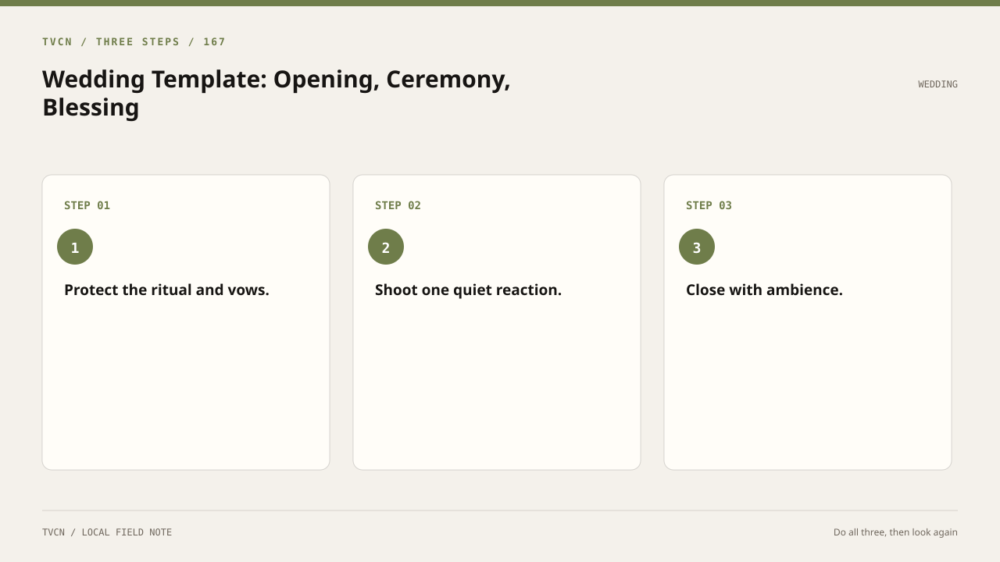

Opening, ceremony, blessing. The opening gives the day, not a dress close-up.

<!-- DIAGRAM_START -->
<h2>Diagram</h2>
<figure>
  
  <figcaption>Do the three steps in order, then look again at the image or file.</figcaption>
</figure>
<!-- DIAGRAM_END -->
<h2>On set</h2>

Open with the feel of the day, keep the ceremony complete, and leave one true sentence of blessing. No wedding-dress close-up opener.

<h2>Do this</h2>

A wedding template runs opening, ceremony, blessing; the opening gives the feel of the day, not a dress close-up.
<ol><li>Open with an action that sets the day, such as tying a tie in the morning.</li><li>Keep the ceremony whole and vows uncut.</li><li>Leave one true sentence in the blessing, not a stock phrase.</li></ol>
<h2>Avoid</h2>

Do not open on dress close-ups; clothing does not say what happened that day.

<h2>Check</h2>
<ul><li>The opening is an action or sound, not a dress still life.</li><li>The ceremony stays whole and vows are not chopped.</li><li>The ending holds one specific true sentence, not “happily ever after.”</li></ul>
