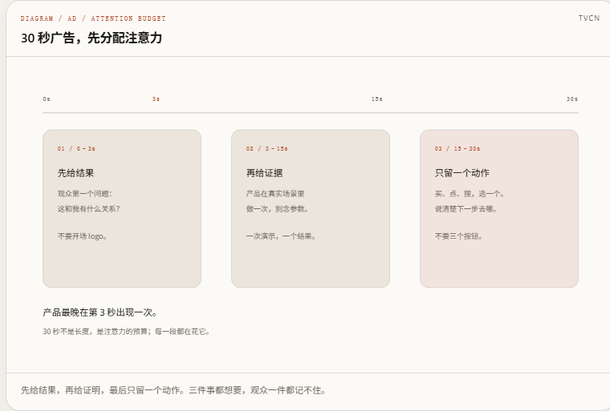

<!-- DIAGRAM_START -->
## 图解

<figure>
  
  <figcaption>先给结果，再给证明，最后只留一个动作。三件事都想要，观众一件都记不住。</figcaption>
</figure>
<!-- DIAGRAM_END -->

产品广告不是产品展示片。前三秒给问题，中段给一个卖点，结尾给一个动作。

## 前三秒

前三秒只做一件事：让目标用户认出“这说的是我”。用问题、结果或反常识画面，不要用品牌 logo 开场。

产品要在动作里出现，不要在台面上转圈。用户买的不是外形，是“用了之后发生了什么”。

## 一个卖点

15 秒只能讲一个卖点。把三个卖点排优先级，只留那个能被画面证明的。说“轻”就让人单手拎起来，说“稳”就放一杯水在上面。

形容词不值钱，证明才值钱。一个可验证的画面，胜过三句“高端品质”。

## 结尾

结尾给一个具体动作：点、买、领券、到店。不要只放 logo 和“了解更多”。如果平台不允许 CTA，就给一个可记住的搜索词。

15 秒结构：3 秒问题，7 秒证明，3 秒结果，2 秒动作。时间不够，先删证明里的重复，不要删问题。

## 3 条验收

- 前三秒能让目标用户认出问题。
- 只讲一个能被画面证明的卖点。
- 结尾有一个具体动作或可记住的搜索词。

<!-- DEEP_DIVE_START -->
## 深读

<strong>约 6 分钟。</strong> 产品广告不是参数表，是三秒让人认出问题，再用证据证明产品解决了它。

### 问题要具体

前三秒拍用户正在遇到的麻烦：油渍、断网、迟到、装不上；用用户的原话，不要用品牌内部术语。

一个片子只卖一个卖点；卖点要能被镜头证明，不是“更懂你”。先写一句“用了它，哪件事从不可能变成可能”。

### 证据三件套

演示：产品在画面里完成动作；对比：用前和用后同机位；第三方：数据、证书、真实用户。三个证据至少有两个，不要只摆参数。

产品是主角，手是配角；特写要能看到材质、按钮、接口。不要用一张产品图从头到尾，观众要看它工作。

### 一个行动

结尾只留一个动作：买、点、搜、看；不要同时放二维码、官网、电话、门店。十五秒版只留问题和证据，三十或六十秒版再加场景。

交付前静音看一遍：没有音乐和旁白，画面能不能讲清问题与证据；不能，就重拍演示。

### 五分钟练习：三秒问题，十秒证据

用手机拍两段：三秒问题（用户正在遇到的麻烦），十秒证据（产品在画面里完成一个动作）。中间不要加品牌 logo，也不要用旁白解释。

静音连放三遍，问旁边的人：他在解决什么问题、你信了吗。对方说不出问题，重拍第一段；说不出证据，重拍第二段。

### 什么时候算完成

静音播放一遍，再问一个人：产品解决了什么问题、你看见什么证据。两个答案都能用一句话说出来，片子才算完成；有一个含糊，就重拍对应的三秒或十秒，不要加字幕硬解释。

### 产品广告，十项检查
<ul><li>三秒内出现具体问题</li><li>只用用户能懂的话</li><li>一个片子只卖一个卖点</li><li>卖点能被镜头证明</li><li>产品在画面里完成动作</li><li>有同机位前后对比</li><li>至少两个证据</li><li>特写能看到材质或接口</li><li>结尾只有一个行动</li><li>静音也能看懂</li></ul>
产品广告不是夸产品，是让观众看见自己的问题被解决了一次。

<!-- DEEP_DIVE_END -->

<section><h2>边界</h2>
本页只解决「产品广告：三秒抓人，十秒讲清」这一个问题；不替代 产品广告拉片：问题怎么变成证据、产品广告模板：三秒问题、十秒证明、给演员调整：只给动词，不给形容词。如果现场问题属于后者，先读对应页，不要在本页继续加参数。
</section>
<!-- SOURCES_START -->
## 参考与延伸阅读

- [S14] [YouTube：社区准则](https://support.google.com/youtube/answer/2801973) — 2026-11-26 访问。用于核对「前三秒」一节的术语/方法/规则（YouTube 社区准则，不是内容创意标准）；不核对其中由本页经验得出的数字、型号与现场结论，也不替代测试。
- [S15] [TikTok：社区准则](https://www.tiktok.com/community-guidelines/en/) — 2026-11-26 访问。用于核对「一个卖点」一节的术语/方法/规则（TikTok 社区准则，不是内容创意标准）；不核对其中由本页经验得出的数字、型号与现场结论，也不替代测试。
- [S29] [YouTube：上传编码建议](https://support.google.com/youtube/answer/1722171) — 2026-11-26 访问。用于核对「结尾」一节的术语/方法/规则（YouTube 上传编码建议，不是创作标准）；不核对其中由本页经验得出的数字、型号与现场结论，也不替代测试。
<!-- SOURCES_END -->

