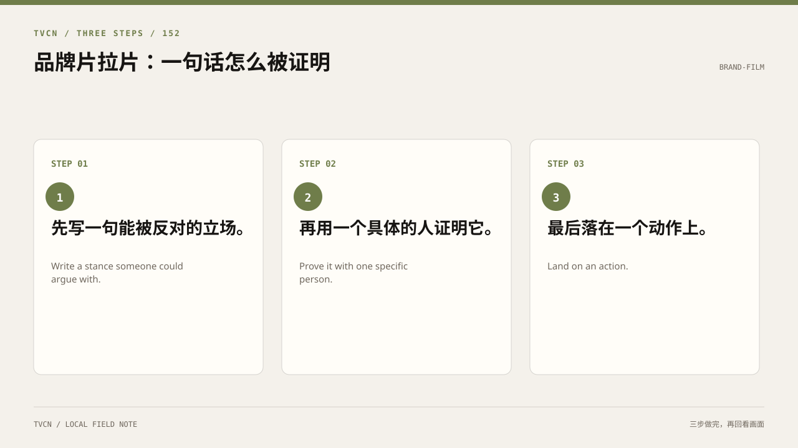

品牌片拉片看一句话怎么被证明；产品只是证据，不是主角。

<!-- DIAGRAM_START -->
<h2>图解</h2>
<figure>
  
  <figcaption>把三步按顺序做完，再回看画面或文件。</figcaption>
</figure>
<!-- DIAGRAM_END -->
<h2>现场</h2>

把主张写成一句能被反对的话；看每个镜头是在证明还是装饰。

<h2>怎么做</h2>

品牌片拉片看一句话怎么被证明；产品只是证据，不是主角。
<ol><li>把主张写成一句能被反对的话。</li><li>看每个镜头是在证明还是装饰。</li><li>数产品出现几次，每次有没有理由。</li></ol>
<h2>别踩</h2>

别用“匠心、热爱、梦想”填空；它们拍出来都一样。

<h2>验收</h2>
<ul><li>主张能被反对，不是人人同意的空话。</li><li>每个镜头能标成证明或装饰，装饰镜头不超过一半。</li><li>产品每次出现都有理由，不是每隔十秒露一次。</li></ul>
