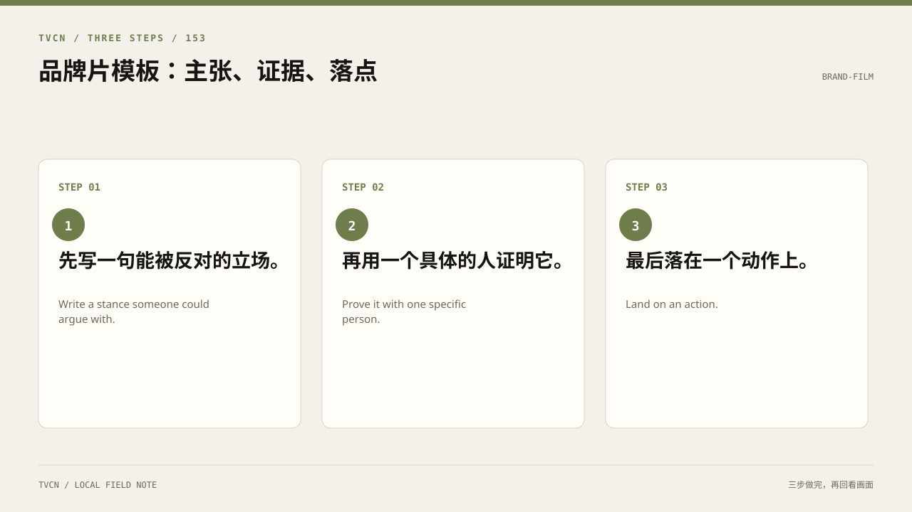

品牌片模板立场、证据、落点；立场要能被反对，证据要具体。

<!-- DIAGRAM_START -->
<h2>图解</h2>
<figure>
  
  <figcaption>把三步按顺序做完，再回看画面或文件。</figcaption>
</figure>
<!-- DIAGRAM_END -->
<h2>现场</h2>

主张要能反对，证据要具体到一个人，落点要是一个动作；不要用梦想、匠心。

<h2>怎么做</h2>

品牌片模板立场、证据、落点；立场要能被反对，证据要具体。
<ol><li>写一句能被反对的立场。</li><li>用一个具体的人证明它。</li><li>落在一个动作上，不要落在口号上。</li></ol>
<h2>别踩</h2>

别用梦想、匠心当主张；没有证据，它们只是词。

<h2>验收</h2>
<ul><li>立场能被反对，能举出一个反例。</li><li>证据具体到一个人和一个动作。</li><li>结尾落在一个动作，没有用口号收尾。</li></ul>
