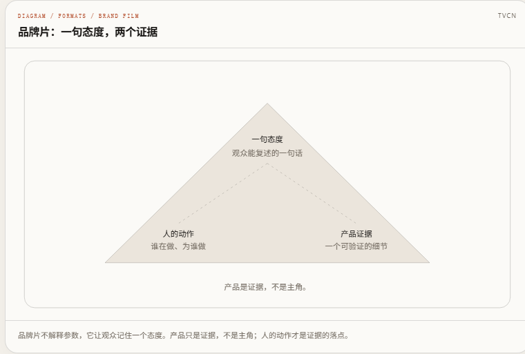

<!-- DIAGRAM_START -->
## 图解

<figure>
  
  <figcaption>品牌片不解释参数，它让观众记住一个态度。产品只是证据，不是主角；人的动作才是证据的落点。</figcaption>
</figure>
<!-- DIAGRAM_END -->

## 先写一句立场

品牌片的第一句话不是“我们成立于 1998 年”，而是一个可以被反对的态度。比如“慢一点，才看得见”。

立场越具体，越容易找到画面。空泛的“匠心”“热爱”，拍出来都一样。

## 用一个具体的人证明

不要用一群笑脸证明品牌。选一个人，拍他做一件具体的事，让产品在他的手里成为工具，而不是图腾。

产品出现的次数越少，出现的那一次越有分量。品牌片不是产品广告的长版。

## 结尾留一个动作

结尾不要总结“这就是我们的品牌”。留一个动作：关门、出发、回头、继续做。让观众自己把态度说出来。

品牌片可以没有旁白，但不能没有立场。没有立场的品牌片，只是一条更贵的宣传片。

## 3 条验收

- 能用一句话说出片子的立场，而且这句话可以被反对。
- 产品是证据，不是每个镜头的主角。
- 结尾停在动作上，没有口号总结。

<!-- DEEP_DIVE_START -->
## 深读

<strong>约 7 分钟。</strong> 品牌片不是企业简介，是一句立场，用一个具体的人或动作证明它。

### 先写一句能被反驳的立场

不要写“创新、品质、陪伴”，这些词谁都能用；写一句有人会不同意的立场，比如“慢一点，才做得完”。

立场要能被拍成动作：等人、返工、拒绝订单、把灯关掉。只有动作能证明，口号不能。

### 用一个人证明

选一个员工、用户或创始人，让他在具体场景做一件能体现立场的事；不要让他对着镜头念企业价值观。

产品是证据，不是主角；拍产品如何被使用、被修、被拒绝。拍一个人的手、桌面、工作台，比拍大楼有用。

### 落点

结尾回到开头那个动作，让观众看到代价或结果；不要用航拍加字幕总结。九十到一百八十秒，字幕少，音乐留白。

如果删掉品牌名，片子仍然成立，说明立场是真的；如果删掉品牌名就什么都不剩，重写。

### 五分钟练习：删掉品牌名还成立吗

写一句会被反驳的立场，再拍一个二十秒动作：一个人为了这句话多做了什么、放弃了什么。不要拍办公室，不要拍 logo。

把片子里的品牌名全部删掉，放给一个不知道客户的人看；他还能说出这句立场，才算成立。说不出，重写立场，不要加字幕解释。

### 什么时候算完成

把品牌名、logo、产品名全部去掉，再放给一个陌生人看。他还能用一句话说出这群人相信什么，片子才算完成；只能说出“拍得挺好”，就回去重写立场，不要加旁白总结。

### 品牌片，十项检查
<ul><li>立场能被反驳</li><li>立场能变成动作</li><li>只用一个主要人物</li><li>人物在具体场景做事</li><li>不念企业价值观</li><li>产品是证据不是主角</li><li>拍使用、修理或拒绝</li><li>结尾回到开头动作</li><li>删掉品牌名仍成立</li><li>不用航拍字幕总结</li></ul>
品牌片不是告诉别人你是谁，是让别人看见你愿意为什么付代价。

<!-- DEEP_DIVE_END -->
<!-- SOURCES_START -->
<h2>参考与延伸阅读</h2>

经验来源：TVCN 现场手册与项目复盘；实测来源：页面标注的复核环境与可复现练习；参考来源：以下公开链接。

<ul><li>[S14] YouTube 社区准则</li><li>[S15] TikTok 社区准则</li><li>[S16] BBC 编辑准则</li></ul>

<a href="../../about/">完整链接与用途见 SOURCES.md</a>

<!-- SOURCES_END -->
