<!-- DIAGRAM_START -->
<h2>图解</h2>
<figure>
  
  <figcaption>示意：时间、段落、画面、声音、作用，五列对齐看。</figcaption>
</figure>
<!-- DIAGRAM_END -->
<h2>样本说明：先别把它当真实客户</h2>
综合样例：一家做冷链仓储的公司。不是单一真实项目，按常见企业宣传结构合成；人物、数字与场景为示意。

拉片的目的不是背镜头，是看“每一拍靠什么成立”。如果你要交客户片，把示例里的数字、品牌、人物全部替换成你自己的素材与证据。
<h2>逐段拆解：五列对齐</h2>
先看时间，再看段落，最后看画面和声音是否服务同一个作用。任何一列对不上，这一段就会变成“好看但没用”。

<table class="data-table"><thead><tr><th>时间</th><th>段落</th><th>画面</th><th>声音</th><th>作用</th></tr></thead><tbody><tr><td>00:00–00:08</td><td>问题</td><td>仓库门口，温度计特写</td><td>环境声 + 一句话</td><td>让观众知道损失在发生</td></tr><tr><td>00:08–00:25</td><td>人物</td><td>夜班主管检查货架</td><td>现场声</td><td>让一个人承担问题</td></tr><tr><td>00:25–00:45</td><td>旧办法</td><td>手写记录、反复打电话</td><td>键盘/电话</td><td>让观众感到旧办法的代价</td></tr><tr><td>00:45–01:10</td><td>介入</td><td>系统屏幕 + 一个操作</td><td>提示音</td><td>只展示一个改变</td></tr><tr><td>01:10–01:35</td><td>结果</td><td>温度曲线、客户签字</td><td>安静</td><td>用证据收尾</td></tr><tr><td>01:35–01:45</td><td>下一步</td><td>主管关灯离开</td><td>环境声</td><td>不喊口号</td></tr></tbody></table>
<h2>镜头与声音：哪些能学，哪些别学</h2>
<strong>能学</strong>：同一动作的前后对比、手部近景、环境声转场、固定机位拍重复。<strong>别学</strong>：为了煽情加慢动作、用音乐盖住现场声、把示例数字当成果。镜头可以借，证据不能借。
<h2>三个可复用动作</h2>
1. 用同一个动作拍两次：一次失败、一次成功，剪在一起，观众自己会比较。2. 每 15 秒给一个手部/物件近景，让抽象 information 落地。3. 结尾不总结，留一个动作或一个问题，让下一集有入口。
<h2>失败与验收：拉片不是抄片</h2>
最常见的失败是“镜头很像，但证据是假的”。验收时问三句：这一段删掉会怎样？声音是否独立成立？结果能否被核对？三句里有两句答不上，就重拍或重剪。
<h2>验收</h2><ul><li>已标注“综合样例”，不冒充真实客户。</li><li>每段画面与声音服务同一作用。</li><li>至少一个前后对比可核对。</li><li>没有用音乐盖住关键现场声。</li><li>结尾没有总结，留了动作/问题。</li><li>删掉任意一段，结构仍成立。</li></ul>
<!-- SOURCES_START -->
<h2>参考与延伸阅读</h2>

经验来源：TVCN 现场手册与项目复盘；实测来源：页面标注的复核环境与可复现练习；参考来源：以下公开链接。

<ul><li>[S14] YouTube 社区准则</li><li>[S15] TikTok 社区准则</li><li>[S16] BBC 编辑准则</li></ul>

<a href="../../SOURCES.md">完整链接与用途见 SOURCES.md</a>

<!-- SOURCES_END -->
