<!-- DIAGRAM_START -->
<h2>图解</h2>
<figure>
  
  <figcaption>示意：六个拍点按顺序落地，缺一个就会变成素材堆。</figcaption>
</figure>
<!-- DIAGRAM_END -->
<h2>先判断：什么时候用</h2>
先别记结论：企业宣传结构：六个拍点 这一页只回答一个现场问题——条件成立时怎么做，条件不成立时在哪一步停下。读完后拿自己的素材复述一次，能复述才算读懂。

适合：有一个明确对象、一个动作、一个能在成片里看见的变化。不适合：只有一句品牌口号、没有人物、也没有可拍过程的项目；那种项目先回去写 brief，不要先开机。
<h2>六拍结构：每一拍只做一件事</h2>
把六拍写成六句话，每句话都要能回答“观众此刻知道什么”。拍的时候按顺序拍，但剪辑时可以打乱；不要为了凑结构硬加空镜。
<ol><li>一个具体问题</li><li>一个人出场</li><li>旧办法失败</li><li>公司介入</li><li>可验证结果</li><li>一个下一步</li></ol><h2>镜头怎么落：六个任务</h2>
每一拍至少一个主镜头，不要用一个机位拍完再靠跳剪。先拍不可替代的动作（手、脸、机器），再拍可补的空镜。
<ul><li>问题：手部/桌面近景，不拍 logo</li><li>人物：中景，先做事再说话</li><li>失败：同一动作重复，节奏变慢</li><li>介入：产品/流程只占一个镜头</li><li>结果：前后对比或第三方证词</li><li>收尾：人物离开，留下一个动作</li></ul><h2>常见失败：三种拍法会塌</h2>
<strong>1. 先拍 logo/航拍</strong>：观众不知道自己在看谁。把第一拍换成问题或动作。<strong>2. 每拍都加旁白</strong>：画面没有承担信息。让一个动作自己说话。<strong>3. 结果不可验证</strong>：只说“效率提升”，没有前后对比/第三方。拍一个能核对的东西。
<h2>成本与验收：一天能不能拍完</h2>
这类片子通常 1 个拍摄日 + 2–3 个后期日：半天拍主镜头，半天拍空镜/补拍；后期先粗剪结构，再配声音。验收只看三件事：六拍是否完整、每一拍是否有主镜头、结果是否能被核对。不要用“感觉高级”当验收。
<h2>验收</h2><ul><li>六拍每一拍都能用一句话说清。</li><li>第一拍是问题/动作，不是 logo。</li><li>每拍至少一个主镜头。</li><li>结果有前后对比或第三方。</li><li>至少拍到一个不可替代的动作。</li><li>粗剪后六拍仍完整。</li></ul>

<!-- SOURCES_START -->
## 参考与延伸阅读

- [S14] [YouTube 社区准则](https://support.google.com/youtube/answer/2801973) — 2026-11-26 访问。用于核对首段“企业宣传不是公司简介视频。先写一个观众愿意看完的问题，再用一个人、一个动作证明公司解决了它。”中的术语与公开背景（平台对误导、危险行为、版权与披露的现行规则）；不替代现场测试。
- [S15] [TikTok 社区准则](https://www.tiktok.com/community-guidelines/en/) — 2026-11-26 访问。用于核对首段“企业宣传不是公司简介视频。先写一个观众愿意看完的问题，再用一个人、一个动作证明公司解决了它。”中的术语与公开背景（短视频平台的 content、AI 生成与商业披露规则）；不替代现场测试。
- [S16] [BBC 编辑准则](https://www.bbc.co.uk/editorialguidelines/) — 2026-11-26 访问。用于核对首段“企业宣传不是公司简介视频。先写一个观众愿意看完的问题，再用一个人、一个动作证明公司解决了它。”中的术语与公开背景（准确性、公正、隐私与隐蔽拍摄的编辑标准）；不替代现场测试。
- [S29] [YouTube 上传规格](https://support.google.com/youtube/answer/1722171) — 2026-11-26 访问。用于核对首段“企业宣传不是公司简介视频。先写一个观众愿意看完的问题，再用一个人、一个动作证明公司解决了它。”中的术语与公开背景（分辨率、码率、帧率与音频编码建议）；不替代现场测试。
<!-- SOURCES_END -->

