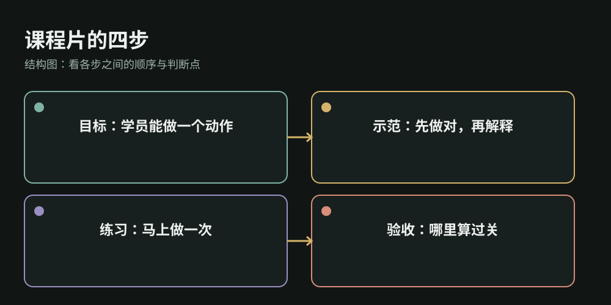

课程视频最容易被“讲完”骗过去：老师讲了 12 分钟，画面清楚，字幕准确，学员看完点头。第二天让他拍一段，他还是不会。问题不在信息量，在课程没有设计“学员做什么”。

<!-- DIAGRAM_START -->
<h2 id="diagram">图解</h2>
<figure class="diagram">
  
  <figcaption>看“目标、示范、练习、验收”四步是否都在片子里；只讲不练的课程，学员只能记住，不能学会。</figcaption>
</figure>
<!-- DIAGRAM_END -->

<section><h2 id="section-1">现场</h2>
一套 5 节摄影课，每节 12 分钟，讲曝光三角、白平衡、构图、收音、剪辑。老师讲得很细，PPT 也漂亮。学员看完做作业，交上来的画面仍然过曝。回访发现：学员知道“高光要保住”，但不知道在自己的相机上按哪个键看波形。
</section>
<section><h2 id="section-2">判断</h2><ul><li><strong>目标是否可做：</strong>“理解曝光”不可验收；“能在自己的相机上打开波形并调一档”可以。</li><li><strong>练习是否在片内：</strong>视频里有没有让学员暂停去做一次；没有练习，信息只是过眼。</li><li><strong>错误示范是否具体：</strong>不是“不要过曝”，而是“高光贴顶时，波形哪一段变红”。</li><li><strong>验收是否可判断：</strong>学员能自己说“过了/没过”，不用等老师。</li></ul></section>
<section><h2 id="section-3">怎么做</h2><ol><li>写一个可做目标：看完这一节，学员能在自己设备上完成一个动作，限 10 分钟。</li><li>先示范再做：开场 30 秒直接做对一次，让学员看见结果；再解释为什么。</li><li>一节只教一个动作：曝光、收音、构图分开；不要在一节里塞三个新概念。</li><li>片中留练习：说到关键处，字幕提示“暂停，做一次”，给 3 个检查点。</li><li>给验收：一张 3 行表，学员自己填“做了/没做/哪里卡住”；下一节从卡住的地方开始。</li></ol></section>
<section><h2 id="section-4">失败</h2><ul><li><strong>念 PPT：</strong>老师把幻灯片读完，学员把概念抄完，没有人做一次。</li><li><strong>信息过载：</strong>12 分钟塞 8 个概念，学员记住第一个，后面的都糊。</li><li><strong>没有错误示范：</strong>只给正确答案，学员遇到自己的设备就不知道错在哪。</li></ul></section>
<section><h2 id="section-5">边界</h2>
这套结构适合技能型课程：摄影、剪辑、录音、软件操作；不适合纯理论、历史或观念课，那些需要论证和阅读。课程片也不能替代完整课程：它负责一个动作，不负责一个学期的能力体系。复杂技能要拆成多节，每节一个动作。
</section>
<section><h2 id="section-6">验收</h2><ul><li>每个学员能说出这一节的可做目标。</li><li>片中至少有一次暂停练习，学员真的做了。</li><li>学员能自己判断“过关/没过”，不用问老师。</li><li>下一节从学员卡住的地方开始，不从第一页重讲。</li></ul></section>
<!-- DEEP_DIVE_START -->
## 深读

<strong>约 8 分钟。</strong> 下面把同一套判断放进两个不同条件，再看一个反例和一个可复用模型；不是重复前文，而是决定什么时候该换做法。

### 条件 A：线上自学

线上自学没有老师在旁边，课程要把“环境”也设计进去。学员用什么相机、什么软件、什么版本，先假设最普通的那一种；每个操作给出菜单路径和快捷键两种说法，避免版本差异。练习要能在 10 分钟内完成，不能要求布景、演员或外拍。

线上课程最容易高估学员的动手能力：老师觉得“打开波形”是常识，学员找不到。解决方法是录屏时把手指或光标留在按键上 2 秒，字幕写出按键名称；不要快速划过菜单。

### 条件 B：线下工作坊

线下工作坊有老师在现场，课程视频不该再承担“讲完”，应该承担“示范”和“回放”。开场用 2 分钟视频演示一个动作，然后让学员做，老师巡场；学员卡住时，回到视频的对应时间码，不用老师重复讲。

工作坊的验收要当众做一次：每个学员在 3 分钟内完成动作，其他人看。当众做会暴露“以为会了”的幻觉；老师记录卡住的位置，下一轮课程直接补那一分钟，不补整节。

### 反例：学员点头，但做不出

一节 15 分钟的剪辑课，老师讲了轨道、素材箱、入出点、波纹删除。学员看完说“懂了”。作业是剪一个 30 秒片段，交上来的片子没有一次 J-cut，入出点全在台词中间。学员不是没听，是没有在片子里做过一次。

修法不是再讲一遍，而是在讲到 J-cut 时停下来，让学员用同一段素材做一次：声音先进 12 帧，画面后进。做完再继续。课程时长增加 3 分钟，作业质量翻倍。

### 可复用模型

<strong>目标 → 示范 → 练习 → 验收。</strong> 目标是“能做一个动作”；示范是“先看结果”；练习是“马上做一次”；验收是“自己判断过关”。四步都在片子里，课程才不是讲座。

每节课只保留一个动作，其他内容写成“下一节”或“附录”。删掉的内容不是浪费，是让学员这一次真的学会。学员学会一个动作，才有信心回来学第二个。

<!-- DEEP_DIVE_END -->
<!-- SOURCES_START -->
## 参考与延伸阅读

- [S42] [Khan Academy：Pixar in a Box](https://www.khanacademy.org/partner-content/pixar) — 2026-11-26 访问。用于核对“判断”一节的术语、方法或规则；不核对本页由经验得出的数字、型号与现场结论，也不替代测试或合同。
- [S16] [BBC 编辑准则：BBC 编辑准则](https://www.bbc.co.uk/editorialguidelines/) — 2026-11-26 访问。用于核对“边界”一节的术语、方法或规则；不核对本页由经验得出的数字、型号与现场结论，也不替代测试或合同。
<!-- SOURCES_END -->
