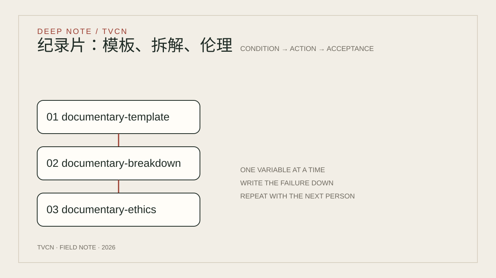

纪录片不是把真实拍下来；模板、拆解和伦理决定你保留了谁的声音。 单看《纪录模板：一个人、一件事、一个变化》只能解决一个局部；把《纪录模板：一个人、一件事、一个变化》《纪录短片拉片：一个人、一件事、一个变化》《纪录片伦理：拍脆弱的人》接成一条链，才会暴露“条件没写、变量太多、结果无法复现”的真问题。

<!-- DEEP_DIVE_START -->
<!-- DIAGRAM_START -->
<h2>图解</h2>
<figure>
  
  <figcaption>看“纪录模板：一个人、一件事、一个变化”和“纪录短片拉片：一个人、一件事、一个变化”两处，先定条件，再看失败能不能被记录下来。</figcaption>
</figure>
<!-- DIAGRAM_END -->

<section><h2 id="section-1">问题</h2>
这一页的问题不是“方法不够多”，而是三个环节各自成立、合起来却不成立：条件没写、变量太多、结果不能复现。

本页按“先定条件—再做判断—只改一个变量—留下证据”的顺序；每一步都能被下一个人复述，才算完成。
</section>
<section><h2 id="section-2">判断</h2><ul><li>《纪录模板：一个人、一件事、一个变化》的第一道门槛：片中有一个人和一件正在做的事</li><li>《纪录短片拉片：一个人、一件事、一个变化》的第二道门槛：采访没有出现在最前面，先看到动作</li><li>《纪录片伦理：拍脆弱的人》的第三道门槛：有一个能看见的变化，不只是人物自己说。”</li></ul>
三条里有一条不成立，就先回到对应单页；不要用整条链掩盖一个没解决的单点。
</section>
<section><h2 id="section-3">做法</h2><ol><li>先写条件：把《纪录模板：一个人、一件事、一个变化》里“选一个人和一件正在做的事”落到一张三行表：素材、环境、验收。</li><li>再做一次最小动作：只按《纪录模板：一个人、一件事、一个变化》的步骤做 30 秒，不加入第二页的方法。</li><li>把《纪录短片拉片：一个人、一件事、一个变化》的步骤接上：先拍他做事，不先拍采访。</li><li>用《纪录片伦理：拍脆弱的人》做对照：等一个能看见的变化发生，再决定结构。</li><li>每改一次只动一个变量；其他条件写进记录，不靠记忆。</li><li>把失败也拍下来：失败版本和成功版本并排，才知道哪一步不能省。</li><li>让下一个人按记录复现一次；他做不出来，说明记录还不够。</li></ol></section>
<section><h2 id="section-4">现场案例</h2>
可复现实验（不是客户案例）：拿 30 秒素材，先按《纪录模板：一个人、一件事、一个变化》的“片中有一个人和一件正在做的事”做 A 版；再按《纪录短片拉片：一个人、一件事、一个变化》的“采访没有出现在最前面，先看到动作”做 B 版；两版只允许一个变量不同。把两版并排看，记录《纪录片伦理：拍脆弱的人》里最先崩的是哪一项：条件、动作还是验收。如果一次就成功，说明变量还不够多，再加一个现实限制重做。
</section>
<section><h2 id="section-5">失败表</h2>
<table class="data-table"><thead><tr><th>现象</th><th>原因</th><th>替换动作</th></tr></thead><tbody><tr><td>别拿“他同意了”当伦理过关；他可能不知道上线后谁能看到</td><td>条件没写清</td><td>回到第一页重写三行表</td></tr><tr><td>只看结果，不记条件</td><td>条件没写清</td><td>回到第一页重写三行表</td></tr><tr><td>只看结果，不记条件</td><td>条件没写清</td><td>回到第一页重写三行表</td></tr></tbody></table>
</section>
<section><h2 id="section-6">验收</h2><ul><li>片中有一个人和一件正在做的事。</li><li>采访没有出现在最前面，先看到动作。</li><li>有一个能看见的变化，不只是人物自己说。”</li><li>前 10 秒有一个正在发生的动作。</li><li>人物、地点、任务三个信息在 30 秒内清楚。</li><li>欲望是一个可拍的东西，不是抽象理想。</li><li>阻碍自然发生，没有假冲突。</li><li>至少有一次完整尝试。</li><li>变化后的同一个动作与开头不同。</li><li>结尾没有总结旁白。</li></ul></section>
<section><h2 id="section-7">替代方案</h2><ul><li>只处理《纪录模板：一个人、一件事、一个变化》里的单点问题：回到<a href="https://formats.tvcn.org/article/documentary-template/">《纪录模板：一个人、一件事、一个变化》</a>，不要用整条链。</li><li>只比较两个动作：看<a href="https://formats.tvcn.org/article/documentary-breakdown/">《纪录短片拉片：一个人、一件事、一个变化》</a>，先不改第三页。</li><li>只做验收：看<a href="https://context.tvcn.org/article/documentary-ethics/">《纪录片伦理：拍脆弱的人》</a>，把判断表拿去做自测。</li></ul></section>

<!-- SOURCES_START -->
## 参考与延伸阅读

- [S12] [Britannica](https://www.britannica.com/art/animation) — 2026-11-26 访问。用于核对首段“纪录片不是把真实拍下来；模板、拆解和伦理决定你保留了谁的声音。”中的术语与公开背景（动画原理、技术与产业史的百科条目）；不替代现场测试。
- [S14] [YouTube 社区准则](https://support.google.com/youtube/answer/2801973) — 2026-11-26 访问。用于核对首段“纪录片不是把真实拍下来；模板、拆解和伦理决定你保留了谁的声音。”中的术语与公开背景（平台对误导、危险行为、版权与披露的现行规则）；不替代现场测试。
- [S15] [TikTok 社区准则](https://www.tiktok.com/community-guidelines/en/) — 2026-11-26 访问。用于核对首段“纪录片不是把真实拍下来；模板、拆解和伦理决定你保留了谁的声音。”中的术语与公开背景（短视频平台的 content、AI 生成与商业披露规则）；不替代现场测试。
- [S16] [BBC 编辑准则](https://www.bbc.co.uk/editorialguidelines/) — 2026-11-26 访问。用于核对首段“纪录片不是把真实拍下来；模板、拆解和伦理决定你保留了谁的声音。”中的术语与公开背景（准确性、公正、隐私与隐蔽拍摄的编辑标准）；不替代现场测试。
- [S29] [YouTube 上传规格](https://support.google.com/youtube/answer/1722171) — 2026-11-26 访问。用于核对首段“纪录片不是把真实拍下来；模板、拆解和伦理决定你保留了谁的声音。”中的术语与公开背景（分辨率、码率、帧率与音频编码建议）；不替代现场测试。
<!-- SOURCES_END -->

