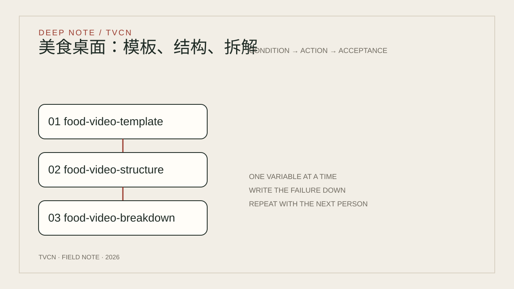

美食片不是食物特写合集；桌面、声音和 30 秒动作顺序决定它好不好吃。 单看《美食桌面模板：一张表拍完》只能解决一个局部；把《美食桌面模板：一张表拍完》《美食桌面结构：六个拍点》《美食桌面拉片：六个段落怎么落地》接成一条链，才会暴露“条件没写、变量太多、结果无法复现”的真问题。

<!-- DEEP_DIVE_START -->
<!-- DIAGRAM_START -->
<h2>图解</h2>
<figure>
  
  <figcaption>看“美食桌面模板：一张表拍完”和“美食桌面结构：六个拍点”两处，先定条件，再看失败能不能被记录下来。</figcaption>
</figure>
<!-- DIAGRAM_END -->

<section><h2 id="section-1">问题</h2>
这一页的问题不是“方法不够多”，而是三个环节各自成立、合起来却不成立：条件没写、变量太多、结果不能复现。

本页按“先定条件—再做判断—只改一个变量—留下证据”的顺序；每一步都能被下一个人复述，才算完成。
</section>
<section><h2 id="section-2">判断</h2><ul><li>《美食桌面模板：一张表拍完》的第一道门槛：把 美食桌面模板：一张表拍完 的条件写成一行，能复述给下一个人</li><li>《美食桌面结构：六个拍点》的第二道门槛：只改一个变量，另一页的结果还能复现</li><li>《美食桌面拉片：六个段落怎么落地》的第三道门槛：失败现象能被记录成“条件—动作—结果”，不是一句感觉</li></ul>
三条里有一条不成立，就先回到对应单页；不要用整条链掩盖一个没解决的单点。
</section>
<section><h2 id="section-3">做法</h2><ol><li>先写条件：把《美食桌面模板：一张表拍完》里“能做/不能做”落到一张三行表：素材、环境、验收。</li><li>再做一次最小动作：只按《美食桌面模板：一张表拍完》的步骤做 30 秒，不加入第二页的方法。</li><li>把《美食桌面结构：六个拍点》的步骤接上：只改一个变量，保持其他条件不变。</li><li>用《美食桌面拉片：六个段落怎么落地》做对照：再拍一条同条件版本，比较差异。</li><li>每改一次只动一个变量；其他条件写进记录，不靠记忆。</li><li>把失败也拍下来：失败版本和成功版本并排，才知道哪一步不能省。</li><li>让下一个人按记录复现一次；他做不出来，说明记录还不够。</li></ol></section>
<section><h2 id="section-4">现场案例</h2>
可复现实验（不是客户案例）：拿 30 秒素材，先按《美食桌面模板：一张表拍完》的“把 美食桌面模板：一张表拍完 的条件写成一行，能复述给下一个人”做 A 版；再按《美食桌面结构：六个拍点》的“只改一个变量，另一页的结果还能复现”做 B 版；两版只允许一个变量不同。把两版并排看，记录《美食桌面拉片：六个段落怎么落地》里最先崩的是哪一项：条件、动作还是验收。如果一次就成功，说明变量还不够多，再加一个现实限制重做。
</section>
<section><h2 id="section-5">失败表</h2>
<table class="data-table"><thead><tr><th>现象</th><th>原因</th><th>替换动作</th></tr></thead><tbody><tr><td>1. 先拍 logo/航拍：观众不知道自己在看谁。把第一拍换成问题或动作。2. 每拍都加旁白：画面没有承担信息…</td><td>条件没写清</td><td>回到第一页重写三行表</td></tr><tr><td>最常见的失败是“镜头很像，但证据是假的”。验收时问三句：这一段删掉会怎样？声音是否独立成立？结果能否被核对？三…</td><td>条件没写清</td><td>回到第一页重写三行表</td></tr><tr><td>只看结果，不记条件</td><td>条件没写清</td><td>回到第一页重写三行表</td></tr></tbody></table>
</section>
<section><h2 id="section-6">验收</h2><ul><li>把 美食桌面模板：一张表拍完 的条件写成一行，能复述给下一个人。</li><li>只改一个变量，另一页的结果还能复现。</li><li>失败现象能被记录成“条件—动作—结果”，不是一句感觉。</li><li>下一位同事不问你，也能按记录做出同一版。</li></ul></section>
<section><h2 id="section-7">替代方案</h2><ul><li>只处理《美食桌面模板：一张表拍完》里的单点问题：回到<a href="https://formats.tvcn.org/article/food-video-template/">《美食桌面模板：一张表拍完》</a>，不要用整条链。</li><li>只比较两个动作：看<a href="https://formats.tvcn.org/article/food-video-structure/">《美食桌面结构：六个拍点》</a>，先不改第三页。</li><li>只做验收：看<a href="https://formats.tvcn.org/article/food-video-breakdown/">《美食桌面拉片：六个段落怎么落地》</a>，把判断表拿去做自测。</li></ul></section>
