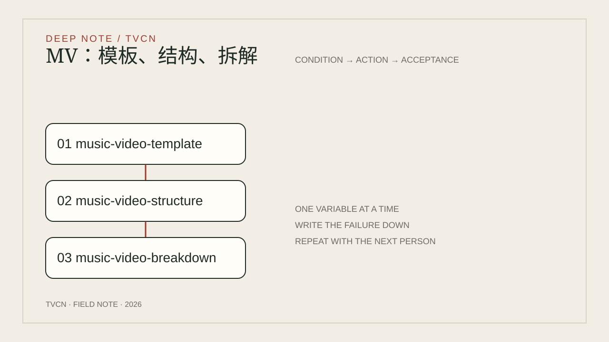

MV 不是把歌配画面；结构、表演和剪辑点要跟着音乐走，而不是跟着台词走。 单看《MV 模板：主歌、副歌、记忆点》只能解决一个局部；把《MV 模板：主歌、副歌、记忆点》《MV 结构：歌是时间轴》《MV 拉片：歌的结构怎么变成画面》接成一条链，才会暴露“条件没写、变量太多、结果无法复现”的真问题。

<!-- DEEP_DIVE_START -->
<!-- DIAGRAM_START -->
<h2>图解</h2>
<figure>
  
  <figcaption>看“MV 模板：主歌、副歌、记忆点”和“MV 结构：歌是时间轴”两处，先定条件，再看失败能不能被记录下来。</figcaption>
</figure>
<!-- DIAGRAM_END -->

<section><h2 id="section-1">问题</h2>
这一页的问题不是“方法不够多”，而是三个环节各自成立、合起来却不成立：条件没写、变量太多、结果不能复现。

本页按“先定条件—再做判断—只改一个变量—留下证据”的顺序；每一步都能被下一个人复述，才算完成。
</section>
<section><h2 id="section-2">判断</h2><ul><li>《MV 模板：主歌、副歌、记忆点》的第一道门槛：主歌能看出人在哪个空间</li><li>《MV 结构：歌是时间轴》的第二道门槛：副歌的记忆动作出现至少两次，能被记住</li><li>《MV 拉片：歌的结构怎么变成画面》的第三道门槛：桥段换了空间或人物关系，不只是音乐变轻</li></ul>
三条里有一条不成立，就先回到对应单页；不要用整条链掩盖一个没解决的单点。
</section>
<section><h2 id="section-3">做法</h2><ol><li>先写条件：把《MV 模板：主歌、副歌、记忆点》里“主歌给空间，让观众知道人在哪里”落到一张三行表：素材、环境、验收。</li><li>再做一次最小动作：只按《MV 模板：主歌、副歌、记忆点》的步骤做 30 秒，不加入第二页的方法。</li><li>把《MV 结构：歌是时间轴》的步骤接上：副歌给一个能重复的记忆动作。</li><li>用《MV 拉片：歌的结构怎么变成画面》做对照：桥段给转折，换空间或换关系。</li><li>每改一次只动一个变量；其他条件写进记录，不靠记忆。</li><li>把失败也拍下来：失败版本和成功版本并排，才知道哪一步不能省。</li><li>让下一个人按记录复现一次；他做不出来，说明记录还不够。</li></ol></section>
<section><h2 id="section-4">现场案例</h2>
可复现实验（不是客户案例）：拿 30 秒素材，先按《MV 模板：主歌、副歌、记忆点》的“主歌能看出人在哪个空间”做 A 版；再按《MV 结构：歌是时间轴》的“副歌的记忆动作出现至少两次，能被记住”做 B 版；两版只允许一个变量不同。把两版并排看，记录《MV 拉片：歌的结构怎么变成画面》里最先崩的是哪一项：条件、动作还是验收。如果一次就成功，说明变量还不够多，再加一个现实限制重做。
</section>
<section><h2 id="section-5">失败表</h2>
<table class="data-table"><thead><tr><th>现象</th><th>原因</th><th>替换动作</th></tr></thead><tbody><tr><td>别把每句歌词都拍成插画；那是配图，不是 MV</td><td>条件没写清</td><td>回到第一页重写三行表</td></tr><tr><td>只看结果，不记条件</td><td>条件没写清</td><td>回到第一页重写三行表</td></tr><tr><td>只看结果，不记条件</td><td>条件没写清</td><td>回到第一页重写三行表</td></tr></tbody></table>
</section>
<section><h2 id="section-6">验收</h2><ul><li>主歌能看出人在哪个空间。</li><li>副歌的记忆动作出现至少两次，能被记住。</li><li>桥段换了空间或人物关系，不只是音乐变轻。</li><li>主歌、副歌、桥段的时间点标在时间线上。</li><li>主歌镜头明显更长，副歌切点更密。</li><li>副歌有一个能重复的记忆动作，不靠歌词字幕。</li><li>歌被拆成明确段落</li><li>每段只有一个情绪任务</li><li>有一个记忆点</li><li>三个视觉母题</li></ul></section>
<section><h2 id="section-7">替代方案</h2><ul><li>只处理《MV 模板：主歌、副歌、记忆点》里的单点问题：回到<a href="https://formats.tvcn.org/article/music-video-template/">《MV 模板：主歌、副歌、记忆点》</a>，不要用整条链。</li><li>只比较两个动作：看<a href="https://formats.tvcn.org/article/music-video-structure/">《MV 结构：歌是时间轴》</a>，先不改第三页。</li><li>只做验收：看<a href="https://formats.tvcn.org/article/music-video-breakdown/">《MV 拉片：歌的结构怎么变成画面》</a>，把判断表拿去做自测。</li></ul></section>

<!-- SOURCES_START -->
## 参考与延伸阅读

- [S12] [Britannica](https://www.britannica.com/art/animation) — 2026-11-26 访问。用于核对首段“MV 不是把歌配画面；结构、表演和剪辑点要跟着音乐走，而不是跟着台词走。”中的术语与公开背景（动画原理、技术与产业史的百科条目）；不替代现场测试。
- [S14] [YouTube 社区准则](https://support.google.com/youtube/answer/2801973) — 2026-11-26 访问。用于核对首段“MV 不是把歌配画面；结构、表演和剪辑点要跟着音乐走，而不是跟着台词走。”中的术语与公开背景（平台对误导、危险行为、版权与披露的现行规则）；不替代现场测试。
- [S15] [TikTok 社区准则](https://www.tiktok.com/community-guidelines/en/) — 2026-11-26 访问。用于核对首段“MV 不是把歌配画面；结构、表演和剪辑点要跟着音乐走，而不是跟着台词走。”中的术语与公开背景（短视频平台的 content、AI 生成与商业披露规则）；不替代现场测试。
- [S16] [BBC 编辑准则](https://www.bbc.co.uk/editorialguidelines/) — 2026-11-26 访问。用于核对首段“MV 不是把歌配画面；结构、表演和剪辑点要跟着音乐走，而不是跟着台词走。”中的术语与公开背景（准确性、公正、隐私与隐蔽拍摄的编辑标准）；不替代现场测试。
- [S29] [YouTube 上传规格](https://support.google.com/youtube/answer/1722171) — 2026-11-26 访问。用于核对首段“MV 不是把歌配画面；结构、表演和剪辑点要跟着音乐走，而不是跟着台词走。”中的术语与公开背景（分辨率、码率、帧率与音频编码建议）；不替代现场测试。
<!-- SOURCES_END -->

