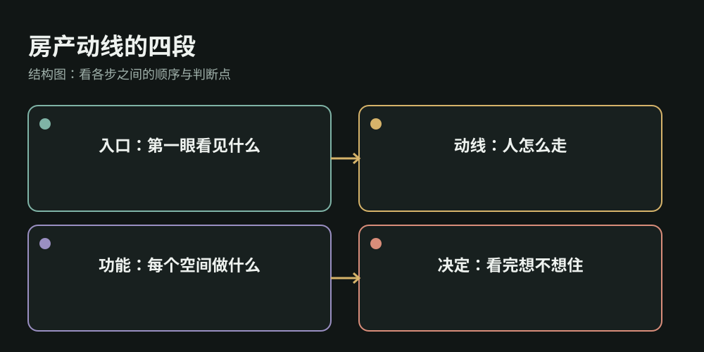

房产片最容易拍成“广角扫全屋”：每个房间都拍到，观众看完还是不知道住进去是什么感觉。问题不是镜头不够广，是没有动线；观众看见的是面积，不是生活。

<!-- DIAGRAM_START -->
<h2 id="diagram">图解</h2>
<figure class="diagram">
  
  <figcaption>看“入口、动线、功能、决定”四段；如果镜头只是在房间里扫，没有人物走路，观众记不住户型。</figcaption>
</figure>
<!-- DIAGRAM_END -->

<section><h2 id="section-1">现场</h2>
一套 90 平方米三房，采光很好，走廊很长。客户要求“拍高级”，之前的片子用广角从门口一路扫到主卧，配钢琴曲。业主看完说“像酒店，不像家”。中介说客户记不住哪个房间朝南。
</section>
<section><h2 id="section-2">判断</h2><ul><li><strong>动线是否清楚：</strong>观众能复述“进门—换鞋—客厅—厨房—卧室”的顺序。</li><li><strong>空间尺度是否可信：</strong>有没有一个人或一件家具做参照；只有广角，房间会显得假大。</li><li><strong>功能是否可见：</strong>每个空间至少有一个使用动作：坐下、烧水、开柜、看窗外。</li><li><strong>光线是否有方向：</strong>观众知道光从哪来，不是每个房间都一样亮。</li></ul></section>
<section><h2 id="section-3">怎么做</h2><ol><li>画一条动线：从门口开始，按真实居住顺序走一遍；不要按房间编号拍。</li><li>先定入口：第一镜给“进门第一眼”，用 24–28mm，不用超广角；让观众知道自己在哪。</li><li>用移动镜头跟着人走：稳定器或滑轨，速度按走路；每个空间只走一次，不反复扫。</li><li>给功能一个动作：坐下、开灯、放包、烧水；动作让空间变成生活。</li><li>结尾回到一个决定：窗外、阳台或餐桌；让观众想“我愿不愿意在这里坐下”。</li></ol></section>
<section><h2 id="section-4">失败</h2><ul><li><strong>广角扫全屋：</strong>每个房间都拍，观众只记住“很大”，记不住户型。</li><li><strong>镜头太快：</strong>一个房间 3 秒，观众还没看清就切走；像看房软件，不像看房。</li><li><strong>只拍空房：</strong>没有人物、没有家具使用，空间没有尺度，也没有生活。</li></ul></section>
<section><h2 id="section-5">边界</h2>
房产片不能替代真实房源信息：面积、朝向、产权、价格必须由文字和经纪提供，不能靠画面暗示。也不适合商业招商、建筑纪录片，那些需要更完整的空间分析。拍摄前要获得业主/租户授权，不要在片子里露出门牌、车牌和私人照片。
</section>
<section><h2 id="section-6">验收</h2><ul><li>观众看完能画出大致动线，不用倒回。</li><li>每个空间有一个使用动作，不是空镜。</li><li>有一个人或家具做尺度参照。</li><li>结尾落在一个具体生活场景，不是 logo。</li></ul></section>
<!-- DEEP_DIVE_START -->
## 深读

<strong>约 8 分钟。</strong> 下面把同一套判断放进两个不同条件，再看一个反例和一个可复用模型；不是重复前文，而是决定什么时候该换做法。

### 条件 A：自住买家

自住买家关心“我每天怎么过”，不是“房子多大”。动线要从生活重复动作出发：早上从卧室到厨房、晚上从客厅到阳台、客人来了坐哪里。每个重复动作拍一次，观众会自动把一天连起来。

自住片要给“不完美”留位置：走廊长、储物少、次卧小，都可以用镜头说明，而不是藏起来。买家看见真实限制，才相信优点。藏掉缺陷，看房时会更失望，成交更慢。

### 条件 B：投资/租赁

投资买家关心“谁会用、用多久、能不能改”，不是“我喜不喜欢”。片子要拍功能组合：能不能做家庭办公、能不能隔出第二间、阳台能不能用；不要只拍装修风格。每个功能用一个动作证明，比如在餐桌打开电脑、在阳台晒被子。

投资片要标清“可见/不可见”：装修、家具、软装哪些包含，哪些是布景；不要用样板间暗示交付标准。画面越漂亮，越要在字幕里写清“展示用，不包含在售价内”。

### 反例：片子很美，但户型看不懂

一条房产片用了航拍、滑轨、慢动作，配乐像汽车广告。看完观众记得客厅很大、厨房很亮，但说不出两个卧室怎么连、卫生间在哪。片子没有动线，只有镜头展示。

修法不是加字幕“主卧 18㎡”，而是让一个人从门口走到主卧，路上经过卫生间和次卧；镜头跟着走，观众自然记住顺序。面积数字放在字幕，空间关系放在身体。

### 可复用模型

<strong>入口 → 动线 → 功能 → 决定。</strong> 入口让观众知道自己在哪；动线让观众记住顺序；功能让观众看见生活；决定让观众知道自己想不想住。四段都在，房产片才不是房间幻灯片。

拍摄前让经纪人用一句话说“这套房最适合谁”。如果说不出来，片子会拍成通用房源；先定人，再定动线。不同买家看同一套房，动线顺序应该不一样。

<!-- DEEP_DIVE_END -->
<!-- SOURCES_START -->
## 参考与延伸阅读

- [S31] [ARRI Cine Systems：ARRI Cine Systems](https://www.arri.com/en/cine-systems) — 2026-11-26 访问。用于核对“判断”一节的术语、方法或规则；不核对本页由经验得出的数字、型号与现场结论，也不替代测试或合同。
- [S29] [YouTube 上传规格：YouTube 上传规格](https://support.google.com/youtube/answer/1722171) — 2026-11-26 访问。用于核对“边界”一节的术语、方法或规则；不核对本页由经验得出的数字、型号与现场结论，也不替代测试或合同。
<!-- SOURCES_END -->
