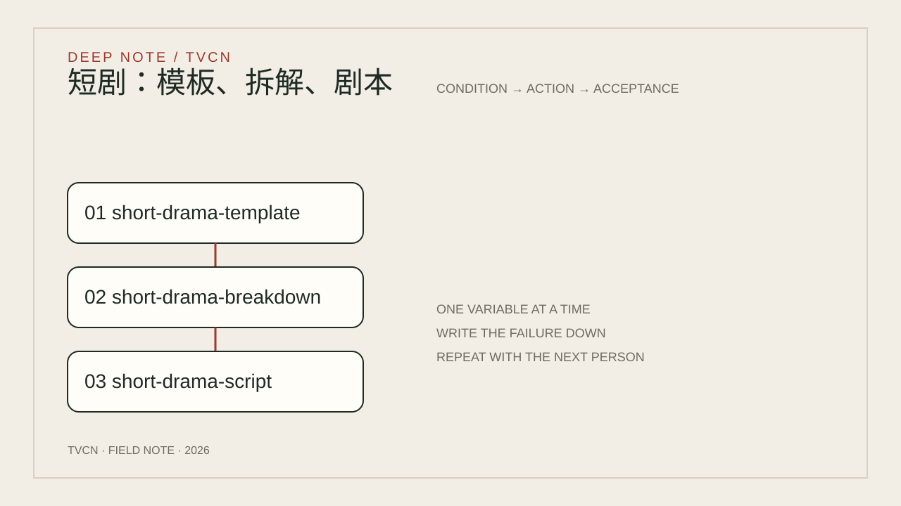

短剧不是把长片剪短；模板、拆解和剧本要围绕一个 30 秒钩子重新排。 单看《短剧模板：30 秒一个钩子》只能解决一个局部；把《短剧模板：30 秒一个钩子》《短剧拉片：30 秒一个反转》《短剧剧本：30 秒一个钩子》接成一条链，才会暴露“条件没写、变量太多、结果无法复现”的真问题。

<!-- DEEP_DIVE_START -->
<!-- DIAGRAM_START -->
<h2>图解</h2>
<figure>
  
  <figcaption>看“短剧模板：30 秒一个钩子”和“短剧拉片：30 秒一个反转”两处，先定条件，再看失败能不能被记录下来。</figcaption>
</figure>
<!-- DIAGRAM_END -->

<section><h2 id="section-1">问题</h2>
这一页的问题不是“方法不够多”，而是三个环节各自成立、合起来却不成立：条件没写、变量太多、结果不能复现。

本页按“先定条件—再做判断—只改一个变量—留下证据”的顺序；每一步都能被下一个人复述，才算完成。
</section>
<section><h2 id="section-2">判断</h2><ul><li>《短剧模板：30 秒一个钩子》的第一道门槛：0–5、5–35、35–60 三段各有一次新信息或新阻碍</li><li>《短剧拉片：30 秒一个反转》的第二道门槛：信息差在前五秒建立，观众知道谁不知道什么</li><li>《短剧剧本：30 秒一个钩子》的第三道门槛：结尾留的问题能在前一分钟找到依据</li></ul>
三条里有一条不成立，就先回到对应单页；不要用整条链掩盖一个没解决的单点。
</section>
<section><h2 id="section-3">做法</h2><ol><li>先写条件：把《短剧模板：30 秒一个钩子》里“0 到 5 秒建立信息差”落到一张三行表：素材、环境、验收。</li><li>再做一次最小动作：只按《短剧模板：30 秒一个钩子》的步骤做 30 秒，不加入第二页的方法。</li><li>把《短剧拉片：30 秒一个反转》的步骤接上：5 到 35 秒给新阻碍。</li><li>用《短剧剧本：30 秒一个钩子》做对照：35 到 60 秒给新代价，结尾留问题。</li><li>每改一次只动一个变量；其他条件写进记录，不靠记忆。</li><li>把失败也拍下来：失败版本和成功版本并排，才知道哪一步不能省。</li><li>让下一个人按记录复现一次；他做不出来，说明记录还不够。</li></ol></section>
<section><h2 id="section-4">现场案例</h2>
可复现实验（不是客户案例）：拿 30 秒素材，先按《短剧模板：30 秒一个钩子》的“0–5、5–35、35–60 三段各有一次新信息或新阻碍”做 A 版；再按《短剧拉片：30 秒一个反转》的“信息差在前五秒建立，观众知道谁不知道什么”做 B 版；两版只允许一个变量不同。把两版并排看，记录《短剧剧本：30 秒一个钩子》里最先崩的是哪一项：条件、动作还是验收。如果一次就成功，说明变量还不够多，再加一个现实限制重做。
</section>
<section><h2 id="section-5">失败表</h2>
<table class="data-table"><thead><tr><th>现象</th><th>原因</th><th>替换动作</th></tr></thead><tbody><tr><td>只看结果，不记条件</td><td>条件没写清</td><td>回到第一页重写三行表</td></tr><tr><td>只看结果，不记条件</td><td>条件没写清</td><td>回到第一页重写三行表</td></tr><tr><td>只看结果，不记条件</td><td>条件没写清</td><td>回到第一页重写三行表</td></tr></tbody></table>
</section>
<section><h2 id="section-6">验收</h2><ul><li>0–5、5–35、35–60 三段各有一次新信息或新阻碍。</li><li>信息差在前五秒建立，观众知道谁不知道什么。</li><li>结尾留的问题能在前一分钟找到依据。</li><li>前 2 秒有异常动作。</li><li>前 25 秒只服务一个假答案。</li><li>设定只用三个信息。</li><li>升级是一个错误动作，不是新角色。</li><li>线索在画面里出现两次。</li><li>反转靠动作，不靠台词解释。</li><li>结尾停在反应，没有旁白复盘。</li></ul></section>
<section><h2 id="section-7">替代方案</h2><ul><li>只处理《短剧模板：30 秒一个钩子》里的单点问题：回到<a href="https://formats.tvcn.org/article/short-drama-template/">《短剧模板：30 秒一个钩子》</a>，不要用整条链。</li><li>只比较两个动作：看<a href="https://formats.tvcn.org/article/short-drama-breakdown/">《短剧拉片：30 秒一个反转》</a>，先不改第三页。</li><li>只做验收：看<a href="https://story.tvcn.org/article/short-drama-script/">《短剧剧本：30 秒一个钩子》</a>，把判断表拿去做自测。</li></ul></section>

<!-- SOURCES_START -->
## 参考与延伸阅读

- [S14] [YouTube：社区准则](https://support.google.com/youtube/answer/2801973) — 2026-11-26 访问。用于核对「问题」一节的术语/方法/规则（YouTube 社区准则，不是内容创意标准）；不核对其中由本页经验得出的数字、型号与现场结论，也不替代测试。
- [S15] [TikTok：社区准则](https://www.tiktok.com/community-guidelines/en/) — 2026-11-26 访问。用于核对「判断」一节的术语/方法/规则（TikTok 社区准则，不是内容创意标准）；不核对其中由本页经验得出的数字、型号与现场结论，也不替代测试。
- [S29] [YouTube：上传编码建议](https://support.google.com/youtube/answer/1722171) — 2026-11-26 访问。用于核对「做法」一节的术语/方法/规则（YouTube 上传编码建议，不是创作标准）；不核对其中由本页经验得出的数字、型号与现场结论，也不替代测试。
<!-- SOURCES_END -->

