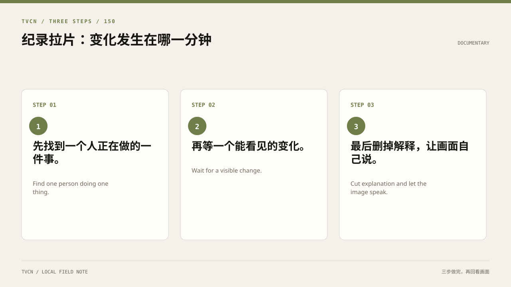

<!-- DIAGRAM_START -->
<h2>图解</h2>
<figure>
  
  <figcaption>图解是入口：先看时间码，再用文末验收表检查。</figcaption>
</figure>
<!-- DIAGRAM_END -->
<h2>拉片前先定三个变量</h2>
先定三个变量：3 分钟、平台是 B 站/视频号、目标不是“介绍一个人”，是“看见一个人变了什么”。纪录片的拉片要数“动作”和“等待”，不是数采访金句。
<blockquote>
<strong>样本说明：</strong>下面的时间码是按该片型常见时长做的教学样本，不对应某一条具体作品，也不是逐帧鉴定。你拉片时按同样位置记，换成自己的片，不要把这里的节点当成唯一答案。
</blockquote><h2>时间码拆解：8 个节点</h2>
按顺序看，不要先看解说。每个节点只记四件事：画面、声音、作用、可偷或不可偷。
<ol class="timecode-list"><li><strong>0:00–0:10</strong>｜画面：一个正在进行的动作：手、门、雨、工具。声音：同期声，不解释。作用：让观众先看见，不先被告知。可偷：从动作中间开始。不可偷：用大景+旁白介绍人物。</li><li><strong>0:10–0:30</strong>｜画面：人物和地点；三个信息：在哪、和谁、做什么。声音：环境声 + 一两句现场对话。作用：建立人物，不建立简历。可偷：让人物做事。不可偷：让采访讲完身份。</li><li><strong>0:30–0:55</strong>｜画面：他想要一个具体结果；目标物可见。声音：动作声靠近。作用：给出欲望。可偷：欲望是一个可拍的东西。不可偷：欲望是一句抽象理想。</li><li><strong>0:55–1:30</strong>｜画面：阻碍出现：时间、钱、身体、关系；不要急着解决。声音：环境变紧，音乐不进。作用：让等待有代价。可偷：让阻碍自然发生。不可偷：制造冲突。</li><li><strong>1:30–2:00</strong>｜画面：他尝试一次，失败或部分成功。声音：真实反应。作用：让观众看见方法。可偷：一次完整的尝试。不可偷：剪碎成蒙太奇。</li><li><strong>2:00–2:25</strong>｜画面：代价出现：时间过去、东西坏了、关系变了。声音：环境声，留白。作用：让变化不是免费的。可偷：用实物/时间标记代价。不可偷：用音乐催泪。</li><li><strong>2:25–2:45</strong>｜画面：变化后的同一个动作；结果不同。声音：同期声。作用：让变化可见。可偷：重复开头的动作。不可偷：用旁白总结“他成长了”。</li><li><strong>2:45–3:00</strong>｜画面：停在变化之后，不给答案。声音：环境声收尾。作用：让观众自己判断。可偷：停在人物继续做事。不可偷：停在采访总结。</li></ol><h2>结构判断</h2>
纪录片的骨架是“动作—人物—欲望—阻碍—尝试—代价—变化—之后”。采访只补动作解释不了的部分；如果采访能删掉，片子会更好。

看结构时只问三件事：前 10 秒给了什么证据；中段每 10–15 秒有没有新信息；结尾是否只落一个动作、一个变化或一个问题。这三件事任何一件缺失，3 分钟的片子就会散。
<h2>预算量级</h2>
预算按中国大陆常见制作成本区间估算，不含媒介投放；它是量级，不是报价。同样一分钟，棚拍、演员、特效、音乐版权任何一项都能把成本翻倍。
<ul><li>低：¥5,000–20,000，2–3 人，1 个真实场景，自然光，2–3 天。</li><li>中：¥20,000–80,000，4–6 人，多场景，基础灯/收音，5–10 天。</li><li>高：¥80,000–300,000+，导演/摄影/录音/制片，跨地区，15–30 天。</li></ul><h2>可偷的 3 个结构</h2>
偷结构，不偷画面。下面三条换成你的题材仍然成立。
<ol><li>从动作中间开始，不从人物介绍开始。</li><li>让阻碍自然发生，不制造冲突。</li><li>重复开头的动作，让变化自己显形。</li></ol><h2>不能照搬的 3 个原因</h2>
不是“不好”，是条件和它不一样；照搬会暴露你的预算、平台和观众。
<ol><li>不能照搬“采访驱动”：没有现场动作，采访只是广播。</li><li>不能照搬“等待美学”：没有代价，长镜头只是慢。</li><li>不能照搬“主题总结”：观众不需要你替他们总结一个人。</li></ol><h2>拉片练习</h2>
做完再拍，不要只看。三个练习按顺序做，第三个必须落成一条 15 秒文件。
<ol><li>关声音看一遍，写下人物想要什么、被什么挡住。</li><li>数片中有几个完整动作；少于 3 个，说明采访太多。</li><li>把开头动作抄下来，看结尾有没有重复/变化。</li></ol>
<h2>验收</h2><ul><li>前 10 秒有一个正在发生的动作。</li><li>人物、地点、任务三个信息在 30 秒内清楚。</li><li>欲望是一个可拍的东西，不是抽象理想。</li><li>阻碍自然发生，没有假冲突。</li><li>至少有一次完整尝试。</li><li>变化后的同一个动作与开头不同。</li><li>结尾没有总结旁白。</li></ul>
