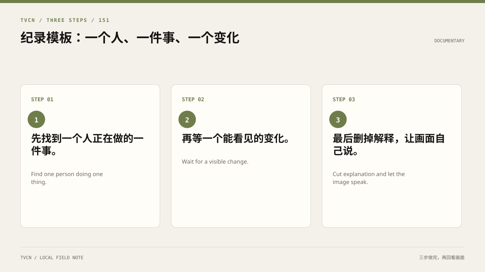

别从时代背景开始；那通常是论文，不是片子。

<!-- DIAGRAM_START -->
<h2>图解</h2>
<figure>
  
  <figcaption>看“选一个人和一件正在做的事”和“先拍他做事，不先拍采访”两处，判断前三秒给出的理由，能不能撑到结尾。</figcaption>
</figure>
<!-- DIAGRAM_END -->
<section><h2 id="section-1">可套用的 60 秒分段表</h2>
<table class="template-table"><thead><tr><th>段落</th><th>时间</th><th>画面</th><th>声音/通过线</th></tr></thead><tbody><tr><td>人物与事</td><td>0–10 秒</td><td>人物已经在做事，不是站着受访</td><td>环境声先入；不铺解释性音乐</td></tr><tr><td>过程</td><td>10–30 秒</td><td>动作连续，能看出步骤和难度</td><td>同期声保留；采访只作补充</td></tr><tr><td>变化</td><td>30–45 秒</td><td>一个可见结果：完成、失败、改变决定</td><td>不靠人物自己说“我变了”</td></tr><tr><td>余波</td><td>45–60 秒</td><td>变化后的第一个动作或空间</td><td>留一句真话；不要总结时代</td></tr></tbody></table>
<h2 id="section-2">开机前先填三行</h2><ul><li><strong>一个人：</strong>写名字和今天要做的一件事。</li><li><strong>一个变化：</strong>镜头里能看见什么不同？不能只写“他成长了”。</li><li><strong>不拍什么：</strong>列出三件会变成宣传片的内容，现场不拍。</li></ul></section><section><h2 id="section-3">现场</h2>
一个人、一件正在做的事、一个可见变化；先拍他做事，不拍采访。
</section><section><h2 id="section-4">怎么做</h2><ol><li>选一个人和一件正在做的事。</li><li>先拍他做事，不先拍采访。</li><li>等一个能看见的变化发生，再决定结构。</li></ol></section><section><h2 id="section-5">别踩</h2></section><section><h2>判断</h2>
现场只认三个信号：
<ul><li>前三秒给出一个可相信的理由</li><li>中段有新信息或新阻碍，不是重复气氛</li><li>结尾有一个可看见的变化，旁白没有替它收尾</li></ul></section><section><h2>失败</h2>
下面三种做法会让页面上的细节白做：
<ul><li>模板套上了，人物和问题却没成立</li><li>前三秒没有理由，只靠标题和音乐</li><li>结尾没有可看见的变化，全靠旁白总结</li></ul></section><section><h2>延伸</h2>
<strong>10 分钟练习：</strong>拆一条 30 秒参考片，标出“选一个人和一件正在做的事”和“先拍他做事，不先拍采访”的时间点；再写一句：如果删掉其中一个，片子还成立吗？
</section>
<h2>验收</h2><ul><li>片中有一个人和一件正在做的事。</li><li>采访没有出现在最前面，先看到动作。</li><li>有一个能看见的变化，不只是人物自己说。”</li></ul>
<!-- SOURCES_START -->
<aside class="article-sources experience-source" data-source-kind="experience">

来源 / Sources
经验来源

经验来源：TVCN 现场手册与编辑复核；本文未做实验室实测，也没有外部数据引用。
</aside>
