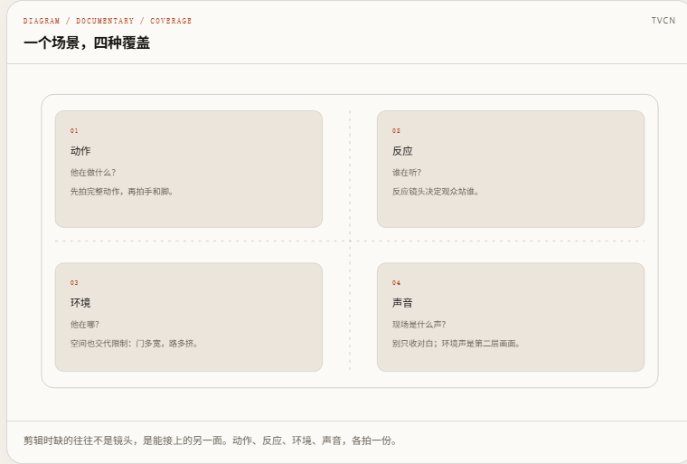

<!-- DIAGRAM_START -->
## 图解

<figure>
  
  <figcaption>剪辑时缺的往往不是镜头，是能接上的另一面。动作、反应、环境、声音，各拍一份。</figcaption>
</figure>
<!-- DIAGRAM_END -->

纪录不是把生活拍下来，是找到一个“之前”和“之后”。有变化，才有结构。

## 找一个变化

先问：这个人在这段时间里，什么变了？搬走、毕业、开店、戒掉、第一次上台。变化可以是外部事件，也可以是态度。

没有变化，就只能拍成一堆好看的素材。变化不需要宏大，哪怕只是“他终于愿意看镜头”。

## 采访问题

不要问“你怎么看”。问具体的事：“那天你几点起床？”“你第一次收钱是什么感觉？”“你当时说了什么？”细节会带出情绪，观点不会。

让受访者讲完，不要急着接话。沉默三秒，常常比追问更有用。

## 结构

用“变化—阻碍—代价—现在”四段。先给一个正在发生的事，再回到变化怎么开始，最后落在今天的一个动作。

不要用旁白解释所有背景。让画面和现场声承担一半信息，旁白只补观众看不到的那一半。

## 3 条验收

- 能说清这个人“之前”和“之后”的差别。
- 采访里有 3 个具体细节，不是观点。
- 结尾落在今天的一个动作。

<!-- DEEP_DIVE_START -->
## 深读

<strong>约 7 分钟。</strong> 纪录短片不是采访合集，是等一个正在发生的变化。

### 选一个正在做决定的人

不要找“有故事的人”坐下来讲过去；找正在面对截止日期、冲突、选择的人。观众要看现在，不是听回忆。

开机前写一个假设：他会不会做成、会不会改变；现场允许被推翻。拍不到变化，就不要硬剪成变化。

### 等，不催

采访只问动作：那天你先做了什么、谁拦着你、你改了什么；不要问“你有什么感受”。

拍过程，不拍结论；拍他失败、重来、犹豫。素材不够，就再等一天，不要用旁白补。

### 结构与伦理

一个人、一件正在发生的事、一个变化；结尾停在变化之后，不要总结意义。

拍脆弱的人要讲清用途、范围和撤回方式；能不给正脸就不给，能打码就早打。

### 五分钟练习：十分钟等一个动作

找一个人正在做一件事，开机前写一句假设：他今天会不会做成。开机后十分钟不打断，只拍手、脚、呼吸和门口。

回看时找“变化发生在哪一秒”：他停了一下、改了一个动作、叹了一口气。找不到变化，就把这段当素材，不要硬剪成故事。

### 什么时候算完成

让一个没看过素材的人指出变化发生在第几分钟、变化前后人物做了什么。指得出来，片子才算完成；指不出来，说明你拍的是状态，不是变化，回去再等一天，不要硬剪。变化不必大，但必须在镜头里发生；哪怕只是一个动作从犹豫变成完成。

### 纪录短片，十项检查
<ul><li>人物正在做决定</li><li>现场有截止日期或阻力</li><li>开机前有假设</li><li>假设允许被推翻</li><li>采访只问动作</li><li>拍到失败或重来</li><li>结尾停在变化之后</li><li>不用旁白补变化</li><li>用途和范围讲清楚</li><li>脆弱人物有保护</li></ul>
纪录不是把生活解释清楚，是让观众看见一个人真的变了一次。

<!-- DEEP_DIVE_END -->
<!-- SOURCES_START -->
<h2>参考与延伸阅读</h2>

经验来源：TVCN 现场手册与项目复盘；实测来源：页面标注的复核环境与可复现练习；参考来源：以下公开链接。

<ul><li>[S14] YouTube 社区准则</li><li>[S15] TikTok 社区准则</li><li>[S16] BBC 编辑准则</li></ul>

<a href="../../about/">完整链接与用途见 SOURCES.md</a>

<!-- SOURCES_END -->
