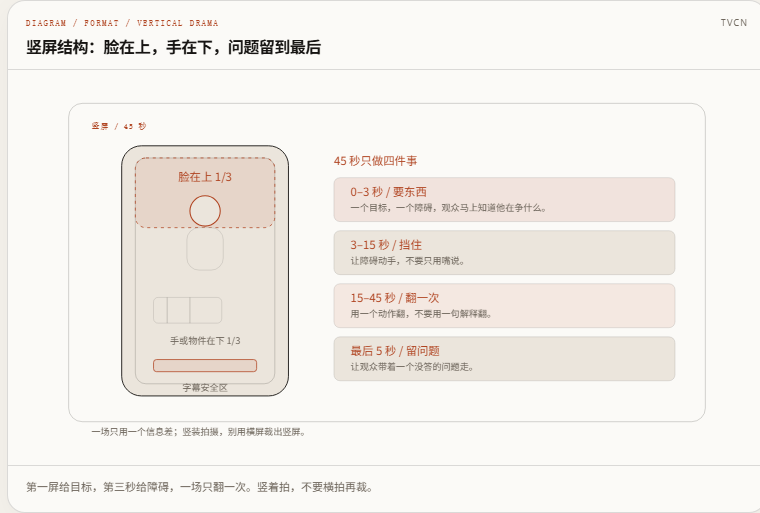

<!-- DIAGRAM_START -->
## 图解

<figure>
  
  <figcaption>第一屏给目标，第三秒给障碍，一场只翻一次。竖着拍，不要横拍再裁。</figcaption>
</figure>
<!-- DIAGRAM_END -->

竖屏没有时间铺世界。第一屏就得让人物要一个东西。

## 第一屏只放一个人和一个目标

竖屏的屏幕窄，放不下“环境 + 两个人 + 字幕 + 情绪”。第一屏只留一个人、一个目标、一个障碍。她想进门，门被反锁；他要签字，笔没水；她来还钥匙，他以为她来复合。

不要用城市空镜开场。观众划到一条竖屏，先判断“这和我有什么关系”。一个人盯着一样东西，比十秒风景更快建立关系。

目标要能被看见：门、合同、手机、钥匙、验孕棒。不要让人物用一句旁白交代“我今天必须拿到钱”。让观众看见她手里的还款短信，比听见她说更有效。

## 一场戏只用一个信息差

短剧的发动机不是吵架，是信息差：一个人知道，另一个人不知道。她晓得合同是假的，他还在算提成；他知道孩子不是他的，她还在挑名字。

一场戏只用一个信息差，翻一次就够。再加第二层、第三层反转，观众会累，也不信。把一场戏写透，比写五个反转有用。

翻的时候让人物做一个动作，不要用一句“其实我早就知道”。动作可以是把合同推回去、把钥匙放在桌上、把手机屏幕转过来。

## 竖屏构图：脸在上，手在下

竖屏最有用的构图是“脸在上三分之一，手或物件在下三分之一”。观众先看表情，再看他在做什么。两个人对峙时，不要硬塞双人中景；用近景切反打，脸更大，压迫更强。

纵向运动比横向调度好用：进门、下楼、坐下、站起来。横向摇镜在竖屏里很容易把人物甩出画。拍的时候手机竖装，不要用横屏拍完再裁，裁出来的构图会失去头顶和手。

字幕放在最下面安全区，别压住嘴和手。平台 UI 会盖掉底部，重要动作往上抬一点。

## 检查

- 前三秒能说出他要什么、谁挡着。
- 一场戏只有一个信息差，只翻一次。
- 脸在上、手在下，最后留一个没答的问题。

<!-- DEEP_DIVE_START -->
## 深读

<strong>约 6 分钟。</strong> 竖屏短剧不是把长剧切短，是三十秒内建立欲望、制造信息差、翻一次。

### 前三秒要东西

第一秒让人物要一个具体东西：钱、钥匙、一个签名、一句承认；第二秒让观众看见谁挡着。不要先交代公司、职位、前情。

信息差是短剧的发动机：观众知道一件人物不知道的事，或者人物知道一件观众不知道的事；两种都能让人往下看。

### 一个场景，两个人物，一次翻转

一个场景就够：前台、车里、餐桌、电梯口。两个人就够：要东西的人和挡东西的人。第三个人只会分散注意力。

先给一个假答案，让观众以为事情要这样解决；再用一个动作或一句话翻掉它。翻转要改变两个人的关系，不只是换一句台词。

### 竖屏表演与拍法

竖屏用半身和近景，脸占画面三分之一；两个人不要站太开，否则观众看不清表情。台词短，一句不超过十二个字，停顿要留出来。

不要用三段式蒙太奇交代前情；把前情藏进一个道具、一句称呼、一个动作。结尾留一个扣：新问题、新威胁、新秘密，不要总结道理。

### 五分钟练习：一个房间一次翻转

写一个三十秒场景：一个人要东西，一个人挡着，一个道具决定真假。前十五秒给假答案，后十五秒用一个动作翻掉它。

竖屏拍半身，台词每句不超过十二字；拍完放给没看过的人，问他“最后谁占了上风”。答不出，说明翻转只改了台词，没改关系。

### 什么时候算完成

放给一个没看过的人，问他最后谁占了上风、哪一句话让关系变了。两个问题都答得出，片子才算完成；只能说出“反转了”却说不出关系怎么变，说明翻转还停在台词上。

### 竖屏短剧，十项检查
<ul><li>第一秒有人要具体东西</li><li>第二秒看见阻力</li><li>信息差成立</li><li>只用一个场景</li><li>只留两个主要人物</li><li>有假答案和翻转</li><li>翻转改变关系</li><li>半身或近景为主</li><li>台词一句不超过十二字</li><li>结尾留新问题</li></ul>
短剧不是短，是每一秒都在改变人物之间的距离。

<!-- DEEP_DIVE_END -->
