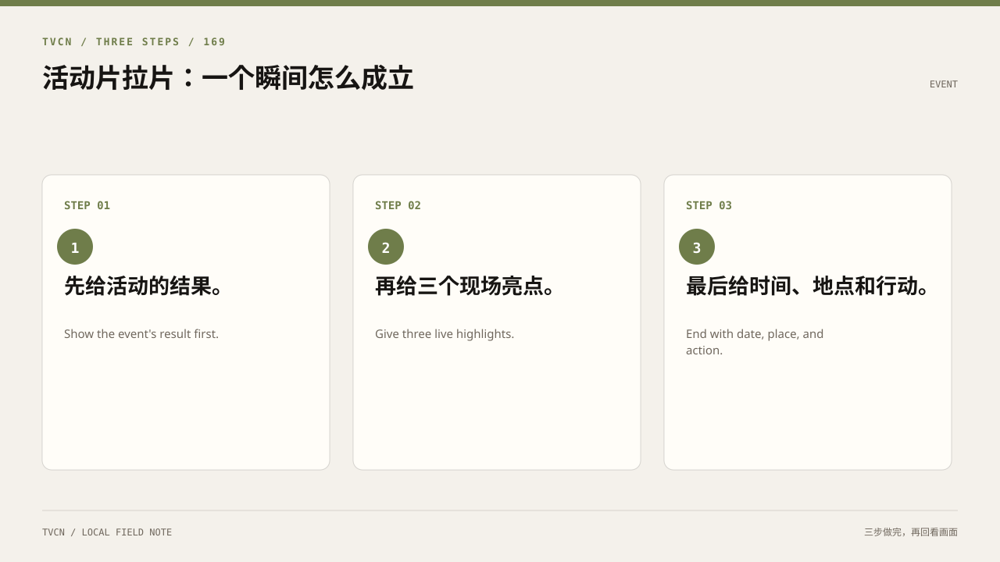

<!-- DIAGRAM_START -->
<h2>图解</h2>
<figure>
  
  <figcaption>图解是入口：先看时间码，再用文末验收表检查。</figcaption>
</figure>
<!-- DIAGRAM_END -->
<h2>拉片前先定三个变量</h2>
先定三个变量：90 秒、平台是视频号/机构账号、目标是“让没来的人知道发生了什么”。活动片最容易拍成流程记录；拉片时先找“关键瞬间”，再找“人的反应”。
<blockquote>
<strong>样本说明：</strong>下面的时间码是按该片型常见时长做的教学样本，不对应某一条具体作品，也不是逐帧鉴定。你拉片时按同样位置记，换成自己的片，不要把这里的节点当成唯一答案。
</blockquote><h2>时间码拆解：8 个节点</h2>
按顺序看，不要先看解说。每个节点只记四件事：画面、声音、作用、可偷或不可偷。
<ol class="timecode-list"><li><strong>0:00–0:05</strong>｜画面：到场：门、签到、第一眼。声音：现场环境声。作用：让观众进入空间。可偷：从一个动作进门。不可偷：用航拍大景开场。</li><li><strong>0:05–0:15</strong>｜画面：规模：三样东西说明人数/布置/主题。声音：环境声 + 一句现场话。作用：交代“多大、是什么”。可偷：用三个细节说明规模。不可偷：用统计字幕。</li><li><strong>0:15–0:30</strong>｜画面：关键瞬间：揭幕、开场、第一句话。声音：现场原声。作用：给片子的“主事件”。可偷：一个动作完成。不可偷：切碎成五个角度。</li><li><strong>0:30–0:45</strong>｜画面：细节：手、道具、屏幕、桌面。声音：细节声。作用：让现场可信。可偷：三个可触摸的细节。不可偷：只拍舞台。</li><li><strong>0:45–1:00</strong>｜画面：人：观众反应、工作人员、嘉宾。声音：真实对话/笑声。作用：让规模变成人。可偷：一张有反应的脸。不可偷：摆拍合影。</li><li><strong>1:00–1:15</strong>｜画面：高潮：颁奖/签约/表演/掌声。声音：现场峰值，音乐后进。作用：给情绪峰值。可偷：让现场声先到峰值。不可偷：用音乐硬推。</li><li><strong>1:15–1:25</strong>｜画面：之后：散场、收拾、空场。声音：环境声回落。作用：让活动有“结束”。可偷：空场/椅子/杯子。不可偷：直接切 logo。</li><li><strong>1:25–1:30</strong>｜画面：落版：主题/日期/主办，只出现一次。声音：一句收口。作用：信息落地。可偷：和空场同框。不可偷：三行头衔。</li></ol><h2>结构判断</h2>
活动片的骨架是“到场—规模—关键瞬间—细节—人—高潮—之后—落版”。它不需要拍完所有流程，只需要让没来的人理解“发生了什么、和我有什么关系”。

看结构时只问三件事：前 10 秒给了什么证据；中段每 10–15 秒有没有新信息；结尾是否只落一个动作、一个变化或一个问题。这三件事任何一件缺失，90 秒的片子就会散。
<h2>预算量级</h2>
预算按中国大陆常见制作成本区间估算，不含媒介投放；它是量级，不是报价。同样一分钟，棚拍、演员、特效、音乐版权任何一项都能把成本翻倍。
<ul><li>低：¥3,000–10,000，1–2 人，单机，现场光，1 天。</li><li>中：¥10,000–40,000，3–5 人，双机 + 收音，1–2 天。</li><li>高：¥40,000–150,000+，导演/多机/导播/后期，2–5 天。</li></ul><h2>可偷的 3 个结构</h2>
偷结构，不偷画面。下面三条换成你的题材仍然成立。
<ol><li>用一个进门动作开场，不用航拍。</li><li>用三个细节说明规模，不用统计字幕。</li><li>让现场声先到高潮，音乐后进。</li></ol><h2>不能照搬的 3 个原因</h2>
不是“不好”，是条件和它不一样；照搬会暴露你的预算、平台和观众。
<ol><li>不能照搬“多机位导播”：没有导播台，切五个角度会碎。</li><li>不能照搬“活动流程片”：把每个环节都拍，等于没有重点。</li><li>不能照搬“领导镜头优先”：观众先认人，不认头衔。</li></ol><h2>拉片练习</h2>
做完再拍，不要只看。三个练习按顺序做，第三个必须落成一条 15 秒文件。
<ol><li>列出活动的三个关键瞬间，只拍这三个。</li><li>关声音看一遍，看画面能不能说清“多大、是什么”。</li><li>把 90 秒压成 30 秒：只留到场、关键瞬间、人、落版。</li></ol>
<h2>验收</h2><ul><li>前 5 秒有到场动作，不是航拍。</li><li>15 秒内能看出规模/主题。</li><li>有一个完整的关键瞬间。</li><li>至少三个可触摸的细节。</li><li>有一张真实反应的脸，不是摆拍。</li><li>高潮处现场声先到峰值。</li><li>结尾有空场/之后，不直接切 logo。</li></ul>

<!-- SOURCES_START -->
## 经验说明

经验说明：本页来自 3 次同类型片型拆解与项目复盘，条件为30 秒–5 分钟成片、单平台交付；页面讨论的具体对象是「活动片拉片：90 秒怎么讲清现场」；不含外部实验室测试，条件变化时结论可能失效。
<!-- SOURCES_END -->

