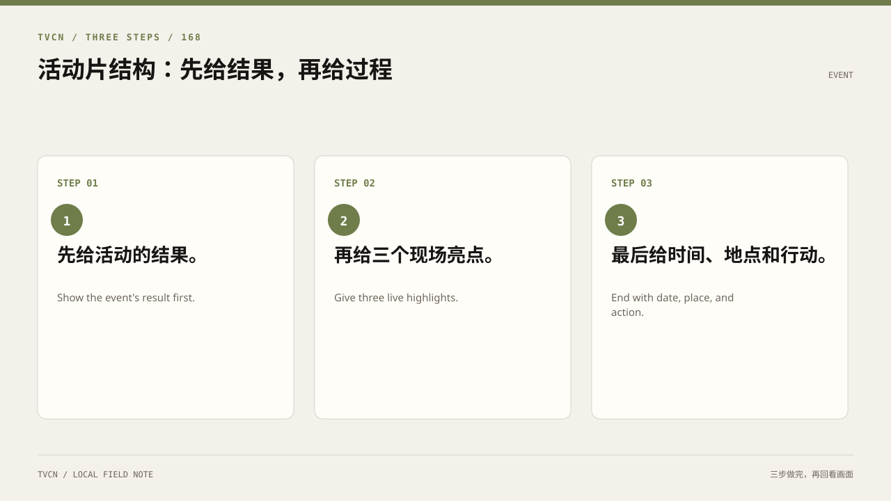

活动片先给结果，再给过程；观众要知道这场活动成了什么。

<!-- DIAGRAM_START -->
<h2>图解</h2>
<figure>
  
  <figcaption>把三步按顺序做完，再回看画面或文件。</figcaption>
</figure>
<!-- DIAGRAM_END -->
<h2>现场</h2>

开场 10 秒给结果：人数、成交或落幕；再回到过程。

<h2>怎么做</h2>

活动片先给结果，再给过程；观众要知道这场活动成了什么。
<ol><li>开场 10 秒给结果：人数、成交或落幕。</li><li>再给三个现场亮点。</li><li>最后给时间、地点和行动。</li></ol>
<h2>别踩</h2>

别把活动片剪成领导名单；观众要知道发生了什么。

<h2>验收</h2>
<ul><li>前 10 秒给出一个可量化或可看见的结果。</li><li>中段有三个现场亮点，不是台上发言。</li><li>结尾能说清时间、地点、怎么参加。</li></ul>

<!-- DEEP_DIVE_START -->
## 深读

<strong>约 6 分钟。</strong> 活动片不是流程记录，是先给结果，再给三个亮点，最后告诉人怎么参加。

### 先给结果

开场三秒给最热闹或最有信息量的瞬间：人挤满场、灯亮起、产品被举起、掌声落下。不要从签到台和空场地开始。

观众先要知道“这是什么、值不值得看”，才愿意看流程。用一句字幕交代时间、地点、人数，不要用主持人开场白。

### 三个亮点

人、动作、空间各取一个亮点：一个人的表情、一个产品被使用的动作、一个场地的规模。每个亮点五到八秒，不要平均分配全片。

每个亮点配一句现场声或一句采访，不要三段旁白。采访只留一句能独立成立的话，不要放完整问答。

### 信息收口

结尾把时间、地点、报名方式、主办方说清；一个画面只放一条信息，不要四行小字挤在一起。

十五到六十秒就够。结尾可以回到开场那个瞬间，让观众知道活动还会再来；不要用“圆满成功”四个字代替具体结果。

### 五分钟练习：十五秒活动片

从现有素材剪十五秒：三秒结果、三个亮点各三秒、三秒信息。不要从签到开始，也不要把领导讲话放满。

静音看一遍，问自己：这是什么活动、什么时候、怎么参加。三个问题答不出，就删一个亮点，把信息补清楚。

### 什么时候算完成

静音放一遍，问一个没参加的人：这是什么活动、什么时候、怎么报名。三个问题都能答出来，片子才算完成；有一个答不出，就删一个亮点，把信息补到画面上。

### 活动宣传，十项检查
<ul><li>三秒内给最热闹的瞬间</li><li>不从签到台开始</li><li>一句字幕交代时间地点人数</li><li>人、动作、空间各一个亮点</li><li>每个亮点五到八秒</li><li>亮点配现场声或一句采访</li><li>采访只留一句</li><li>结尾信息一条一画面</li><li>时长十五到六十秒</li><li>不用“圆满成功”代替结果</li></ul>
活动片不是把流程走完，是让人看完之后知道下一次该不该来。

<!-- DEEP_DIVE_END -->
