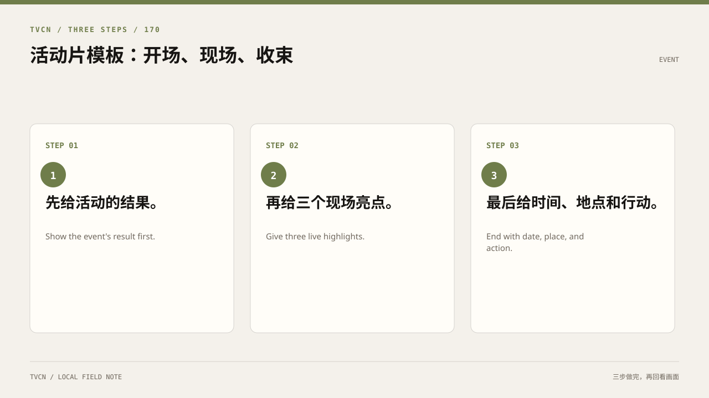

别全铺音乐；现场声一没，观众就像在看宣传片。

<!-- DIAGRAM_START -->
<h2>图解</h2>
<figure>
  
  <figcaption>看“开场给结果”和“现场给三个亮点，保留环境声”两处，判断前三秒给出的理由，能不能撑到结尾。</figcaption>
</figure>
<!-- DIAGRAM_END -->
<section><h2 id="section-1">可套用的 60 秒分段表</h2>
<table class="template-table"><thead><tr><th>段落</th><th>时间</th><th>画面</th><th>声音/通过线</th></tr></thead><tbody><tr><td>结果</td><td>0–10 秒</td><td>活动最热的一秒，或完成后的现场</td><td>一句“发生了什么”；不是主持人开场</td></tr><tr><td>开场</td><td>10–20 秒</td><td>人进场、签到、空间建立</td><td>环境声；交代时间地点</td></tr><tr><td>现场亮点</td><td>20–40 秒</td><td>三个不同亮点，每个一个镜头</td><td>保留现场声；不全程铺音乐</td></tr><tr><td>收束</td><td>40–50 秒</td><td>人群散场或最后一个动作</td><td>一句结果；不列领导名单</td></tr><tr><td>行动</td><td>50–60 秒</td><td>时间地点或报名入口</td><td>只给一个下一步</td></tr></tbody></table>
<h2 id="section-2">开机前先填三行</h2><ul><li><strong>结果：</strong>活动结束时发生了什么？一句话。</li><li><strong>三个亮点：</strong>每个写“镜头能看到什么”，不写“气氛很好”。</li><li><strong>行动：</strong>观众怎么参加下一次？时间、地点、入口。</li></ul></section><section><h2 id="section-3">现场</h2>
开场结果、现场三个亮点、收束时间地点行动；不要领导名单。
</section><section><h2 id="section-4">怎么做</h2><ol><li>开场给结果。</li><li>现场给三个亮点，保留环境声。</li><li>收束给时间、地点、行动，不要领导名单。</li></ol></section><section></section><section><h2>判断</h2>
这一页的判断只看三条可观察的验收，不靠口号：
<ul><li><strong>1.</strong> 开场先给结果，不是主持人上台。</li><li><strong>2.</strong> 现场段有三个亮点，能听到环境声。</li><li><strong>3.</strong> 收束能说清时间、地点、怎么参加。</li></ul></section><section><h2>失败</h2>
下面任一条出现，先停，不要靠后期补：
<ul><li><strong>1.</strong> 只做到“开场先给结果，不是主持人上台”的形式，换一个机位或场景就重现不了。</li><li><strong>2.</strong> 把“现场段有三个亮点，能听到环境声”留到后期或口头解释，现场没有留下能复查的记录。</li><li><strong>3.</strong> 第 3 条验收“收束能说清时间、地点、怎么参加”没人复核，交片时才发现。</li></ul></section><section><h2>延伸</h2>
<strong>10 分钟练习：</strong>拆一条 30 秒参考片，标出“开场给结果”和“现场给三个亮点，保留环境声”的时间点；再写一句：如果删掉其中一个，片子还成立吗？
</section>
<h2>验收</h2><ul><li>开场先给结果，不是主持人上台。</li><li>现场段有三个亮点，能听到环境声。</li><li>收束能说清时间、地点、怎么参加。</li></ul>

> 意图分工：本页负责「活动片模板：开场、现场、收束」的可执行细节；同集群先读 <a href="https://formats.tvcn.org/article/music-video-template/">MV 模板：主歌、副歌、记忆点</a> 建立总判断，再回到本页。

<!-- INTENT_SCOPE -->

<section><h2>边界</h2>
本页只解决「活动片模板：开场、现场、收束」这一个问题；不替代 实验影像拉片：规则、重复、打破、实验影像结构：规则先于效果、一句话故事：谁想要什么，被什么挡住。如果现场问题属于后者，先读对应页，不要在本页继续加参数。
</section>
<!-- SOURCES_START -->
## 经验说明

经验说明：本页来自 6 个同类型成片项目的片型拆解，成片 30 秒–5 分钟、单平台交付；只讨论「活动片模板：开场、现场、收束」的结构与判断顺序，不含外部实验室测试，也不适用于多机位直播、影院交付或需要定制叙事的长片。
<!-- SOURCES_END -->

