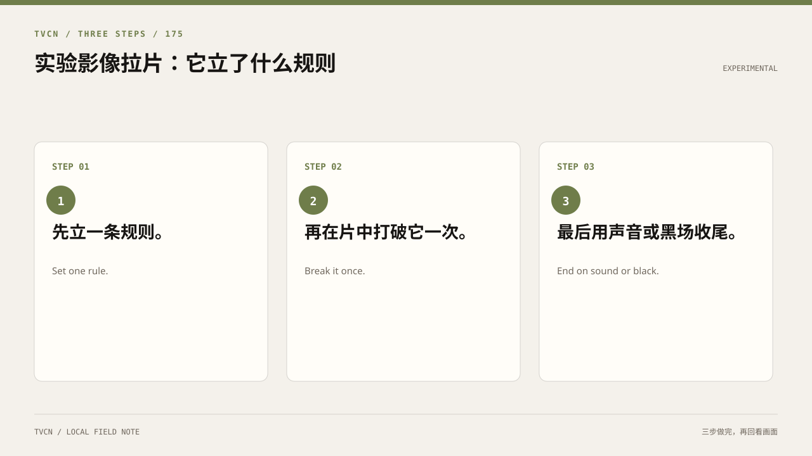

<!-- DIAGRAM_START -->
<h2>图解</h2>
<figure>
  
  <figcaption>图解是入口：先看时间码，再用文末验收表检查。</figcaption>
</figure>
<!-- DIAGRAM_END -->
<h2>拉片前先定三个变量</h2>
先定三个变量：4 分钟、影展/艺术平台、目标是“让观众说出规则和打破”。实验片不是“随便拍”，它比剧情片更需要规则；拉片时先找规则，再找重复里的变量。
<blockquote>
<strong>样本说明：</strong>下面的时间码是按该片型常见时长做的教学样本，不对应某一条具体作品，也不是逐帧鉴定。你拉片时按同样位置记，换成自己的片，不要把这里的节点当成唯一答案。
</blockquote><h2>时间码拆解：8 个节点</h2>
按顺序看，不要先看解说。每个节点只记四件事：画面、声音、作用、可偷或不可偷。
<ol class="timecode-list"><li><strong>0:00–0:10</strong>｜画面：规则之前：一个空场/一个物件/一次准备。声音：环境声，无音乐。作用：让观众安静下来。可偷：用一个静止镜头开场。不可偷：用快速蒙太奇。</li><li><strong>0:10–0:20</strong>｜画面：规则建立：固定机位、左到右、一个动作。声音：动作声第一次完整出现。作用：让观众知道“接下来会重复”。可偷：第一遍就完整。不可偷：第一遍就切碎。</li><li><strong>0:20–0:60</strong>｜画面：重复 1：只改一个变量（轻/慢/亮）。声音：同一动作声。作用：建立预期。可偷：让变量可见。不可偷：同时改三个变量。</li><li><strong>1:00–1:40</strong>｜画面：重复 2：变量加重（重/快/暗）。声音：动作声变大。作用：让重复有方向。可偷：用重量/速度。不可偷：用旁白解释。</li><li><strong>1:40–2:20</strong>｜画面：重复 3：变量到极限，人物开始不完成动作。声音：呼吸靠近。作用：让预期即将失效。可偷：让动作差一点完成。不可偷：直接打破。</li><li><strong>2:20–3:00</strong>｜画面：打破：机位仍不动，动作/人物出画。声音：留下的声音在空场。作用：让规则失效。可偷：只打破一次。不可偷：连续打破三次。</li><li><strong>3:00–3:40</strong>｜画面：后果：空场/物件/痕迹留在画面。声音：环境声。作用：让打破有代价。可偷：停在后果。不可偷：马上切黑。</li><li><strong>3:40–4:00</strong>｜画面：停止：不回到原样，不再解释。声音：留白。作用：让观众自己带走。可偷：停在一个未完成状态。不可偷：加字幕总结。</li></ol><h2>结构判断</h2>
实验片的骨架是“规则—重复—变量—极限—打破—后果—停止”。规则越清楚，重复越有张力；打破只能一次，后果必须留在画面里。

看结构时只问三件事：前 10 秒给了什么证据；中段每 10–15 秒有没有新信息；结尾是否只落一个动作、一个变化或一个问题。这三件事任何一件缺失，4 分钟的片子就会散。
<h2>预算量级</h2>
预算按中国大陆常见制作成本区间估算，不含媒介投放；它是量级，不是报价。同样一分钟，棚拍、演员、特效、音乐版权任何一项都能把成本翻倍。
<ul><li>低：¥1,000–5,000，1–2 人，1 个空间，自然光，1 天。</li><li>中：¥5,000–20,000，2–4 人，控制光/声音，2–3 天。</li><li>高：¥20,000–80,000+，导演/摄影/声音/美术，搭景或后期，5–10 天。</li></ul><h2>可偷的 3 个结构</h2>
偷结构，不偷画面。下面三条换成你的题材仍然成立。
<ol><li>第一遍就完整，让观众知道规则。</li><li>每次重复只改一个变量。</li><li>打破后停在后果，不切黑。</li></ol><h2>不能照搬的 3 个原因</h2>
不是“不好”，是条件和它不一样；照搬会暴露你的预算、平台和观众。
<ol><li>不能照搬“长镜头=实验”：没有规则，长只是慢。</li><li>不能照搬“无叙事=高级”：没有预期，打破只是事故。</li><li>不能照搬“旁白解释”：解释会杀死观众自己的发现。</li></ol><h2>拉片练习</h2>
做完再拍，不要只看。三个练习按顺序做，第三个必须落成一条 15 秒文件。
<ol><li>用一句话写下片子的规则。</li><li>数重复次数和每次改变的变量；多于一个变量就重剪。</li><li>关声音看一遍，看画面能不能建立预期。</li></ol>
<h2>验收</h2><ul><li>前 20 秒能建立规则。</li><li>第一次重复完整，不切碎。</li><li>每次重复只改一个变量。</li><li>第三次重复让预期接近失效。</li><li>打破只发生一次。</li><li>打破后停在后果，至少 10 秒。</li><li>全片没有旁白解释。</li></ul>

<!-- SOURCES_START -->
## 参考与延伸阅读

- [S49] [MoMA：电影收藏与放映](https://www.moma.org/visit/film) — 2026-11-26 访问。用于核对「拉片前先定三个变量」一节的术语/方法/规则（MoMA 电影收藏资料，不是创作教程）；不核对其中由本页经验得出的数字、型号与现场结论，也不替代测试。
- [S44] [奥斯卡电影档案馆](https://www.oscars.org/film-archive) — 2026-11-26 访问。用于核对「时间码拆解：8 个节点」一节的术语/方法/规则（奥斯卡档案与修复资料，不是发行规则）；不核对其中由本页经验得出的数字、型号与现场结论，也不替代测试。
<!-- SOURCES_END -->

