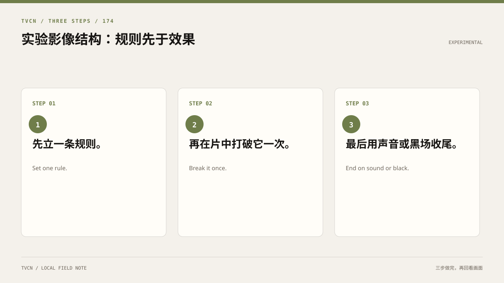

实验片不是随便剪。先写一条规则：固定机位、固定时长、固定颜色，或每镜只做一个动作；整片按这条规则变化，观众才能感到“怪得有道理”。

<!-- DIAGRAM_START -->
<h2>图解</h2>
<figure>
  
  <figcaption>看“立一条规则：固定机位 10 分钟、只…”和“在片中打破它一次”两处，判断前三秒给出的理由，能不能撑到结尾。</figcaption>
</figure>
<!-- DIAGRAM_END -->
<section><h2 id="section-1">实验可以怪，但必须有一条可追踪的规则</h2>
把规则写在纸上，拍完再对照：哪一镜违反了规则？违反是有意还是失控？这两个答案决定它留不留。
<h2 id="section-2">边界</h2>
反叙事不等于没有结构。观众可以不知道故事，但必须能感到某样东西在累积或改变，否则三分钟后就只剩噪音。
<h2 id="section-3">实验影像模板：一条规则，重复三次，再打破一次</h2>

实验影像不是“随便拍”。可用的模板要有一个能被观众识别的规则，再用重复建立预期，最后用一次可控的打破制造变化。没有规则，打破也不成立。

<table class="template-table"><thead><tr><th>段落</th><th>时长</th><th>画面</th><th>声音</th><th>观众预期</th></tr></thead><tbody>
<tr><td>规则</td><td>0–15s</td><td>一个固定机位、一个重复动作</td><td>现场声，不配乐</td><td>“我知道它在干什么”</td></tr>
<tr><td>重复 1</td><td>15–30s</td><td>同一动作，轻微变化</td><td>同一环境声</td><td>“还会再来一次”</td></tr>
<tr><td>重复 2</td><td>30–45s</td><td>同一动作，时间拉长</td><td>加入一个异响</td><td>“有一点不对”</td></tr>
<tr><td>打破</td><td>45–55s</td><td>动作被中断或反转</td><td>声音先断，再恢复</td><td>“规则失效了”</td></tr>
<tr><td>余波</td><td>55–60s</td><td>回到规则，但不再完整</td><td>只留环境声</td><td>“刚才发生了什么”</td></tr>
<tr><td>片尾</td><td>2s</td><td>黑场或一个静止物</td><td>静音</td><td>留白</td></tr>
</tbody></table>

<h3>填写规则</h3>
<ol><li>“规则”必须用一句话写清：谁、在什么空间、重复什么动作。写不清，不拍。</li><li>重复至少三次，但每次只改一个变量：时间、声音、构图或动作幅度。</li><li>打破只发生一次；第二次打破会把观众弄累。</li><li>余波要回到规则，不要解释；解释会把实验变成说明文。</li></ol>
<aside class="template-download">
<strong>可套用的 Markdown 模板</strong> 与上方分段表同一套内容，把方括号换成你的镜头即可。
<a href="../../assets/templates/experimental-template.zh.md" download>下载 .md</a></aside>

验收：找一个没看过脚本的人，看完问他“规则是什么、哪里被打破”。答得出，模板成立；答不出，先删段落，不要加特效。
</section><section><h2 id="section-4">现场</h2>
立一条规则：固定机位 10 分钟、只拍一个房间、只用一种颜色；再打破一次。
</section><section><h2 id="section-5">怎么做</h2><ol><li>立一条规则：固定机位 10 分钟、只拍一个房间、只用一种颜色。</li><li>在片中打破它一次。</li><li>用声音或黑场收尾。</li></ol></section><section><h2 id="section-6">别踩</h2>
别用“看不懂”当深度；规则不清就是没做。
</section><figure class="article-audio"><audio controls preload="none" src="../../assets/audio/zh/fmt-experimental.zh.mp3"></audio><figcaption>20 秒语音演示：一个检查点和最常见的失败。文字稿与步骤在正文里。</figcaption></figure><section><h2>判断</h2>
这一页的判断只看三条可观察的验收，不靠口号：
<ul><li><strong>1.</strong> 能用一句话说出全片规则。</li><li><strong>2.</strong> 规则在片中被打破一次，位置可指认。</li><li><strong>3.</strong> 结尾用声音或黑场收住，不是随便停。</li></ul></section><section><h2>失败</h2>
下面任一条出现，先停，不要靠后期补：
<ul><li><strong>1.</strong> 只做到“能用一句话说出全片规则”的形式，换一个机位或场景就重现不了。</li><li><strong>2.</strong> 把“规则在片中被打破一次，位置可指认”留到后期或口头解释，现场没有留下能复查的记录。</li><li><strong>3.</strong> 别用“看不懂”当深度；规则不清就是没做。</li></ul></section><section><h2>延伸</h2>
<strong>10 分钟练习：</strong>拆一条 30 秒参考片，标出“立一条规则：固定机位 10 分钟、只…”和“在片中打破它一次”的时间点；再写一句：如果删掉其中一个，片子还成立吗？
</section>
<h2>验收</h2><ul><li>能用一句话说出全片规则。</li><li>规则在片中被打破一次，位置可指认。</li><li>结尾用声音或黑场收住，不是随便停。</li></ul>

<!-- DEEP_DIVE_START -->
## 深读

<strong>约 6 分钟。</strong> 实验影像不是随便拍，是先立一条规则，再让画面在规则里变化。

### 先立规则

规则越简单越能看出变化：固定机位、一个动作重复、一种颜色、一个时间长度。不要同时玩五个花样，观众会只看到噪点。

把规则写成一句话贴在监视器上：例如“只拍同一扇窗，每十分钟一次，共十二次”。有了规则，变化才有意义。

### 只破一条

整片只打破一次规则：机位突然移动、颜色突然抽掉、声音突然断掉。破得越少，破的时候越响。

破规则时，剪辑或声音要跟着变；不要靠堆特效。特效是装饰，规则才是结构。

### 声音与长度

声音可以承担结构：一段持续的环境声、一次突然的静音、一个重复的机械声。不要一开始就铺满音乐。

一到五分钟，结尾要有一个停止的理由：最后一个动作完成、光变暗、声音消失。可以没有故事，但不能没有结束。

### 五分钟练习：一条规则，一次破

定一条能拍六十秒的规则：固定机位、一个动作重复、一种颜色。先完整拍三遍，第三遍只改一个变量：光、声音或机位。

把三遍接起来，看观众能不能指出“哪一遍变了”。指不出，说明规则不够清楚；变太多，说明你破了不止一条。

### 什么时候算完成

问观众这条片子的规则是什么、哪一次破了。两个答案都说得出来，片子才算完成；只说“氛围不错”，说明规则没立住，回去删掉一半效果，只留一个变化。

### 实验影像，十项检查
<ul><li>规则能用一句话说清</li><li>规则简单可重复</li><li>整片只破一次规则</li><li>破的时候声音或剪辑改变</li><li>不靠特效堆</li><li>声音承担结构</li><li>不是从头铺满音乐</li><li>时长一到五分钟</li><li>结尾有停止理由</li><li>可以没有故事但有结束</li></ul>
实验影像的自由不在“想拍什么拍什么”，在“定一条规则，然后敢只破一次”。

<!-- DEEP_DIVE_END -->

<!-- SOURCES_START -->
## 参考与延伸阅读

- [S14] [YouTube 社区准则](https://support.google.com/youtube/answer/2801973) — 2026-11-26 访问。用于核对首段“实验影像先立规则：固定机位、重复动作、单一颜色；规则越清楚，效果越强。”中的术语与公开背景（平台对误导、危险行为、版权与披露的现行规则）；不替代现场测试。
- [S15] [TikTok 社区准则](https://www.tiktok.com/community-guidelines/en/) — 2026-11-26 访问。用于核对首段“实验影像先立规则：固定机位、重复动作、单一颜色；规则越清楚，效果越强。”中的术语与公开背景（短视频平台的 content、AI 生成与商业披露规则）；不替代现场测试。
- [S16] [BBC 编辑准则](https://www.bbc.co.uk/editorialguidelines/) — 2026-11-26 访问。用于核对首段“实验影像先立规则：固定机位、重复动作、单一颜色；规则越清楚，效果越强。”中的术语与公开背景（准确性、公正、隐私与隐蔽拍摄的编辑标准）；不替代现场测试。
- [S29] [YouTube 上传规格](https://support.google.com/youtube/answer/1722171) — 2026-11-26 访问。用于核对首段“实验影像先立规则：固定机位、重复动作、单一颜色；规则越清楚，效果越强。”中的术语与公开背景（分辨率、码率、帧率与音频编码建议）；不替代现场测试。
<!-- SOURCES_END -->

