<!-- DIAGRAM_START -->
<h2>图解</h2>
<figure>
  
  <figcaption>示意：时间、段落、画面、声音、作用，五列对齐看。</figcaption>
</figure>
<!-- DIAGRAM_END -->
<h2>样本说明：先别把它当真实客户</h2>
综合样例：一支哑光唇膏的 30 秒短片。不是单一真实项目；产品、人物与色号为合成示意。

拉片的目的不是背镜头，是看“每一拍靠什么成立”。如果你要交客户片，把示例里的数字、品牌、人物全部替换成你自己的素材与证据。
<h2>逐段拆解：五列对齐</h2>
先看时间，再看段落，最后看画面和声音是否服务同一个作用。任何一列对不上，这一段就会变成“好看但没用”。

<table class="data-table"><thead><tr><th>时间</th><th>段落</th><th>画面</th><th>声音</th><th>作用</th></tr></thead><tbody><tr><td>00:00–00:06</td><td>材质</td><td>唇部/布料微距</td><td>布料摩擦</td><td>先给纹理</td></tr><tr><td>00:06–00:14</td><td>动作</td><td>转头/抬手</td><td>环境声</td><td>身体先于产品</td></tr><tr><td>00:14–00:22</td><td>产品</td><td>手部打开/涂抹</td><td>咔哒/涂抹</td><td>不转包装</td></tr><tr><td>00:22–00:28</td><td>光线</td><td>同镜头柔→硬</td><td>音乐变化</td><td>质感可见</td></tr><tr><td>00:28–00:34</td><td>证据</td><td>唇部边缘/贴合</td><td>安静</td><td>不磨皮</td></tr><tr><td>00:34–00:40</td><td>收尾</td><td>眼神/离开</td><td>环境声</td><td>不喊口号</td></tr></tbody></table>
<h2>镜头与声音：哪些能学，哪些别学</h2>
<strong>能学</strong>：同一动作的前后对比、手部近景、环境声转场、固定机位拍重复。<strong>别学</strong>：为了煽情加慢动作、用音乐盖住现场声、把示例数字当成果。镜头可以借，证据不能借。
<h2>三个可复用动作</h2>
1. 用同一个动作拍两次：一次失败、一次成功，剪在一起，观众自己会比较。2. 每 15 秒给一个手部/物件近景，让抽象 information 落地。3. 结尾不总结，留一个动作或一个问题，让下一集有入口。
<h2>失败与验收：拉片不是抄片</h2>
最常见的失败是“镜头很像，但证据是假的”。验收时问三句：这一段删掉会怎样？声音是否独立成立？结果能否被核对？三句里有两句答不上，就重拍或重剪。
<h2>验收</h2><ul><li>已标注“综合样例”，不冒充真实客户。</li><li>每段画面与声音服务同一作用。</li><li>至少一个前后对比可核对。</li><li>没有用音乐盖住关键现场声。</li><li>结尾没有总结，留了动作/问题。</li><li>删掉任意一段，结构仍成立。</li></ul>

<section><h2>边界</h2>
本页只解决「时尚美妆拉片：六个段落怎么落地」这一个问题；不替代 时尚美妆结构：六个拍点、时尚美妆模板：一张表拍完、给演员调整：只给动词，不给形容词。如果现场问题属于后者，先读对应页，不要在本页继续加参数。
</section>
<!-- DEEP_DIVE_START -->
## 深读

<strong>约 7 分钟。</strong> 这一节不重复前面的做法，只补三个东西：两种条件、一个反例、一个可复用模型；读完能判断什么时候换做法。

### 条件 A：产品证据型

产品证据型美妆片的第一任务是“让人相信产品做了什么”。每个妆效至少给三个证据：使用前后的同一角度、质地近距离、持妆后的状态。不要只给漂亮的脸；漂亮不能证明产品。

证据镜头要控制变量：同一灯光、同一焦段、同一背景，只换产品/时间。变量一多，观众不知道变化是产品还是光。拍之前写一张“证据表”：哪三个镜头必须同条件。

### 条件 B：氛围/品牌型

氛围型美妆片不证明产品，建立“成为谁”的感觉。人物状态比产品重要：她要去哪、见谁、为什么化妆。产品出现在动作里，不出现在台词里；涂口红是出门前最后一个动作，不是产品展示。

氛围型也要有“真实锚点”：一个毛孔、一根碎发、一点没涂匀的边缘。全完美会变成广告塑料；一个不完美让观众相信这是一个人。

### 反例：很美，但不知道卖什么

一条 45 秒美妆片，模特在浴室、窗边、街上，光线漂亮，音乐高级。看完观众记得“氛围”，不记得产品名、质地、适合谁。品牌花了钱，只买到一支情绪片。

修法不是加口播，而是加一个“证据段”：3 秒同一角度的 before/after，2 秒质地，1 秒持妆。证据段不需要漂亮，需要清楚；清楚之后，氛围才有用。

### 可复用模型

<strong>人物状态 → 产品证据 → 质地 → 余留。</strong> 先让人物有一个去处，再给产品三个证据，再拍质地，最后留一个使用后的状态。四段都有，美妆片才既好看又可信。

每段只解决一个问题：人物段解决“我想成为谁”，证据段解决“产品做了什么”，质地段解决“摸起来怎样”，余留段解决“用完以后呢”。

<!-- DEEP_DIVE_END -->

<!-- SOURCES_START -->
## 参考与延伸阅读

- [S16] [BBC：编辑准则](https://www.bbc.co.uk/editorialguidelines/) — 2026-11-26 访问。用于核对「样本说明：先别把它当真实客户」一节的术语/方法/规则（BBC 编辑准则，不是平台流量规则）；不核对其中由本页经验得出的数字、型号与现场结论，也不替代测试。
- [S14] [YouTube：社区准则](https://support.google.com/youtube/answer/2801973) — 2026-11-26 访问。用于核对「逐段拆解：五列对齐」一节的术语/方法/规则（YouTube 社区准则，不是内容创意标准）；不核对其中由本页经验得出的数字、型号与现场结论，也不替代测试。
<!-- SOURCES_END -->

