<!-- DIAGRAM_START -->
<h2>图解</h2>
<figure>
  
  <figcaption>示意：时间、段落、画面、声音、作用，五列对齐看。</figcaption>
</figure>
<!-- DIAGRAM_END -->
<h2>样本说明：先别把它当真实客户</h2>
综合样例：一家小面馆的一碗牛肉面。不是单一真实项目；店铺、人物与价格均为合成示意。

拉片的目的不是背镜头，是看“每一拍靠什么成立”。如果你要交客户片，把示例里的数字、品牌、人物全部替换成你自己的素材与证据。
<h2>逐段拆解：五列对齐</h2>
先看时间，再看段落，最后看画面和声音是否服务同一个作用。任何一列对不上，这一段就会变成“好看但没用”。

<table class="data-table"><thead><tr><th>时间</th><th>段落</th><th>画面</th><th>声音</th><th>作用</th></tr></thead><tbody><tr><td>00:00–00:08</td><td>食材</td><td>牛肉纹理/面条近景</td><td>刀/水</td><td>先给质感</td></tr><tr><td>00:08–00:20</td><td>手</td><td>撒盐/下面</td><td>手部声</td><td>让手做事</td></tr><tr><td>00:20–00:35</td><td>热</td><td>锅边蒸汽/油声</td><td>沸腾</td><td>让温度可见</td></tr><tr><td>00:35–00:50</td><td>变化</td><td>同角度生/熟对比</td><td>声音变柔</td><td>只给一个变化</td></tr><tr><td>00:50–01:05</td><td>入口</td><td>夹面/喝汤/表情</td><td>咀嚼</td><td>不夸张</td></tr><tr><td>01:05–01:15</td><td>余味</td><td>空碗/手放下</td><td>环境声</td><td>不喊好吃</td></tr></tbody></table>
<h2>镜头与声音：哪些能学，哪些别学</h2>
<strong>能学</strong>：同一动作的前后对比、手部近景、环境声转场、固定机位拍重复。<strong>别学</strong>：为了煽情加慢动作、用音乐盖住现场声、把示例数字当成果。镜头可以借，证据不能借。
<h2>三个可复用动作</h2>
1. 用同一个动作拍两次：一次失败、一次成功，剪在一起，观众自己会比较。2. 每 15 秒给一个手部/物件近景，让抽象 information 落地。3. 结尾不总结，留一个动作或一个问题，让下一集有入口。
<h2>失败与验收：拉片不是抄片</h2>
最常见的失败是“镜头很像，但证据是假的”。验收时问三句：这一段删掉会怎样？声音是否独立成立？结果能否被核对？三句里有两句答不上，就重拍或重剪。
<h2>验收</h2><ul><li>已标注“综合样例”，不冒充真实客户。</li><li>每段画面与声音服务同一作用。</li><li>至少一个前后对比可核对。</li><li>没有用音乐盖住关键现场声。</li><li>结尾没有总结，留了动作/问题。</li><li>删掉任意一段，结构仍成立。</li></ul>
<!-- SOURCES_START -->
<h2>参考与延伸阅读</h2>

经验来源：TVCN 现场手册与项目复盘；实测来源：页面标注的复核环境与可复现练习；参考来源：以下公开链接。

<ul><li>[S14] YouTube 社区准则</li><li>[S15] TikTok 社区准则</li><li>[S16] BBC 编辑准则</li></ul>

<a href="../../about/">完整链接与用途见 SOURCES.md</a>

<!-- SOURCES_END -->
