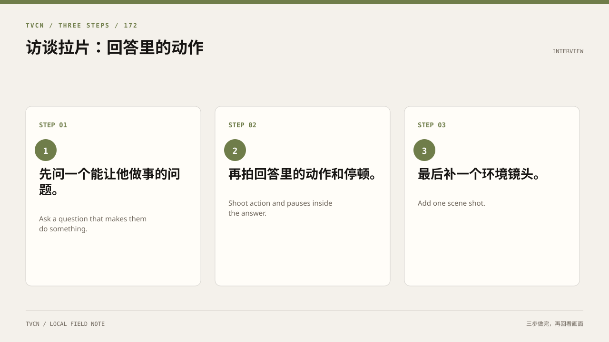

<!-- DIAGRAM_START -->
<h2>图解</h2>
<figure>
  
  <figcaption>图解是入口：先看时间码，再用文末验收表检查。</figcaption>
</figure>
<!-- DIAGRAM_END -->
<h2>拉片前先定三个变量</h2>
先定三个变量：3 分钟、平台是 B 站/视频号、目标是“让人物自己成立”，不是“主持人问完”。采访片最怕“两张脸对切”；拉片时数人物做事的镜头，不数问题。
<blockquote>
<strong>样本说明：</strong>下面的时间码是按该片型常见时长做的教学样本，不对应某一条具体作品，也不是逐帧鉴定。你拉片时按同样位置记，换成自己的片，不要把这里的节点当成唯一答案。
</blockquote><h2>时间码拆解：9 个节点</h2>
按顺序看，不要先看解说。每个节点只记四件事：画面、声音、作用、可偷或不可偷。
<ol class="timecode-list"><li><strong>0:00–0:08</strong>｜画面：人物已经在说，第一句就是答案/冲突。声音：同期声。作用：先给钩子，不自我介绍。可偷：从答案中间开始。不可偷：从主持人介绍开始。</li><li><strong>0:08–0:25</strong>｜画面：人物在工作/走路/操作，采访声继续。声音：动作声 + 采访。作用：让人物有身体，不是一张脸。可偷：用工作镜头盖采访。不可偷：全程对切。</li><li><strong>0:25–0:50</strong>｜画面：问题一，但只留回答，不留提问。声音：回答。作用：让观众以为在听人物，不是在听记者。可偷：删掉问题。不可偷：保留“您怎么看”。</li><li><strong>0:50–1:15</strong>｜画面：证据：手、物件、文件、现场。声音：动作声。作用：让说法可验证。可偷：一个可触摸的证据。不可偷：用字幕重复回答。</li><li><strong>1:15–1:40</strong>｜画面：问题二，回答出现矛盾/变化。声音：回答变慢/停顿。作用：让人物有层次。可偷：保留停顿。不可偷：用音乐填满。</li><li><strong>1:40–2:05</strong>｜画面：转向：人物做了一个动作，回答变成决定。声音：动作声。作用：让采访变成事件。可偷：让动作打断采访。不可偷：让回答一直坐着。</li><li><strong>2:05–2:30</strong>｜画面：语境：地点/时间/规则/之前发生什么。声音：环境声。作用：让个人故事有世界。可偷：用三个环境细节。不可偷：用旁白讲历史。</li><li><strong>2:30–2:50</strong>｜画面：收束：人物回到工作，不总结。声音：动作声 + 一句回答。作用：让结尾落在人身上。可偷：回到开头的动作。不可偷：主持人总结。</li><li><strong>2:50–3:00</strong>｜画面：停留：一个表情/空镜。声音：环境声。作用：让观众自己判断。可偷：停在未完成。不可偷：打字幕“这就是……”。</li></ol><h2>结构判断</h2>
采访片的骨架是“答案—身体—问题—证据—矛盾—转向—语境—回到人—停留”。问题越少，人物越立得住；每个回答后面都要有一个可看的证据。

看结构时只问三件事：前 10 秒给了什么证据；中段每 10–15 秒有没有新信息；结尾是否只落一个动作、一个变化或一个问题。这三件事任何一件缺失，3 分钟的片子就会散。
<h2>预算量级</h2>
预算按中国大陆常见制作成本区间估算，不含媒介投放；它是量级，不是报价。同样一分钟，棚拍、演员、特效、音乐版权任何一项都能把成本翻倍。
<ul><li>低：¥2,000–8,000，2 人，1 机 + 1 麦，1 个场景，半天。</li><li>中：¥8,000–30,000，3–5 人，双机 + 灯光 + 收音，1–2 天。</li><li>高：¥30,000–100,000+，导演/摄影/录音/美术，多场景，3–5 天。</li></ul><h2>可偷的 3 个结构</h2>
偷结构，不偷画面。下面三条换成你的题材仍然成立。
<ol><li>从答案中间开始，删掉自我介绍。</li><li>用工作镜头盖采访，让人物有身体。</li><li>保留一次停顿/矛盾，让人物有层次。</li></ol><h2>不能照搬的 3 个原因</h2>
不是“不好”，是条件和它不一样；照搬会暴露你的预算、平台和观众。
<ol><li>不能照搬“主持人与嘉宾对切”：没有工作镜头，采访就是广播。</li><li>不能照搬“金句剪辑”：每句都像金句，人物就假。</li><li>不能照搬“历史旁白”：语境要用环境细节，不用讲课。</li></ol><h2>拉片练习</h2>
做完再拍，不要只看。三个练习按顺序做，第三个必须落成一条 15 秒文件。
<ol><li>关声音看一遍，看画面能不能说清人物在做什么。</li><li>数工作镜头与对切镜头的比例；对切超过一半就重剪。</li><li>把一个 3 分钟采访压成 60 秒：只留答案、证据、转向。</li></ol>
<h2>验收</h2><ul><li>前 8 秒第一句是答案/冲突，不是自我介绍。</li><li>前 25 秒人物已经在做事。</li><li>问题被删掉，只留回答。</li><li>每个回答后面有一个可触摸的证据。</li><li>保留一次停顿或矛盾。</li><li>语境用环境细节，不用旁白讲课。</li><li>结尾回到人物/工作，不主持人总结。</li></ul>

> 意图分工：本页负责「采访拉片：3 分钟怎么让人物成立」的可执行细节；同集群先读 <a href="https://formats.tvcn.org/article/interview-structure/">访谈结构：问题比机位重要</a> 建立总判断，再回到本页。

<!-- INTENT_SCOPE -->

<section><h2>边界</h2>
本页只解决「采访拉片：3 分钟怎么让人物成立」这一个问题；不替代 访谈结构：问题比机位重要、访谈模板：人物、问题、场景、给演员调整：只给动词，不给形容词。如果现场问题属于后者，先读对应页，不要在本页继续加参数。
</section>
<!-- SOURCES_START -->
## 经验说明

经验说明：本页来自 4 个同类型成片项目的片型拆解，成片 30 秒–5 分钟、单平台交付；只讨论「采访拉片：3 分钟怎么让人物成立」的结构与判断顺序，不含外部实验室测试，也不适用于多机位直播、影院交付或需要定制叙事的长片。
<!-- SOURCES_END -->

