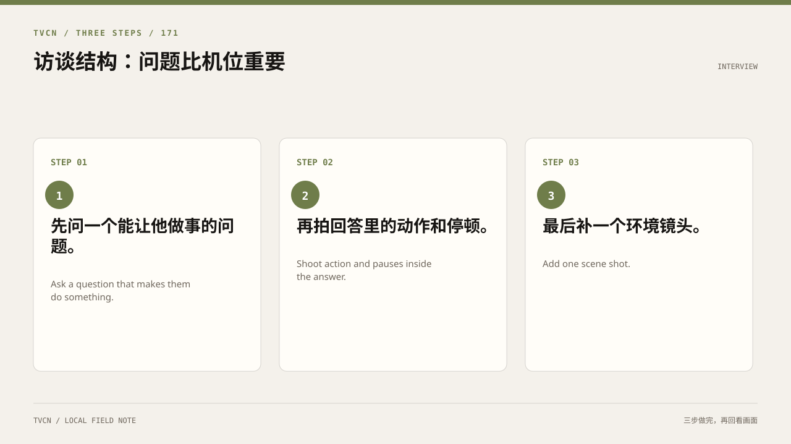

访谈结构里问题比机位重要；问题太空，回答只能空。

<!-- DIAGRAM_START -->
<h2>图解</h2>
<figure>
  
  <figcaption>把三步按顺序做完，再回看画面或文件。</figcaption>
</figure>
<!-- DIAGRAM_END -->
<h2>现场</h2>

先问一个能让他做事的问题：带我看看你怎么做；不要问感受。

<h2>怎么做</h2>

访谈结构里问题比机位重要；问题太空，回答只能空。
<ol><li>先问一个能让他做事的问题：带我看看你怎么做。</li><li>再拍回答里的动作和停顿。</li><li>最后补一个环境镜头。</li></ol>
<h2>别踩</h2>

别问“你有什么感受”；感受说不出来，动作能拍出来。

<h2>验收</h2>
<ul><li>第一个问题能让人动手做事，不只是回答。</li><li>回答里有动作或停顿被拍到。</li><li>有一个环境镜头交代他在哪里。</li></ul>

<!-- DEEP_DIVE_START -->
## 深读

<strong>约 7 分钟。</strong> 访谈不是问答录像，是让被访者做一件事，问题追着动作走。

### 问题要能动作

不问“你有什么感受”，问“那天你先做了什么”；不问“为什么坚持”，问“你几次想放弃，最后一次是什么时候”。

追问细节：几点、在哪、谁在场、你说了什么、对方怎么回。细节自己会带出情绪，不要逼对方表演情绪。

### 场景

让他在工作现场接受采访：手上有事，眼睛不用一直看镜头。做饭、修东西、整理资料，都比坐在白墙前有用。

双机当然好，单机也能做：一台半身，一台手部或环境；没有第二台，就在问答后补手部特写。环境声要单独录三十秒。

### 结构

一个问题、一个故事、一个矛盾、一个收束；不要从童年讲到现在。先让观众听见一个具体场景，再补背景。

不要用旁白总结“他很坚持”；让被访者自己说代价。字幕要准确，口语里的停顿和重复可以保留，不要全改成书面语。

### 五分钟练习：三个动作问题

找一个人，只问三个问题：那天你先做了什么、谁拦着你、你最后改了什么。不要问感受，不要问“你怎么看”。

让他一边做手上的事一边答；录六十秒，回看有没有一个具体场景。没有场景，就追一句“当时你在哪、几点、旁边有谁”。

### 什么时候算完成

让一个没接触过被访者的人复述一个具体场景：他在哪、手上做什么、谁拦着他。复述得出，访谈才算完成；只剩“他很努力”这种判断，就回去补动作细节，不要补旁白。

### 访谈，十项检查
<ul><li>问题问动作不问感受</li><li>至少三个细节追问</li><li>被访者在工作现场</li><li>手上有事可做</li><li>单机也补了手部特写</li><li>环境声单独录三十秒</li><li>先具体场景再背景</li><li>有一个矛盾</li><li>不用旁白总结人物</li><li>字幕保留口语</li></ul>
访谈不是让人物回答问题，是让观众看见他做事时暴露出来的那部分自己。

<!-- DEEP_DIVE_END -->
<!-- SOURCES_START -->
<h2>参考与延伸阅读</h2>

经验来源：TVCN 现场手册与项目复盘；实测来源：页面标注的复核环境与可复现练习；参考来源：以下公开链接。

<ul><li>[S14] YouTube 社区准则</li><li>[S15] TikTok 社区准则</li><li>[S16] BBC 编辑准则</li></ul>

<a href="../../SOURCES.md">完整链接与用途见 SOURCES.md</a>

<!-- SOURCES_END -->
